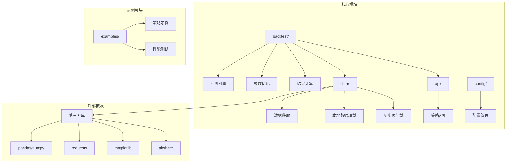
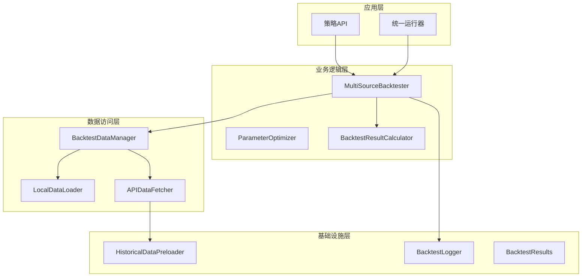
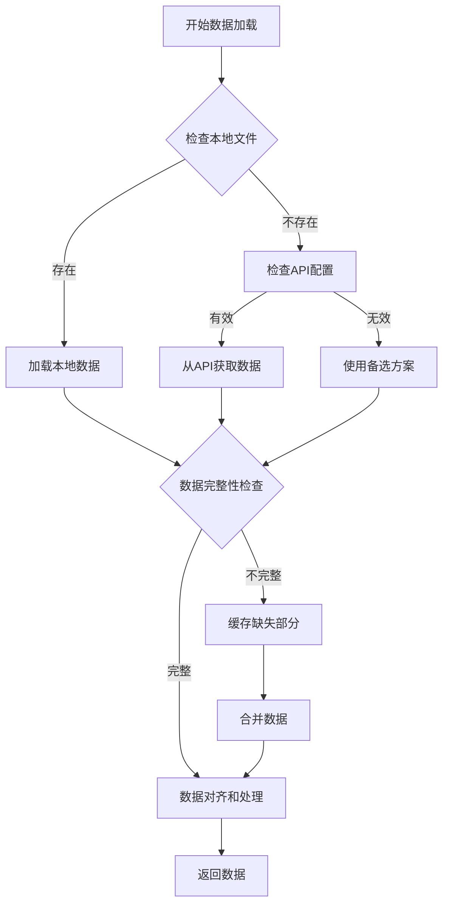
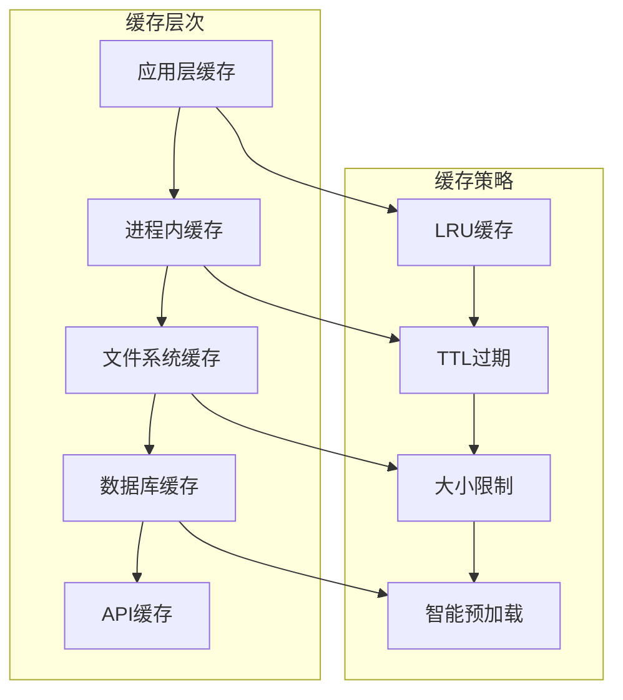
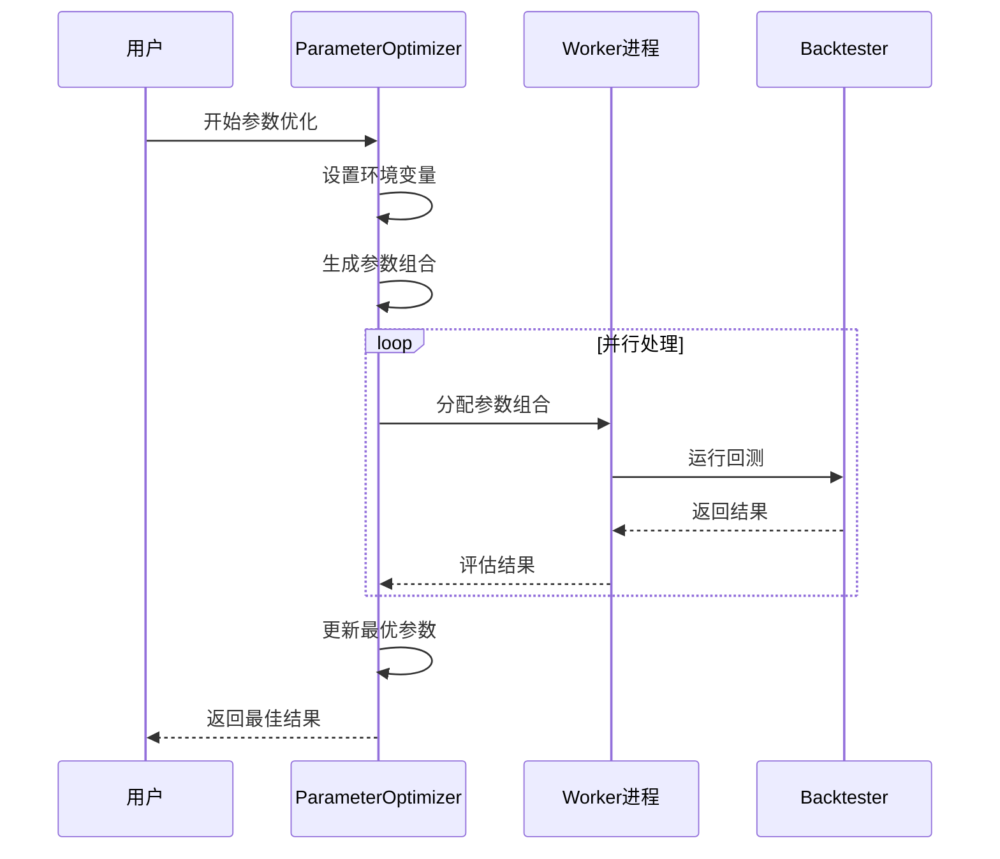
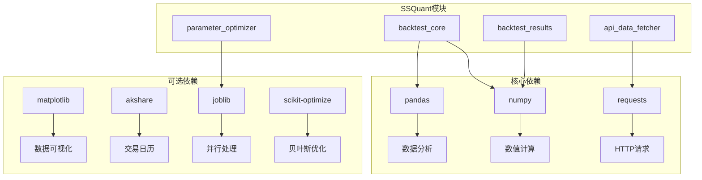

# 性能优化

<cite>
**本文档引用的文件**
- [backtest_core.py](file://ssquant/backtest/backtest_core.py)
- [backtest_data.py](file://ssquant/backtest/backtest_data.py)
- [historical_preloader.py](file://ssquant/data/historical_preloader.py)
- [multi_data_fetcher.py](file://ssquant/data/multi_data_fetcher.py)
- [unified_runner.py](file://ssquant/backtest/unified_runner.py)
- [parameter_optimizer.py](file://ssquant/backtest/parameter_optimizer.py)
- [local_data_loader.py](file://ssquant/data/local_data_loader.py)
- [api_data_fetcher.py](file://ssquant/data/api_data_fetcher.py)
- [backtest_results.py](file://ssquant/backtest/backtest_results.py)
- [backtest_logger.py](file://ssquant/backtest/backtest_logger.py)
- [B_双均线策略.py](file://examples/B_双均线策略.py)
- [B_多品种多周期交易策略.py](file://examples/B_多品种多周期交易策略.py)
- [B_多品种多周期交易策略_参数优化.py](file://examples/B_多品种多周期交易策略_参数优化.py)
- [requirements.txt](file://requirements.txt)
- [setup.py](file://setup.py)
</cite>

## 目录
1. [简介](#简介)
2. [项目结构](#项目结构)
3. [核心组件](#核心组件)
4. [架构概览](#架构概览)
5. [详细组件分析](#详细组件分析)
6. [依赖关系分析](#依赖关系分析)
7. [性能考虑因素](#性能考虑因素)
8. [故障排除指南](#故障排除指南)
9. [结论](#结论)
10. [附录](#附录)

## 简介

SSQuant是一个专业的期货量化交易框架，提供了完整的回测、实盘交易和模拟交易功能。本文档专注于系统的性能优化，涵盖回测引擎的性能瓶颈识别、数据加载优化、内存管理策略、多数据源处理、缓存机制、预加载策略、策略执行效率提升、算法优化和并行处理等方面。

## 项目结构

SSQuant采用模块化设计，主要分为以下几个核心模块：

**图表来源**
- [backtest_core.py](file://ssquant/backtest/backtest_core.py#L1-L579)
- [backtest_data.py](file://ssquant/backtest/backtest_data.py#L1-L246)
- [multi_data_fetcher.py](file://ssquant/data/multi_data_fetcher.py#L1-L139)

**章节来源**
- [backtest_core.py](file://ssquant/backtest/backtest_core.py#L1-L50)
- [backtest_data.py](file://ssquant/backtest/backtest_data.py#L1-L30)
- [multi_data_fetcher.py](file://ssquant/data/multi_data_fetcher.py#L1-L20)

## 核心组件

### 回测引擎核心组件

SSQuant的回测引擎由多个相互协作的组件组成，每个组件都有其特定的性能特征和优化机会：

#### MultiSourceBacktester - 主回测器
- **职责**: 管理整个回测流程，协调数据获取、策略执行和结果计算
- **性能特点**: 支持多数据源并行处理，内置进度监控和性能统计
- **关键配置**: 
  - `use_cache`: 启用数据缓存
  - `align_data`: 数据对齐选项
  - `debug`: 调试模式控制

#### BacktestDataManager - 数据管理器
- **职责**: 统一管理数据获取、处理和对齐
- **性能特点**: 支持本地文件和API双重数据源，智能缓存策略
- **关键功能**: 
  - 多格式本地数据加载（CSV/HDF5/7z/SQLite）
  - API数据获取和缓存管理
  - 数据对齐和填充

#### ParameterOptimizer - 参数优化器
- **职责**: 提供多种参数优化算法
- **性能特点**: 支持并行计算，内存友好的结果管理
- **优化算法**: 网格搜索、随机搜索、贝叶斯优化

**章节来源**
- [backtest_core.py](file://ssquant/backtest/backtest_core.py#L14-L84)
- [backtest_data.py](file://ssquant/backtest/backtest_data.py#L8-L20)
- [parameter_optimizer.py](file://ssquant/backtest/parameter_optimizer.py#L74-L125)

## 架构概览

SSQuant采用分层架构设计，确保各层之间的职责清晰分离：

**图表来源**
- [unified_runner.py](file://ssquant/backtest/unified_runner.py#L26-L58)
- [backtest_core.py](file://ssquant/backtest/backtest_core.py#L14-L84)
- [backtest_data.py](file://ssquant/backtest/backtest_data.py#L8-L20)

## 详细组件分析

### 数据加载优化策略

#### 多数据源加载机制

SSQuant支持多种数据源的混合使用，通过智能的加载策略实现性能优化：

**图表来源**
- [backtest_data.py](file://ssquant/backtest/backtest_data.py#L32-L189)
- [local_data_loader.py](file://ssquant/data/local_data_loader.py#L5-L54)

#### 本地数据加载优化

本地数据加载支持多种格式，每种格式都有其特定的优化策略：

**CSV格式优化**:
- 使用pandas的高效读取机制
- 支持大文件分块读取
- 自动字段验证和类型转换

**SQLite格式优化**:
- 原生SQL查询优化
- 索引自动使用
- 连接池管理

**HDF5格式优化**:
- 压缩存储减少磁盘I/O
- 分块读取支持大数据集
- 内存映射文件

**7z压缩格式优化**:
- 流式解压避免内存峰值
- 多文件合并处理
- 自动格式检测

**章节来源**
- [local_data_loader.py](file://ssquant/data/local_data_loader.py#L1-L233)

### 缓存机制设计

#### 多层次缓存架构

SSQuant实现了多层次的缓存策略来提升数据访问性能：

**图表来源**
- [api_data_fetcher.py](file://ssquant/data/api_data_fetcher.py#L171-L625)
- [backtest_data.py](file://ssquant/backtest/backtest_data.py#L32-L189)

#### 缓存优化技术

**智能缓存策略**:
- 基于时间范围的缓存覆盖检查
- 交易日历集成确保数据完整性
- 缺失部分的增量更新

**缓存配置选项**:
- `use_cache`: 控制缓存启用
- `cache_dir`: 缓存目录配置
- `save_data`: 缓存持久化

**章节来源**
- [api_data_fetcher.py](file://ssquant/data/api_data_fetcher.py#L171-L625)

### 参数优化并行处理

#### 多进程并行优化

参数优化器支持高效的并行处理来加速参数搜索：

**图表来源**
- [parameter_optimizer.py](file://ssquant/backtest/parameter_optimizer.py#L140-L309)

#### 并行优化配置

**并行处理选项**:
- `parallel`: 启用并行计算
- `n_jobs`: 并行进程数
- `JOBLIB_AVAILABLE`: joblib库检测

**性能优化建议**:
- Windows平台建议使用4-8个进程
- Linux/Mac平台可使用-1表示所有核心
- 避免超出系统资源限制

**章节来源**
- [parameter_optimizer.py](file://ssquant/backtest/parameter_optimizer.py#L140-L309)

### 内存管理策略

#### 内存优化技术

SSQuant采用了多种内存管理策略来优化内存使用：

**数据结构优化**:
- 使用pandas的高效数据结构
- 内存映射文件支持大文件
- 数据类型优化减少内存占用

**垃圾回收优化**:
- 及时释放不需要的对象
- 循环引用检测和处理
- 大对象的延迟加载

**内存监控**:
- 进度条显示内存使用
- 性能统计和分析
- 内存泄漏检测

**章节来源**
- [backtest_core.py](file://ssquant/backtest/backtest_core.py#L217-L297)

## 依赖关系分析

### 核心依赖关系

**图表来源**
- [requirements.txt](file://requirements.txt#L1-L16)
- [setup.py](file://setup.py#L56-L74)

### 性能相关依赖

**核心性能依赖**:
- **pandas**: 数据处理和分析的核心库
- **numpy**: 高效数值计算基础
- **requests**: 网络数据获取

**可选性能增强依赖**:
- **joblib**: 并行计算支持
- **scikit-optimize**: 高级优化算法
- **matplotlib**: 数据可视化

**章节来源**
- [requirements.txt](file://requirements.txt#L1-L16)
- [setup.py](file://setup.py#L56-L74)

## 性能考虑因素

### 回测引擎性能瓶颈

#### 主要性能瓶颈识别

**数据加载瓶颈**:
- API请求延迟和频率限制
- 大数据集的内存占用
- 磁盘I/O性能限制

**策略执行瓶颈**:
- 复杂指标计算的CPU消耗
- 频繁的数据访问操作
- 内存分配和垃圾回收

**内存管理瓶颈**:
- 大型DataFrame的内存占用
- 数据对齐操作的内存需求
- 多数据源的内存叠加

#### 性能优化策略

**数据加载优化**:
- 启用数据缓存机制
- 使用本地文件替代API请求
- 实现数据预加载策略

**策略执行优化**:
- 简化指标计算逻辑
- 减少不必要的数据访问
- 使用向量化操作

**内存管理优化**:
- 及时释放不需要的数据
- 使用适当的数据类型
- 实现内存池管理

**章节来源**
- [backtest_core.py](file://ssquant/backtest/backtest_core.py#L144-L306)
- [backtest_data.py](file://ssquant/backtest/backtest_data.py#L32-L189)

### 多数据源处理性能

#### 数据源协调机制

SSQuant支持同时处理多个数据源，通过智能协调机制实现性能优化：

**数据源对齐策略**:
- 时间索引对齐确保同步
- 缺失数据填充策略
- 不同周期的数据合并

**性能优化技术**:
- 并行数据加载
- 智能缓存共享
- 内存映射文件

**章节来源**
- [backtest_core.py](file://ssquant/backtest/backtest_core.py#L195-L200)
- [backtest_data.py](file://ssquant/backtest/backtest_data.py#L221-L238)

### 缓存机制性能

#### 缓存策略优化

**缓存层次设计**:
- 应用层缓存快速访问
- 文件系统缓存持久存储
- 数据库缓存结构化存储

**缓存命中率优化**:
- 智能缓存预热
- 缓存失效策略
- 内存缓存大小控制

**章节来源**
- [api_data_fetcher.py](file://ssquant/data/api_data_fetcher.py#L305-L574)
- [backtest_data.py](file://ssquant/backtest/backtest_data.py#L32-L189)

## 故障排除指南

### 常见性能问题诊断

#### 数据加载问题

**问题症状**:
- 数据加载缓慢
- API请求超时
- 内存使用过高

**诊断步骤**:
1. 检查网络连接稳定性
2. 验证API凭据有效性
3. 监控磁盘I/O性能
4. 分析内存使用模式

**解决方案**:
- 启用数据缓存
- 优化数据格式
- 实现分批加载

#### 参数优化问题

**问题症状**:
- 优化过程卡顿
- 内存溢出
- 进度条不更新

**诊断步骤**:
1. 检查并行进程数设置
2. 监控系统资源使用
3. 验证参数范围合理性
4. 检查数据完整性

**解决方案**:
- 调整并行进程数
- 优化参数搜索范围
- 实现增量优化

**章节来源**
- [parameter_optimizer.py](file://ssquant/backtest/parameter_optimizer.py#L140-L309)
- [backtest_logger.py](file://ssquant/backtest/backtest_logger.py#L61-L79)

### 性能监控工具使用

#### 内置监控功能

SSQuant提供了完善的性能监控工具：

**进度监控**:
- 实时进度显示
- 预估完成时间
- 处理速率统计

**性能统计**:
- 内存使用监控
- CPU使用率跟踪
- 数据处理统计

**日志分析**:
- 详细执行日志
- 错误信息记录
- 性能指标输出

**章节来源**
- [backtest_core.py](file://ssquant/backtest/backtest_core.py#L235-L297)
- [backtest_logger.py](file://ssquant/backtest/backtest_logger.py#L21-L59)

## 结论

SSQuant框架在性能优化方面采用了多层次的设计策略，从数据加载、缓存机制到参数优化都体现了深度的性能考量。通过合理的配置和优化策略，可以显著提升系统的运行效率。

**关键优化要点**:
1. **数据缓存**: 启用多层缓存机制，减少重复数据加载
2. **并行处理**: 合理配置并行进程数，充分利用硬件资源
3. **内存管理**: 优化数据结构，及时释放不需要的资源
4. **算法优化**: 简化复杂计算，使用向量化操作
5. **监控分析**: 建立完善的性能监控体系

通过实施这些优化策略，用户可以有效识别和解决性能问题，提升SSQuant系统的整体运行效率。

## 附录

### 性能优化最佳实践

#### 配置优化建议

**数据加载配置**:
- 启用`use_cache=True`以利用缓存机制
- 设置合适的`cache_dir`路径
- 配置`save_data=True`进行数据持久化

**回测配置优化**:
- 合理设置`align_data`和`fill_method`
- 调整`debug`模式以平衡性能和调试信息
- 优化`progress_update_interval`减少UI更新开销

**参数优化配置**:
- 根据平台选择合适的`n_jobs`值
- 设置合理的`progress_log_interval`
- 使用`skip_final_report=True`加速优化过程

#### 性能监控指标

**关键性能指标**:
- **数据加载时间**: 从开始到数据可用的时间
- **回测执行时间**: 完整回测的总耗时
- **内存使用峰值**: 系统内存的最大占用
- **CPU使用率**: 处理器的平均负载
- **缓存命中率**: 缓存数据的有效利用率

**监控工具推荐**:
- 系统监控工具（如htop、Task Manager）
- Python性能分析工具（如cProfile）
- 内存分析工具（如memory_profiler）

**章节来源**
- [backtest_core.py](file://ssquant/backtest/backtest_core.py#L28-L44)
- [parameter_optimizer.py](file://ssquant/backtest/parameter_optimizer.py#L140-L175)