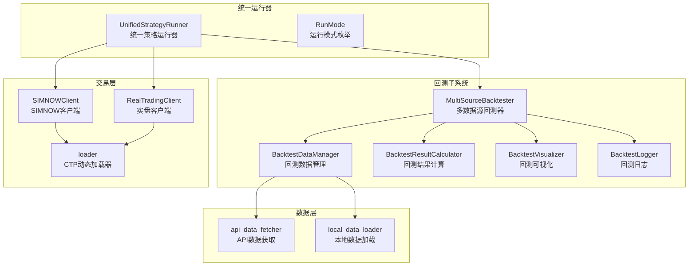
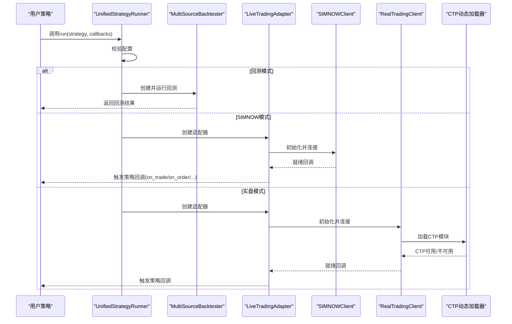
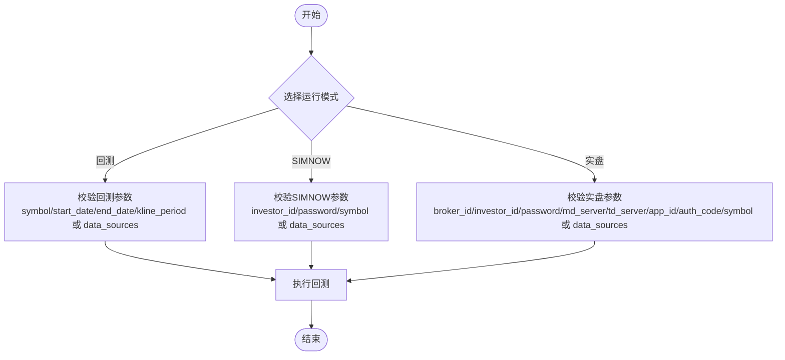
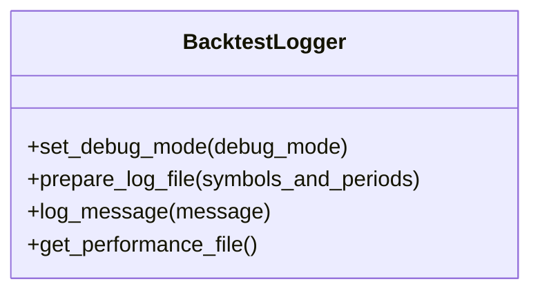
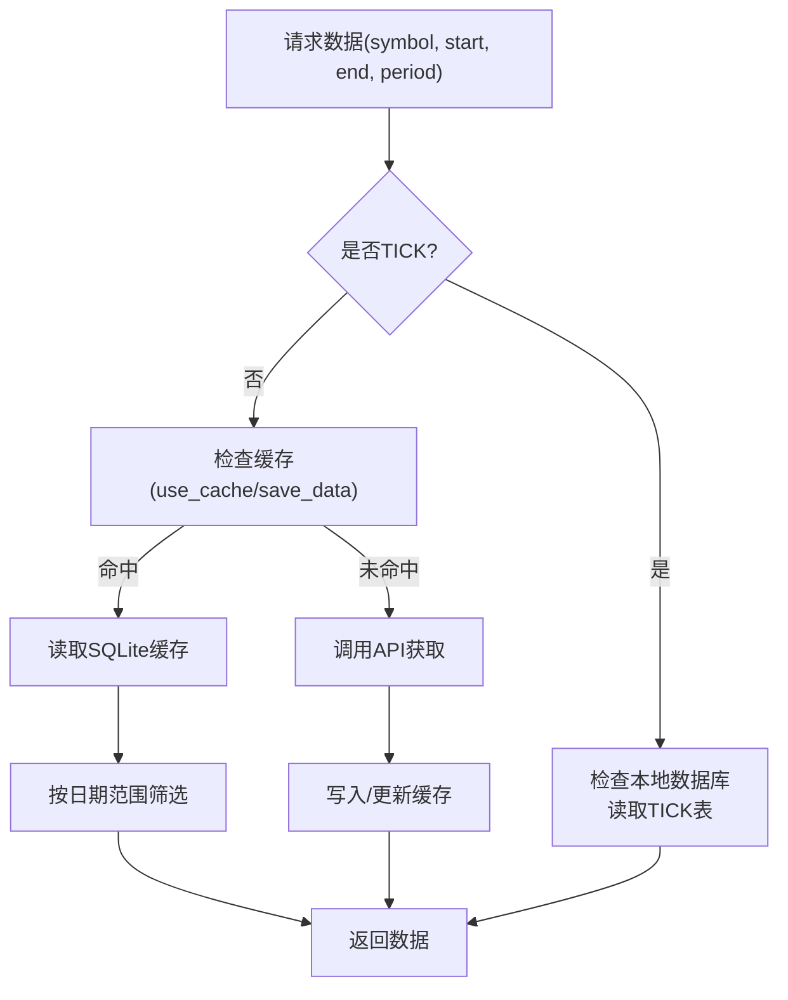
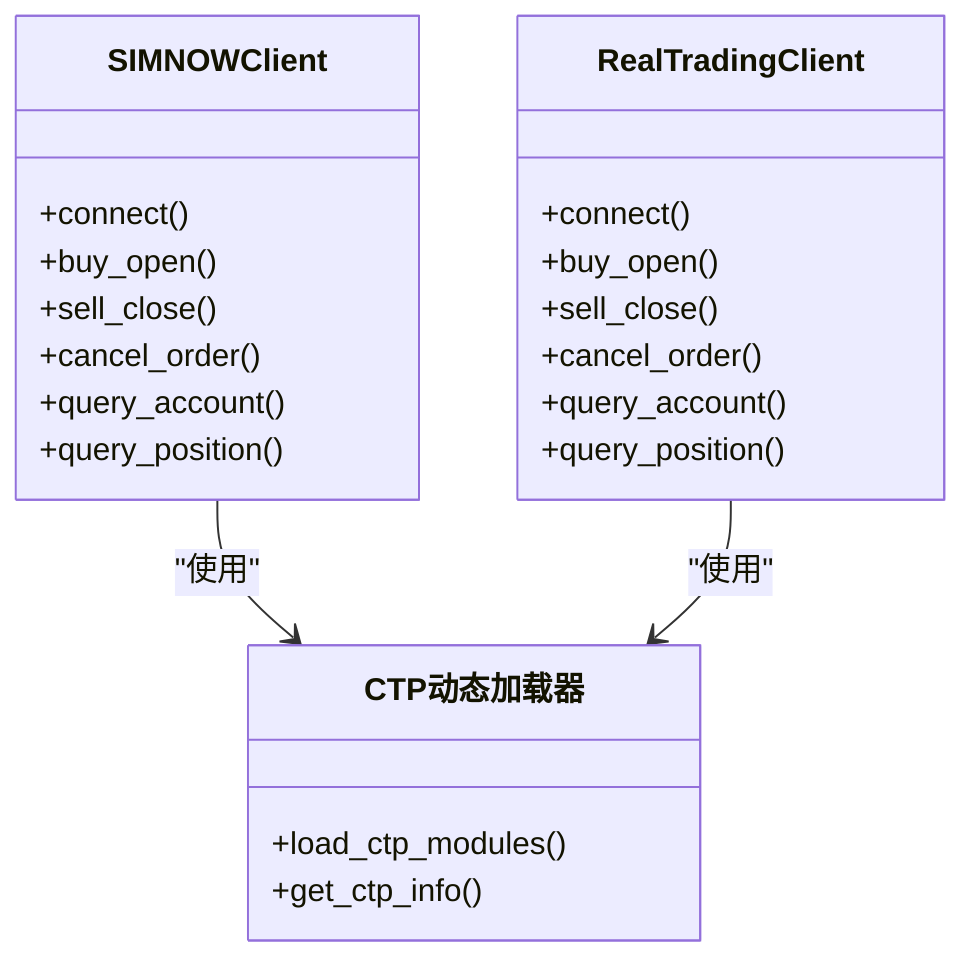
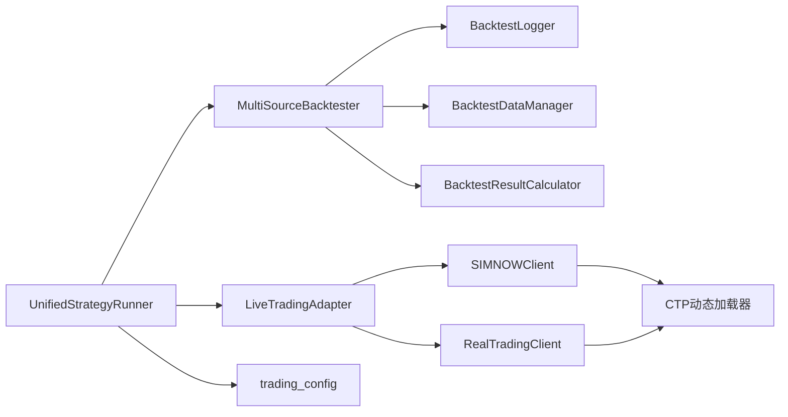

# 故障排除与维护

<cite>
**本文引用的文件**
- [README.md](file://README.md)
- [ssquant/__init__.py](file://ssquant/__init__.py)
- [ssquant/config/trading_config.py](file://ssquant/config/trading_config.py)
- [ssquant/backtest/unified_runner.py](file://ssquant/backtest/unified_runner.py)
- [ssquant/backtest/backtest_core.py](file://ssquant/backtest/backtest_core.py)
- [ssquant/backtest/backtest_logger.py](file://ssquant/backtest/backtest_logger.py)
- [ssquant/data/api_data_fetcher.py](file://ssquant/data/api_data_fetcher.py)
- [ssquant/data/local_data_loader.py](file://ssquant/data/local_data_loader.py)
- [ssquant/ctp/loader.py](file://ssquant/ctp/loader.py)
- [ssquant/pyctp/simnow_client.py](file://ssquant/pyctp/simnow_client.py)
- [ssquant/pyctp/real_trading_client.py](file://ssquant/pyctp/real_trading_client.py)
- [ssquant/api/debug_utils.py](file://ssquant/api/debug_utils.py)
- [examples/B_双均线策略.py](file://examples/B_双均线策略.py)
- [examples/A_撤单重发示例.py](file://examples/A_撤单重发示例.py)
</cite>

## 目录
1. [简介](#简介)
2. [项目结构](#项目结构)
3. [核心组件](#核心组件)
4. [架构总览](#架构总览)
5. [详细组件分析](#详细组件分析)
6. [依赖关系分析](#依赖关系分析)
7. [性能考量](#性能考量)
8. [故障排除指南](#故障排除指南)
9. [结论](#结论)
10. [附录](#附录)

## 简介
本指南面向SSQuant使用者，聚焦“故障排除与维护”。内容涵盖：
- 常见错误类型分类、诊断方法与解决步骤
- 日志系统使用、错误信息解读与调试技巧
- 配置问题排查、参数验证与修复方法
- 网络连接问题、数据源异常与交易接口故障处理
- 系统监控最佳实践、预警机制与维护计划

## 项目结构
SSQuant采用模块化设计，围绕“统一运行器”贯穿回测、SIMNOW模拟与实盘CTP交易；数据层支持API与本地文件；交易层封装CTP接口。

图示来源
- [ssquant/backtest/unified_runner.py](file://ssquant/backtest/unified_runner.py#L19-L379)
- [ssquant/backtest/backtest_core.py](file://ssquant/backtest/backtest_core.py#L14-L200)
- [ssquant/backtest/backtest_logger.py](file://ssquant/backtest/backtest_logger.py#L4-L90)
- [ssquant/data/api_data_fetcher.py](file://ssquant/data/api_data_fetcher.py#L171-L800)
- [ssquant/data/local_data_loader.py](file://ssquant/data/local_data_loader.py#L5-L233)
- [ssquant/pyctp/simnow_client.py](file://ssquant/pyctp/simnow_client.py#L590-L800)
- [ssquant/pyctp/real_trading_client.py](file://ssquant/pyctp/real_trading_client.py#L538-L755)
- [ssquant/ctp/loader.py](file://ssquant/ctp/loader.py#L1-L203)

章节来源
- [ssquant/backtest/unified_runner.py](file://ssquant/backtest/unified_runner.py#L19-L379)
- [ssquant/backtest/backtest_core.py](file://ssquant/backtest/backtest_core.py#L14-L200)
- [ssquant/backtest/backtest_logger.py](file://ssquant/backtest/backtest_logger.py#L4-L90)
- [ssquant/data/api_data_fetcher.py](file://ssquant/data/api_data_fetcher.py#L171-L800)
- [ssquant/data/local_data_loader.py](file://ssquant/data/local_data_loader.py#L5-L233)
- [ssquant/pyctp/simnow_client.py](file://ssquant/pyctp/simnow_client.py#L590-L800)
- [ssquant/pyctp/real_trading_client.py](file://ssquant/pyctp/real_trading_client.py#L538-L755)
- [ssquant/ctp/loader.py](file://ssquant/ctp/loader.py#L1-L203)

## 核心组件
- 统一运行器：负责在回测、SIMNOW与实盘之间切换，统一策略入口与回调。
- 回测子系统：多数据源对齐、回测执行、结果计算与可视化。
- 数据层：API数据获取与本地文件加载，支持CSV/HDF5/7z/SQLite多种格式。
- 交易层：SIMNOW与实盘客户端，封装CTP接口，提供行情、交易、查询与回调。
- 配置与调试：集中配置、调试工具与日志系统。

章节来源
- [ssquant/backtest/unified_runner.py](file://ssquant/backtest/unified_runner.py#L26-L379)
- [ssquant/backtest/backtest_core.py](file://ssquant/backtest/backtest_core.py#L14-L200)
- [ssquant/backtest/backtest_logger.py](file://ssquant/backtest/backtest_logger.py#L4-L90)
- [ssquant/data/api_data_fetcher.py](file://ssquant/data/api_data_fetcher.py#L171-L800)
- [ssquant/data/local_data_loader.py](file://ssquant/data/local_data_loader.py#L5-L233)
- [ssquant/pyctp/simnow_client.py](file://ssquant/pyctp/simnow_client.py#L590-L800)
- [ssquant/pyctp/real_trading_client.py](file://ssquant/pyctp/real_trading_client.py#L538-L755)
- [ssquant/ctp/loader.py](file://ssquant/ctp/loader.py#L1-L203)

## 架构总览
统一运行器根据运行模式调度不同执行路径：回测走多数据源回测器；SIMNOW与实盘走LiveTradingAdapter，分别对接SIMNOWClient与RealTradingClient，底层通过CTP动态加载器接入CTP。

图示来源
- [ssquant/backtest/unified_runner.py](file://ssquant/backtest/unified_runner.py#L162-L379)
- [ssquant/backtest/backtest_core.py](file://ssquant/backtest/backtest_core.py#L144-L200)
- [ssquant/pyctp/simnow_client.py](file://ssquant/pyctp/simnow_client.py#L662-L701)
- [ssquant/pyctp/real_trading_client.py](file://ssquant/pyctp/real_trading_client.py#L631-L658)
- [ssquant/ctp/loader.py](file://ssquant/ctp/loader.py#L172-L188)

## 详细组件分析

### 统一运行器与配置验证
- 统一运行器支持三种模式：回测、SIMNOW、实盘。
- 配置参数在不同模式下差异较大，运行器会进行参数完整性校验。
- 回测支持单数据源与多数据源配置；SIMNOW/实盘支持单数据源与多数据源。

图示来源
- [ssquant/backtest/unified_runner.py](file://ssquant/backtest/unified_runner.py#L122-L161)

章节来源
- [ssquant/backtest/unified_runner.py](file://ssquant/backtest/unified_runner.py#L79-L161)

### 回测日志系统
- BacktestLogger负责日志文件创建、控制台输出与性能报告文件生成。
- 支持通过环境变量禁用可视化与控制台日志。
- 日志包含回测品种、时间戳与关键信息，便于定位问题。

图示来源
- [ssquant/backtest/backtest_logger.py](file://ssquant/backtest/backtest_logger.py#L4-L90)

章节来源
- [ssquant/backtest/backtest_logger.py](file://ssquant/backtest/backtest_logger.py#L4-L90)

### 数据获取与缓存策略
- API数据获取支持K线与TICK两类，具备缓存与补全逻辑。
- TICK数据仅能从本地数据库读取，需先通过SIMNOW采集。
- 交易日历与日期范围校验，避免请求非交易日数据。
- 本地数据加载支持CSV/HDF5/7z/SQLite，自动字段校验与日期筛选。

图示来源
- [ssquant/data/api_data_fetcher.py](file://ssquant/data/api_data_fetcher.py#L171-L800)
- [ssquant/data/local_data_loader.py](file://ssquant/data/local_data_loader.py#L5-L233)

章节来源
- [ssquant/data/api_data_fetcher.py](file://ssquant/data/api_data_fetcher.py#L171-L800)
- [ssquant/data/local_data_loader.py](file://ssquant/data/local_data_loader.py#L5-L233)

### 交易接口与错误处理
- SIMNOWClient与RealTradingClient分别封装行情与交易回调。
- 错误码映射与GBK/GB18030解码处理，提升错误信息可读性。
- 支持平今/平昨智能重试（例如平今失败自动改为平昨）。

图示来源
- [ssquant/pyctp/simnow_client.py](file://ssquant/pyctp/simnow_client.py#L590-L800)
- [ssquant/pyctp/real_trading_client.py](file://ssquant/pyctp/real_trading_client.py#L538-L755)
- [ssquant/ctp/loader.py](file://ssquant/ctp/loader.py#L84-L188)

章节来源
- [ssquant/pyctp/simnow_client.py](file://ssquant/pyctp/simnow_client.py#L590-L800)
- [ssquant/pyctp/real_trading_client.py](file://ssquant/pyctp/real_trading_client.py#L538-L755)
- [ssquant/ctp/loader.py](file://ssquant/ctp/loader.py#L84-L188)

### 调试工具与模块检查
- debug_utils提供模块存在性、函数存在性与路径检查，便于快速定位导入问题。
- 回测时可自动打印模块加载情况，辅助排查依赖缺失。

章节来源
- [ssquant/api/debug_utils.py](file://ssquant/api/debug_utils.py#L104-L136)
- [ssquant/backtest/backtest_core.py](file://ssquant/backtest/backtest_core.py#L162-L169)

## 依赖关系分析
- 统一运行器依赖回测核心与LiveTradingAdapter。
- 回测核心依赖数据管理器、日志与结果计算模块。
- 交易层依赖CTP动态加载器，实盘客户端还依赖CTP模块可用性。
- 配置模块提供账户与默认参数，贯穿各层。

图示来源
- [ssquant/backtest/unified_runner.py](file://ssquant/backtest/unified_runner.py#L162-L379)
- [ssquant/backtest/backtest_core.py](file://ssquant/backtest/backtest_core.py#L14-L200)
- [ssquant/pyctp/simnow_client.py](file://ssquant/pyctp/simnow_client.py#L590-L800)
- [ssquant/pyctp/real_trading_client.py](file://ssquant/pyctp/real_trading_client.py#L538-L755)
- [ssquant/ctp/loader.py](file://ssquant/ctp/loader.py#L1-L203)
- [ssquant/config/trading_config.py](file://ssquant/config/trading_config.py#L115-L187)

章节来源
- [ssquant/backtest/unified_runner.py](file://ssquant/backtest/unified_runner.py#L162-L379)
- [ssquant/backtest/backtest_core.py](file://ssquant/backtest/backtest_core.py#L14-L200)
- [ssquant/pyctp/simnow_client.py](file://ssquant/pyctp/simnow_client.py#L590-L800)
- [ssquant/pyctp/real_trading_client.py](file://ssquant/pyctp/real_trading_client.py#L538-L755)
- [ssquant/ctp/loader.py](file://ssquant/ctp/loader.py#L1-L203)
- [ssquant/config/trading_config.py](file://ssquant/config/trading_config.py#L115-L187)

## 性能考量
- 回测阶段建议合理设置预加载历史K线数量与对齐填充方式，避免数据冗余与对齐开销。
- 数据缓存策略可显著降低API请求频率，建议在回测与实盘中均启用缓存。
- 日志输出在调试模式下会写入文件，生产运行建议关闭控制台日志以减少I/O开销。
- CTP模块按Python版本自动加载，确保使用匹配版本以避免加载失败与性能问题。

## 故障排除指南

### 一、常见错误类型与分类
- 环境与依赖类
  - CTP模块不可用：检查Python版本、系统架构与CTP文件目录。
  - 模块导入失败：检查sys.path与模块路径。
- 配置类
  - 缺少必填参数：统一运行器会在启动前校验参数。
  - 账户配置错误：核对账户名、服务器地址、AppID/授权码。
- 数据类
  - API认证失败：用户名/密码为空或过期。
  - 缓存损坏：SQLite异常或数据为空。
  - TICK数据缺失：数据库中无TICK表或日期范围无数据。
- 网络与连接类
  - SIMNOW/实盘连接断开：检查服务器地址与网络连通性。
  - 交易回调异常：检查错误码映射与GBK解码。
- 交易执行类
  - 平今失败：自动平昨重试；若无昨仓则报错。
  - 订单超时：触发撤单并按策略重发。

章节来源
- [ssquant/ctp/loader.py](file://ssquant/ctp/loader.py#L36-L81)
- [ssquant/backtest/unified_runner.py](file://ssquant/backtest/unified_runner.py#L122-L161)
- [ssquant/data/api_data_fetcher.py](file://ssquant/data/api_data_fetcher.py#L773-L794)
- [ssquant/pyctp/simnow_client.py](file://ssquant/pyctp/simnow_client.py#L146-L208)
- [ssquant/pyctp/real_trading_client.py](file://ssquant/pyctp/real_trading_client.py#L280-L321)

### 二、诊断方法与解决步骤
- 环境与依赖
  - 使用CTP状态打印与模块检查工具，确认CTP可用性与模块路径。
  - 若CTP不可用，回测功能仍可用，实盘受限。
- 配置验证
  - 使用统一运行器的配置校验，补齐缺失参数。
  - 核对trading_config.py中的账户配置与API认证信息。
- 数据问题
  - API认证错误：检查用户名/密码；必要时重设认证。
  - 缓存问题：删除缓存数据库或禁用缓存后重试。
  - TICK数据：先通过SIMNOW采集并启用保存TICK开关。
- 网络与连接
  - SIMNOW/实盘连接失败：检查服务器名称/地址、网络连通性与防火墙。
  - 断线重连：关注断线回调，确认重连逻辑。
- 交易执行
  - 平今失败：检查持仓缓存，确认昨仓是否存在；否则按策略处理。
  - 订单超时：启用算法交易与超时撤单，重发时使用超价偏移。

章节来源
- [ssquant/ctp/loader.py](file://ssquant/ctp/loader.py#L151-L188)
- [ssquant/api/debug_utils.py](file://ssquant/api/debug_utils.py#L104-L136)
- [ssquant/backtest/unified_runner.py](file://ssquant/backtest/unified_runner.py#L122-L161)
- [ssquant/config/trading_config.py](file://ssquant/config/trading_config.py#L115-L187)
- [ssquant/data/api_data_fetcher.py](file://ssquant/data/api_data_fetcher.py#L266-L269)
- [ssquant/pyctp/simnow_client.py](file://ssquant/pyctp/simnow_client.py#L146-L208)
- [ssquant/pyctp/real_trading_client.py](file://ssquant/pyctp/real_trading_client.py#L280-L321)

### 三、日志系统使用与错误解读
- 回测日志：包含回测开始、模块检查、数据获取与结果等关键节点。
- 交易日志：SIMNOW/实盘客户端打印登录、订阅、报单、成交、撤单等状态。
- 错误信息：错误码映射与GBK/GB18030解码，帮助定位问题。
- 调试技巧：在调试模式下启用详细日志，结合环境变量控制输出。

章节来源
- [ssquant/backtest/backtest_logger.py](file://ssquant/backtest/backtest_logger.py#L21-L90)
- [ssquant/pyctp/simnow_client.py](file://ssquant/pyctp/simnow_client.py#L517-L583)
- [ssquant/pyctp/real_trading_client.py](file://ssquant/pyctp/real_trading_client.py#L470-L536)

### 四、配置问题排查与修复
- 必填参数缺失：统一运行器会抛出明确错误，按提示补齐。
- 账户配置错误：核对账户名、服务器、AppID/授权码与密码。
- API认证：检查用户名/密码，必要时重设。
- 数据保存：根据需求开启/关闭CSV/DB保存，注意路径权限。

章节来源
- [ssquant/backtest/unified_runner.py](file://ssquant/backtest/unified_runner.py#L122-L161)
- [ssquant/config/trading_config.py](file://ssquant/config/trading_config.py#L115-L187)

### 五、网络连接问题处理
- SIMNOW/实盘连接断开：检查服务器名称/地址、网络连通性与防火墙。
- 交易前置连接：关注连接事件与登录响应，失败时查看错误描述。
- 断线重连：确认客户端断线回调与重连逻辑。

章节来源
- [ssquant/pyctp/simnow_client.py](file://ssquant/pyctp/simnow_client.py#L41-L50)
- [ssquant/pyctp/real_trading_client.py](file://ssquant/pyctp/real_trading_client.py#L25-L52)

### 六、数据源异常处理
- API认证失败：检查用户名/密码；服务器返回401/402/405/406等状态码。
- 缓存异常：捕获SQLite异常并回退到API直取；必要时删除缓存。
- TICK数据：检查数据库中是否存在TICK表，按日期范围筛选是否为空。

章节来源
- [ssquant/data/api_data_fetcher.py](file://ssquant/data/api_data_fetcher.py#L773-L794)
- [ssquant/data/api_data_fetcher.py](file://ssquant/data/api_data_fetcher.py#L599-L605)
- [ssquant/data/api_data_fetcher.py](file://ssquant/data/api_data_fetcher.py#L214-L235)

### 七、交易接口故障处理
- 平今失败：自动改为平昨重试；若无昨仓则报错。
- 订单超时：触发撤单并按策略重发，重发时使用超价偏移。
- 错误码映射：参考错误描述字典，结合GBK解码提升可读性。

章节来源
- [ssquant/pyctp/real_trading_client.py](file://ssquant/pyctp/real_trading_client.py#L286-L317)
- [ssquant/pyctp/simnow_client.py](file://ssquant/pyctp/simnow_client.py#L312-L343)
- [ssquant/pyctp/real_trading_client.py](file://ssquant/pyctp/real_trading_client.py#L494-L536)
- [ssquant/pyctp/simnow_client.py](file://ssquant/pyctp/simnow_client.py#L541-L583)

### 八、系统监控与维护
- 监控要点：连接状态、登录状态、报单/成交/撤单回调、持仓与资金查询。
- 预警机制：基于回调与日志输出，建立异常告警与自动重试。
- 维护计划：定期检查CTP可用性、清理缓存、备份数据库与日志文件。

章节来源
- [ssquant/pyctp/simnow_client.py](file://ssquant/pyctp/simnow_client.py#L685-L701)
- [ssquant/pyctp/real_trading_client.py](file://ssquant/pyctp/real_trading_client.py#L649-L658)

## 结论
通过统一运行器与模块化架构，SSQuant在回测、SIMNOW与实盘之间实现了无缝切换。结合完善的日志系统、错误码映射与调试工具，用户可以高效定位并解决运行过程中的各类问题。建议在生产环境中启用缓存、规范配置与监控，以获得稳定可靠的交易体验。

## 附录

### A. 常用环境与配置检查清单
- Python版本与架构：确保64位Windows与支持的Python版本。
- CTP可用性：使用CTP状态打印确认模块加载。
- 账户配置：核对账户名、服务器、AppID/授权码与密码。
- 数据保存：根据需求开启CSV/DB保存，检查路径权限。

章节来源
- [ssquant/ctp/loader.py](file://ssquant/ctp/loader.py#L151-L188)
- [ssquant/config/trading_config.py](file://ssquant/config/trading_config.py#L115-L187)

### B. 示例策略与测试脚本
- 双均线策略：展示统一运行器在不同模式下的使用。
- 撤单重发示例：演示订单超时、撤单与重发流程。

章节来源
- [examples/B_双均线策略.py](file://examples/B_双均线策略.py#L134-L269)
- [examples/A_撤单重发示例.py](file://examples/A_撤单重发示例.py#L285-L429)