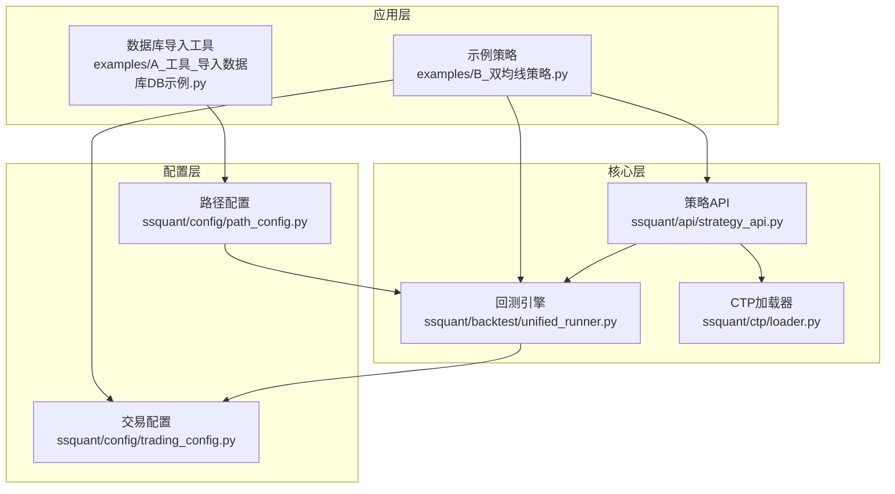
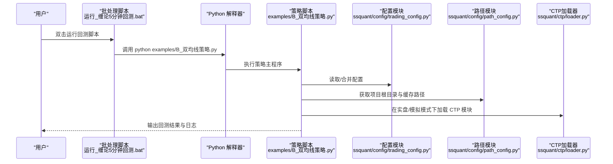
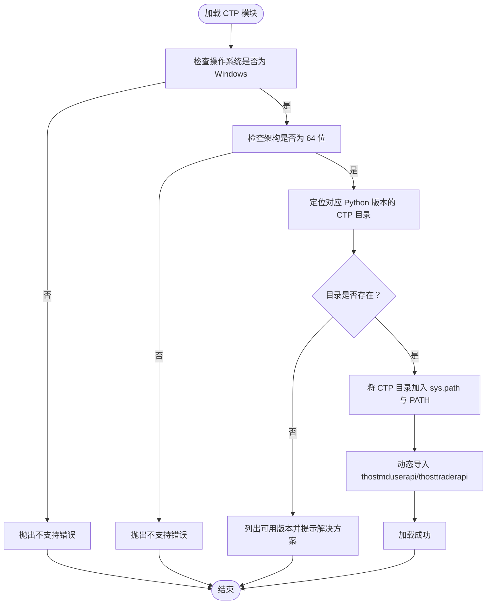
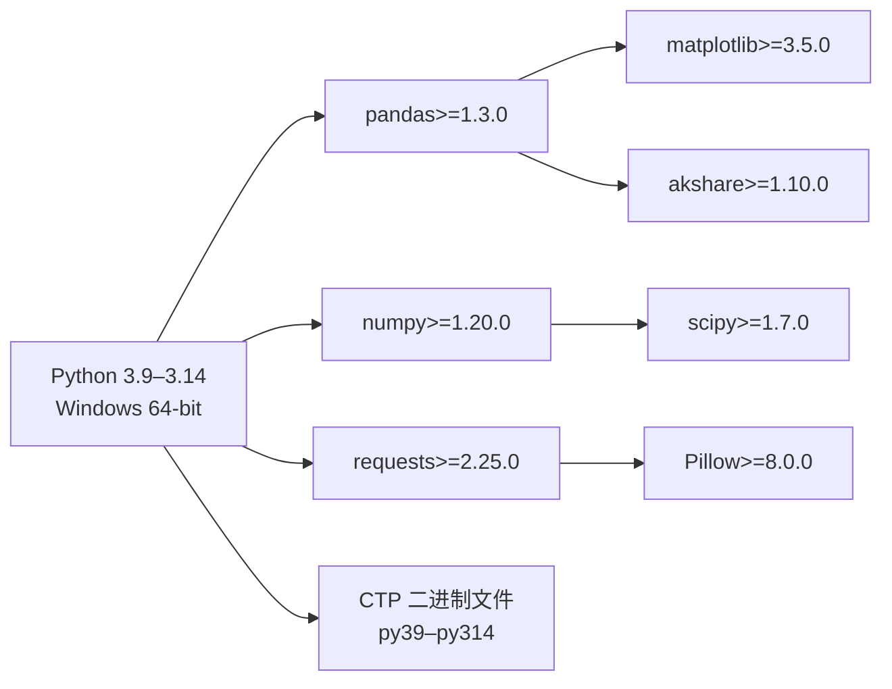

# 环境配置

<cite>
**本文引用的文件**
- [README.md](file://README.md)
- [requirements.txt](file://requirements.txt)
- [setup.py](file://setup.py)
- [pyproject.toml](file://pyproject.toml)
- [ssquant/config/trading_config.py](file://ssquant/config/trading_config.py)
- [ssquant/config/path_config.py](file://ssquant/config/path_config.py)
- [ssquant/ctp/loader.py](file://ssquant/ctp/loader.py)
- [ssquant/__init__.py](file://ssquant/__init__.py)
- [setup_and_run.bat](file://setup_and_run.bat)
- [运行_缠论5分钟回测.bat](file://运行_缠论5分钟回测.bat)
- [examples/B_双均线策略.py](file://examples/B_双均线策略.py)
- [examples/A_工具_导入数据库DB示例.py](file://examples/A_工具_导入数据库DB示例.py)
</cite>

## 目录
1. [简介](#简介)
2. [项目结构](#项目结构)
3. [核心组件](#核心组件)
4. [架构总览](#架构总览)
5. [详细组件分析](#详细组件分析)
6. [依赖关系分析](#依赖关系分析)
7. [性能考虑](#性能考虑)
8. [故障排查指南](#故障排查指南)
9. [结论](#结论)
10. [附录](#附录)

## 简介
本指南面向首次搭建 SSQuant 开发与运行环境的用户，围绕 Python 版本要求（3.9–3.14）、操作系统兼容性（Windows 10+）、硬件与网络要求、依赖库安装与版本兼容性、虚拟环境与包管理工具、路径与权限、以及常见问题诊断与解决展开，帮助你在不同环境下快速、稳定地完成环境准备与验证。

## 项目结构
SSQuant 是一个以“一套代码三处运行”为目标的量化交易框架，支持回测、SIMNOW 模拟与实盘 CTP。其核心模块包括：
- API 层：统一策略 API（策略入口）
- 回测引擎：统一运行器、回测核心、可视化与报告
- 配置层：交易配置、路径配置
- 数据层：数据获取、本地数据加载、多数据源
- CTP 层：按 Python 版本分发的 CTP 二进制文件与动态加载器
- 示例与工具：策略示例、数据库导入工具

图表来源
- [examples/B_双均线策略.py](file://examples/B_双均线策略.py#L1-L269)
- [examples/A_工具_导入数据库DB示例.py](file://examples/A_工具_导入数据库DB示例.py#L1-L776)
- [ssquant/config/trading_config.py](file://ssquant/config/trading_config.py#L1-L187)
- [ssquant/config/path_config.py](file://ssquant/config/path_config.py#L1-L30)
- [ssquant/ctp/loader.py](file://ssquant/ctp/loader.py#L1-L203)

章节来源
- [README.md](file://README.md#L297-L321)

## 核心组件
- Python 版本与系统要求
  - Python 版本：3.9 ~ 3.14（>=3.9,<3.15）
  - 操作系统：Windows 10+（当前仅支持 Windows；Linux 版本待更新）
  - 内存：建议 4GB+
  - 网络：实盘/SIMNOW 需稳定网络
- 依赖库
  - 必需：pandas、numpy、requests
  - 可视化：matplotlib、scipy、Pillow、akshare
  - 可选（机器学习）：scikit-learn、joblib、statsmodels
- CTP 支持
  - 内置 CTP 6.7.7 ~ 6.7.10，按 Python 版本提供 py39–py314 的二进制文件
  - 仅支持 64 位 Python；Windows 平台

章节来源
- [README.md](file://README.md#L43-L51)
- [README.md](file://README.md#L370-L390)
- [setup.py](file://setup.py#L59-L61)
- [pyproject.toml](file://pyproject.toml#L10-L11)
- [requirements.txt](file://requirements.txt#L1-L16)
- [pyproject.toml](file://pyproject.toml#L32-L40)

## 架构总览
SSQuant 的环境配置涉及“Python 运行时 + 依赖库 + CTP 二进制 + 路径与权限 + 配置文件”。下图展示从用户启动脚本到策略执行的关键流程与依赖关系。

图表来源
- [运行_缠论5分钟回测.bat](file://运行_缠论5分钟回测.bat#L1-L17)
- [examples/B_双均线策略.py](file://examples/B_双均线策略.py#L134-L269)
- [ssquant/config/trading_config.py](file://ssquant/config/trading_config.py#L115-L165)
- [ssquant/config/path_config.py](file://ssquant/config/path_config.py#L10-L30)
- [ssquant/ctp/loader.py](file://ssquant/ctp/loader.py#L84-L122)

## 详细组件分析

### Python 版本与系统要求
- 版本范围：3.9 ~ 3.14（>=3.9,<3.15）
- 操作系统：Windows 10+（当前仅支持 Windows；Linux 版本待更新）
- 架构：仅支持 64 位 Python
- 网络与内存：实盘/SIMNOW 需稳定网络；建议 4GB+

章节来源
- [setup.py](file://setup.py#L60-L61)
- [pyproject.toml](file://pyproject.toml#L10-L11)
- [pyproject.toml](file://pyproject.toml#L29)
- [README.md](file://README.md#L47-L48)
- [README.md](file://README.md#L372-L374)

### 依赖库安装与版本兼容性
- 必需依赖
  - pandas>=1.3.0
  - numpy>=1.20.0
  - requests>=2.25.0
- 可视化依赖（回测报告）
  - matplotlib>=3.5.0
  - scipy>=1.7.0
  - Pillow>=8.0.0
  - akshare>=1.10.0
- 可选依赖（机器学习）
  - scikit-learn>=0.24.0
  - joblib>=1.0.0
  - statsmodels>=0.12.0
- 安装方式
  - 使用 pip 安装（推荐）
  - 若遇到索引问题，可使用国内镜像源重装
  - 按需安装可选依赖（如 ml/dev）

章节来源
- [requirements.txt](file://requirements.txt#L4-L13)
- [pyproject.toml](file://pyproject.toml#L32-L40)
- [setup.py](file://setup.py#L62-L74)
- [README.md](file://README.md#L58-L74)

### 虚拟环境与包管理工具
- 建议使用虚拟环境隔离依赖，避免与系统或其他项目冲突
- 推荐使用 pip 安装与升级
- 若从源码安装，使用可编辑模式（pip install -e .）
- 常见问题：ModuleNotFoundError: No module named 'ssquant'
  - 检查是否已安装
  - 重新安装（PyPI 或源码）
  - 验证导入

章节来源
- [README.md](file://README.md#L58-L89)
- [README.md](file://README.md#L90-L120)

### 路径与权限管理
- 项目根目录与缓存路径
  - 通过路径模块统一管理，避免硬编码
  - 默认数据缓存目录：data_cache
  - 回测结果与日志目录：backtest_results、backtest_logs
- CTP DLL 路径
  - 动态加载器会将 CTP 目录加入 PATH 或使用 add_dll_directory
  - Windows 下若失败会回退到环境变量 PATH
- 权限
  - 需要对 data_cache、backtest_results 等目录具备读写权限
  - 若无权限，可能导致回测/数据落盘失败

章节来源
- [ssquant/config/path_config.py](file://ssquant/config/path_config.py#L10-L30)
- [ssquant/ctp/loader.py](file://ssquant/ctp/loader.py#L94-L122)
- [ssquant/ctp/loader.py](file://ssquant/ctp/loader.py#L104-L113)

### CTP 模块加载与兼容性
- 自动匹配当前 Python 版本（py39–py314）
- 仅支持 Windows 64 位
- 若找不到对应版本的 CTP 文件，会抛出错误并提示可用版本与解决方案
- CTP 不可用时，回测功能仍可使用，实盘受限

图表来源
- [ssquant/ctp/loader.py](file://ssquant/ctp/loader.py#L36-L81)
- [ssquant/ctp/loader.py](file://ssquant/ctp/loader.py#L94-L122)

章节来源
- [ssquant/ctp/loader.py](file://ssquant/ctp/loader.py#L1-L203)
- [ssquant/__init__.py](file://ssquant/__init__.py#L6-L17)

### 配置与运行脚本
- 交易配置
  - 提供回测默认参数、账户配置（SIMNOW/实盘）、数据保存路径等
  - 通过 get_config 组合运行模式与账户参数
- 路径配置
  - 统一获取项目根目录、缓存目录、回测结果与日志目录
- 运行脚本
  - 提供批处理脚本一键运行示例策略
  - 设置编码与输出日志，便于排障

章节来源
- [ssquant/config/trading_config.py](file://ssquant/config/trading_config.py#L115-L165)
- [ssquant/config/path_config.py](file://ssquant/config/path_config.py#L10-L30)
- [运行_缠论5分钟回测.bat](file://运行_缠论5分钟回测.bat#L1-L17)
- [setup_and_run.bat](file://setup_and_run.bat#L1-L12)

## 依赖关系分析
- 版本约束
  - Python：>=3.9,<3.15
  - 操作系统：Windows
- 直接依赖
  - pandas、numpy、requests（必需）
  - matplotlib、scipy、Pillow、akshare（可视化）
  - 可选：scikit-learn、joblib、statsmodels
- 间接依赖
  - CTP 二进制文件随包分发，按 Python 版本放置于 ssquant/ctp/pyXX/

图表来源
- [pyproject.toml](file://pyproject.toml#L10-L11)
- [pyproject.toml](file://pyproject.toml#L32-L40)
- [requirements.txt](file://requirements.txt#L4-L13)
- [ssquant/ctp/loader.py](file://ssquant/ctp/loader.py#L53-L81)

章节来源
- [setup.py](file://setup.py#L59-L61)
- [pyproject.toml](file://pyproject.toml#L10-L11)
- [requirements.txt](file://requirements.txt#L4-L13)

## 性能考虑
- 数据缓存与 IO
  - 使用 data_cache 目录缓存回测数据，减少重复下载与解析
  - 合理设置历史回看条数（history_lookback_bars），避免过长导致内存压力
- 可视化与报告
  - 可视化依赖（matplotlib/scipy/Pillow/akshare）会增加内存占用，建议在资源充足的环境中运行
- CTP 性能
  - CTP 仅支持 Windows 64 位，确保使用正确的 Python 版本以获得最佳兼容性

章节来源
- [ssquant/config/trading_config.py](file://ssquant/config/trading_config.py#L52-L56)
- [ssquant/config/path_config.py](file://ssquant/config/path_config.py#L20-L29)

## 故障排查指南
- Python 版本不匹配
  - 现象：CTP 模块不可用或加载失败
  - 处理：使用 3.9–3.14 之间的 Python，并确保为 64 位
- 操作系统不支持
  - 现象：提示 CTP 仅支持 Windows
  - 处理：在 Windows 上运行；Linux/Mac 仅支持纯回测模式
- ModuleNotFoundError: No module named 'ssquant'
  - 现象：运行策略时报模块未找到
  - 处理：确认已安装；使用 pip list 检查；重新安装（PyPI 或源码）
- CTP DLL 路径问题
  - 现象：无法加载 CTP 模块或报错
  - 处理：确保 CTP 目录被加入 PATH；Windows 下优先使用 add_dll_directory，失败则回退到环境变量
- 权限不足
  - 现象：无法写入 data_cache、backtest_results 等目录
  - 处理：赋予相应目录读写权限，或以管理员身份运行
- 网络问题（实盘/SIMNOW）
  - 现象：登录失败或数据拉取异常
  - 处理：检查网络连通性与防火墙设置；必要时更换服务器或使用国内镜像源

章节来源
- [ssquant/ctp/loader.py](file://ssquant/ctp/loader.py#L36-L48)
- [ssquant/ctp/loader.py](file://ssquant/ctp/loader.py#L104-L113)
- [README.md](file://README.md#L90-L120)
- [README.md](file://README.md#L64-L74)

## 结论
通过遵循本指南，你可以在 Windows 10+ 环境下，使用 Python 3.9–3.14 的 64 位版本，正确安装并配置 SSQuant 的依赖库与 CTP 二进制文件，建立合适的虚拟环境与路径权限，顺利运行回测、SIMNOW 模拟与实盘交易。遇到问题时，可依据故障排查指南快速定位并解决。

## 附录
- 快速安装与验证
  - 使用 pip 安装（推荐）
  - 若索引问题，使用国内镜像源重装
  - 验证导入：python -c "from ssquant.api.strategy_api import StrategyAPI; print('ssquant 导入成功!')"
- 常用运行脚本
  - 双击运行_缠论5分钟回测.bat 进行回测
  - setup_and_run.bat 用于示例回测并输出日志

章节来源
- [README.md](file://README.md#L58-L89)
- [README.md](file://README.md#L64-L74)
- [运行_缠论5分钟回测.bat](file://运行_缠论5分钟回测.bat#L1-L17)
- [setup_and_run.bat](file://setup_and_run.bat#L1-L12)