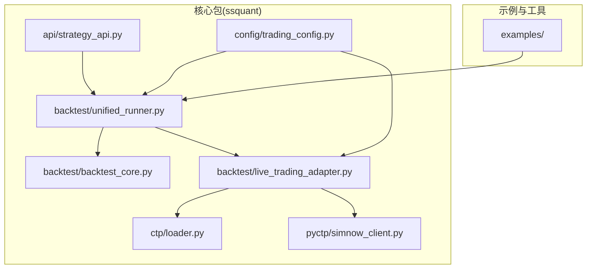
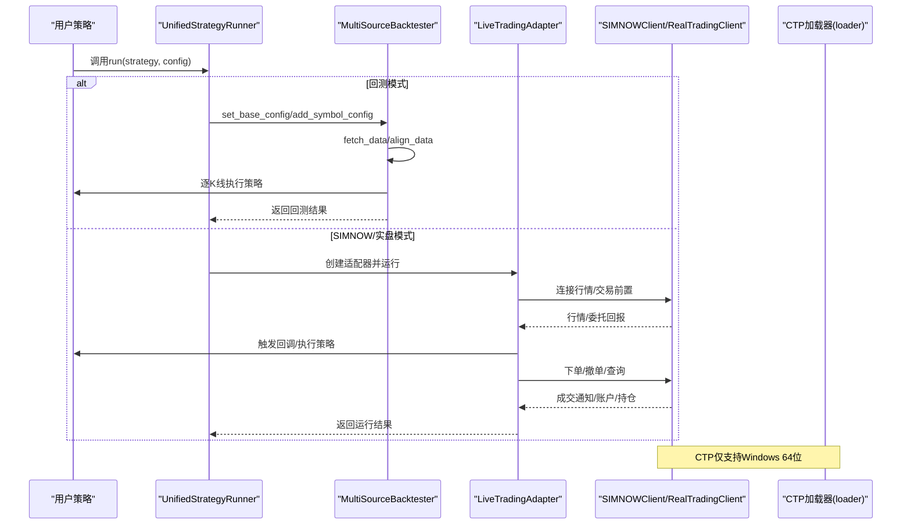
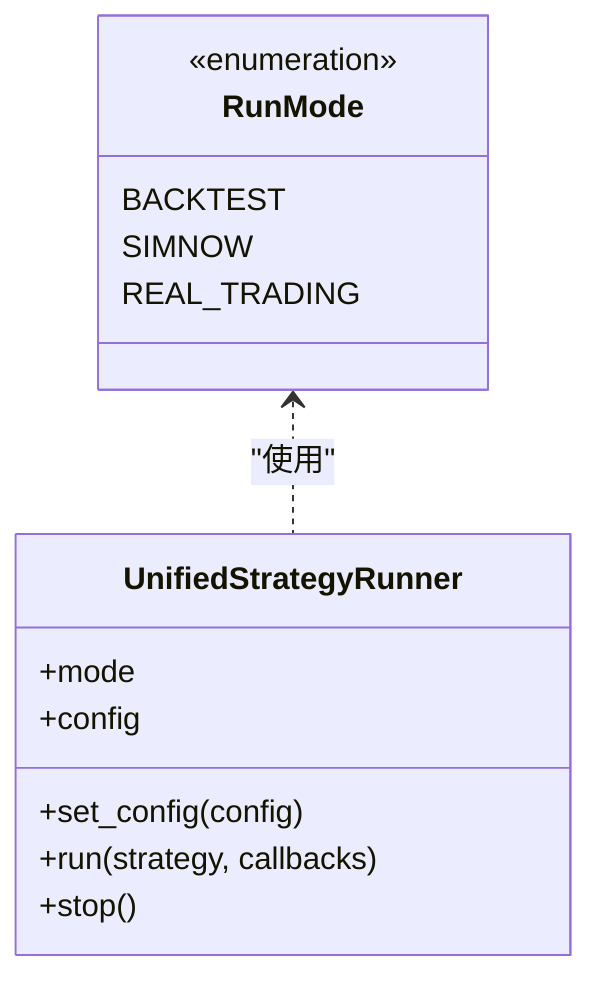
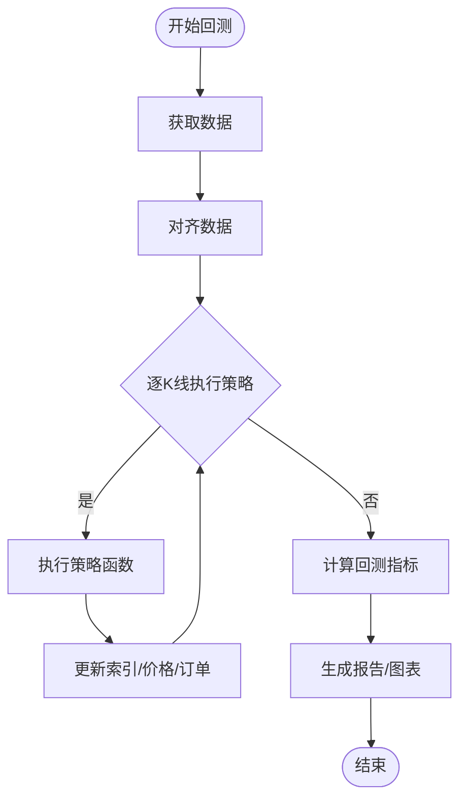
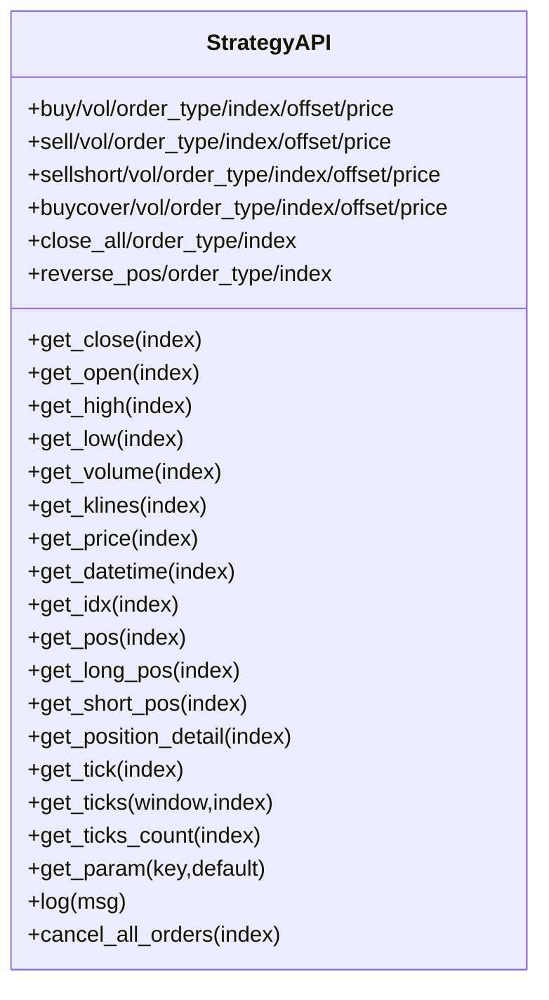
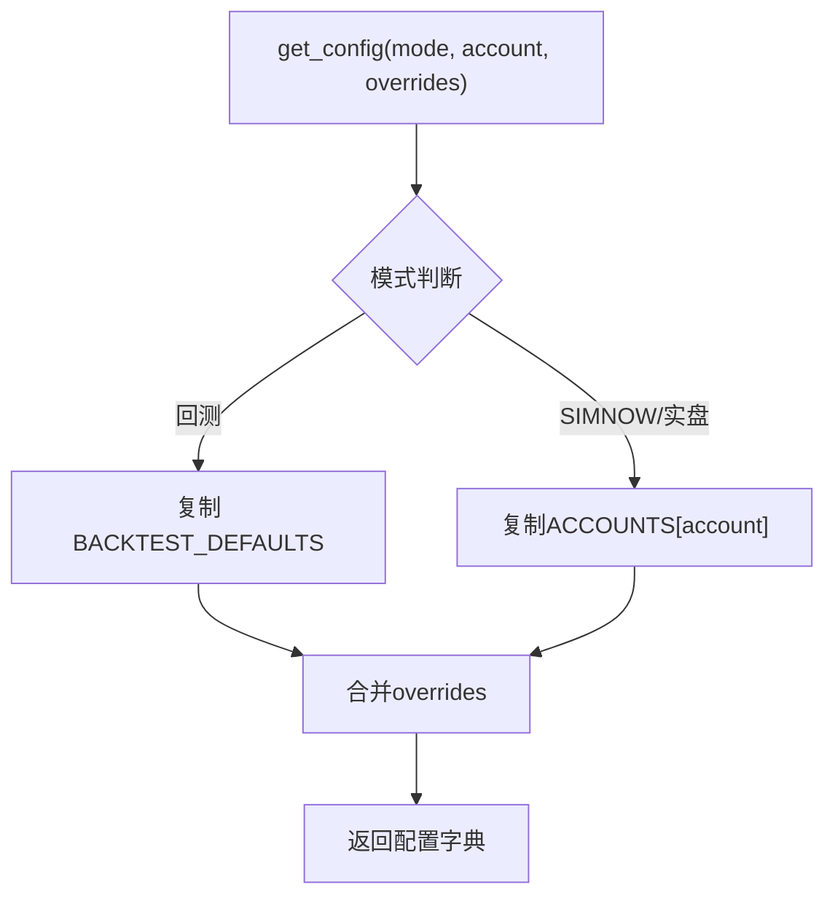
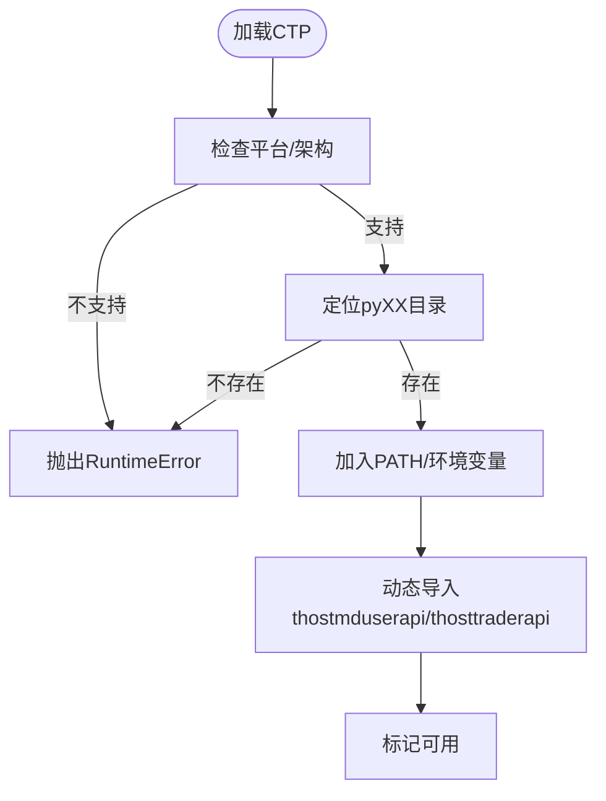
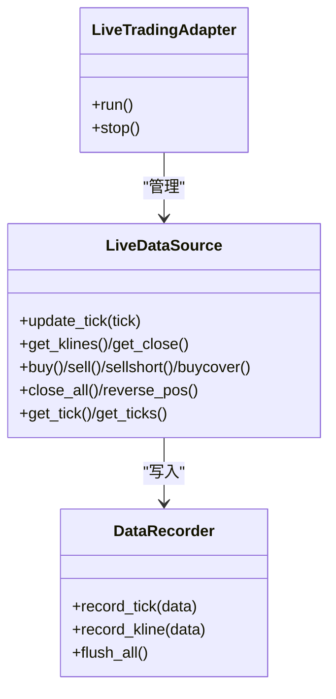

# 部署与运维

<cite>
**本文引用的文件**
- [README.md](file://README.md)
- [用户手册.md](file://用户手册.md)
- [API参考手册.md](file://API参考手册.md)
- [setup.py](file://setup.py)
- [pyproject.toml](file://pyproject.toml)
- [requirements.txt](file://requirements.txt)
- [setup_and_run.bat](file://setup_and_run.bat)
- [ssquant/config/trading_config.py](file://ssquant/config/trading_config.py)
- [ssquant/backtest/unified_runner.py](file://ssquant/backtest/unified_runner.py)
- [ssquant/backtest/backtest_core.py](file://ssquant/backtest/backtest_core.py)
- [ssquant/backtest/live_trading_adapter.py](file://ssquant/backtest/live_trading_adapter.py)
- [ssquant/api/strategy_api.py](file://ssquant/api/strategy_api.py)
- [ssquant/ctp/loader.py](file://ssquant/ctp/loader.py)
- [ssquant/pyctp/simnow_client.py](file://ssquant/pyctp/simnow_client.py)
- [examples/chanlun_5m_strategy.py](file://examples/chanlun_5m_strategy.py)
</cite>

## 目录
1. [简介](#简介)
2. [项目结构](#项目结构)
3. [核心组件](#核心组件)
4. [架构总览](#架构总览)
5. [详细组件分析](#详细组件分析)
6. [依赖与版本兼容性](#依赖与版本兼容性)
7. [安装与部署流程](#安装与部署流程)
8. [配置与启动验证](#配置与启动验证)
9. [性能优化与资源监控](#性能优化与资源监控)
10. [故障排除](#故障排除)
11. [版本升级与迁移回滚](#版本升级与迁移回滚)
12. [日志管理与监控告警](#日志管理与监控告警)
13. [运维最佳实践](#运维最佳实践)
14. [结论](#结论)

## 简介
本指导面向SSQuant量化交易框架的部署与运维，覆盖环境准备、依赖管理、安装部署、配置与启动验证、性能优化、资源监控、故障排除、版本升级与迁移回滚、日志与监控告警以及运维最佳实践。目标是帮助用户稳定可靠地部署和运行系统，涵盖回测、SIMNOW模拟与实盘CTP三类运行模式。

## 项目结构
SSQuant采用模块化设计，核心模块包括策略API、回测引擎、配置管理、数据管理、CTP封装与适配器等。典型目录结构如下：
- ssquant/api：策略API与上下文封装
- ssquant/backtest：回测引擎与多数据源适配
- ssquant/config：运行配置与账户配置
- ssquant/data：数据获取与本地加载
- ssquant/ctp：CTP二进制文件与加载器
- ssquant/pyctp：SIMNOW/实盘客户端封装
- examples：19个策略示例与工具脚本
- tests：单元测试

图表来源
- [ssquant/api/strategy_api.py](file://ssquant/api/strategy_api.py#L1-L570)
- [ssquant/backtest/backtest_core.py](file://ssquant/backtest/backtest_core.py#L1-L579)
- [ssquant/backtest/unified_runner.py](file://ssquant/backtest/unified_runner.py#L1-L379)
- [ssquant/config/trading_config.py](file://ssquant/config/trading_config.py#L1-L187)
- [ssquant/ctp/loader.py](file://ssquant/ctp/loader.py#L1-L203)
- [ssquant/pyctp/simnow_client.py](file://ssquant/pyctp/simnow_client.py#L1-L815)
- [ssquant/backtest/live_trading_adapter.py](file://ssquant/backtest/live_trading_adapter.py#L1-L800)

章节来源
- [README.md](file://README.md#L297-L321)

## 核心组件
- 统一运行器：支持回测、SIMNOW模拟、实盘交易三种模式，负责配置校验、模式切换与运行调度。
- 回测引擎：多数据源对齐、K线/TICK聚合、策略执行、结果计算与可视化。
- 策略API：统一的数据访问与交易接口，屏蔽回测与实盘差异。
- 配置管理：账户配置、数据API认证、运行参数与回测默认参数。
- CTP加载器：按Python版本自动加载对应CTP二进制文件，提供状态查询与错误提示。
- 实盘适配器：将CTP接口适配为统一API，支持数据落盘、订单超时与重试、回调注册等。

章节来源
- [ssquant/backtest/unified_runner.py](file://ssquant/backtest/unified_runner.py#L26-L379)
- [ssquant/backtest/backtest_core.py](file://ssquant/backtest/backtest_core.py#L14-L579)
- [ssquant/api/strategy_api.py](file://ssquant/api/strategy_api.py#L1-L570)
- [ssquant/config/trading_config.py](file://ssquant/config/trading_config.py#L1-L187)
- [ssquant/ctp/loader.py](file://ssquant/ctp/loader.py#L1-L203)
- [ssquant/backtest/live_trading_adapter.py](file://ssquant/backtest/live_trading_adapter.py#L1-L800)

## 架构总览
SSQuant通过统一运行器在不同模式间切换，回测模式使用历史数据与引擎模拟成交；SIMNOW/实盘模式通过CTP封装与适配器对接实时行情与交易。

图表来源
- [ssquant/backtest/unified_runner.py](file://ssquant/backtest/unified_runner.py#L162-L379)
- [ssquant/backtest/backtest_core.py](file://ssquant/backtest/backtest_core.py#L144-L381)
- [ssquant/backtest/live_trading_adapter.py](file://ssquant/backtest/live_trading_adapter.py#L1-L800)
- [ssquant/pyctp/simnow_client.py](file://ssquant/pyctp/simnow_client.py#L1-L815)
- [ssquant/ctp/loader.py](file://ssquant/ctp/loader.py#L1-L203)

## 详细组件分析

### 统一运行器（UnifiedStrategyRunner）
- 职责：根据运行模式选择回测或实盘适配器，校验配置，执行策略并返回结果。
- 关键能力：多数据源配置、模式切换、回调注册（实盘）、停止运行。
- 配置校验：针对回测、SIMNOW、实盘分别校验必填参数。

图表来源
- [ssquant/backtest/unified_runner.py](file://ssquant/backtest/unified_runner.py#L19-L379)

章节来源
- [ssquant/backtest/unified_runner.py](file://ssquant/backtest/unified_runner.py#L79-L214)

### 回测引擎（MultiSourceBacktester）
- 职责：多数据源对齐、K线/TICK聚合、策略执行、结果计算与报告生成。
- 关键能力：基础配置、多数据源添加、预加载数据、参数优化、可视化与报告。
- 性能：支持NO_VISUALIZATION/NO_CONSOLE_LOG环境变量以抑制输出，提升参数优化效率。

图表来源
- [ssquant/backtest/backtest_core.py](file://ssquant/backtest/backtest_core.py#L144-L381)

章节来源
- [ssquant/backtest/backtest_core.py](file://ssquant/backtest/backtest_core.py#L85-L381)

### 策略API（StrategyAPI）
- 职责：提供统一的数据访问与交易接口，屏蔽回测与实盘差异。
- 关键能力：多数据源访问、K线/TICK序列、持仓查询、交易下单、参数与日志、回调注册（实盘）。

图表来源
- [ssquant/api/strategy_api.py](file://ssquant/api/strategy_api.py#L1-L570)

章节来源
- [ssquant/api/strategy_api.py](file://ssquant/api/strategy_api.py#L91-L570)

### 配置管理（trading_config.py）
- 职责：集中管理数据API认证、回测默认参数、账户配置（SIMNOW/实盘）、账户增删查。
- 关键能力：get_config按模式生成配置、get_api_auth/set_api_auth、add_account/list_accounts。

图表来源
- [ssquant/config/trading_config.py](file://ssquant/config/trading_config.py#L115-L165)

章节来源
- [ssquant/config/trading_config.py](file://ssquant/config/trading_config.py#L1-L187)

### CTP加载器（loader.py）
- 职责：按当前Python版本自动定位并加载对应CTP二进制文件，提供状态查询与错误提示。
- 关键能力：版本标签生成、目录检查、动态导入、错误信息汇总。

图表来源
- [ssquant/ctp/loader.py](file://ssquant/ctp/loader.py#L84-L188)

章节来源
- [ssquant/ctp/loader.py](file://ssquant/ctp/loader.py#L1-L203)

### 实盘适配器（live_trading_adapter.py）
- 职责：将CTP接口适配为统一API，支持数据落盘（CSV/DB）、订单超时与重试、回调注册。
- 关键能力：数据记录器（异步队列）、历史数据预加载、K线聚合、订单防重复、智能算法交易。

图表来源
- [ssquant/backtest/live_trading_adapter.py](file://ssquant/backtest/live_trading_adapter.py#L26-L800)

章节来源
- [ssquant/backtest/live_trading_adapter.py](file://ssquant/backtest/live_trading_adapter.py#L1-L800)

## 依赖与版本兼容性
- Python版本：3.9 ~ 3.14（打包元数据与构建配置均限定）
- 操作系统：Windows 10+（CTP仅支持Windows）
- 核心依赖：pandas、numpy、requests
- 可视化依赖：matplotlib、scipy、Pillow、akshare
- 可选依赖：scikit-learn、joblib、statsmodels（机器学习策略）

章节来源
- [setup.py](file://setup.py#L59-L91)
- [pyproject.toml](file://pyproject.toml#L10-L40)
- [requirements.txt](file://requirements.txt#L1-L16)
- [README.md](file://README.md#L43-L51)

## 安装与部署流程
- 环境要求：Windows 10+、Python 3.9~3.14、4GB+内存
- 安装方式：
  - 从PyPI安装：pip install ssquant
  - 从源码安装：pip install -e .
- 依赖安装：pip install -r requirements.txt（可选：机器学习策略需额外安装scikit-learn等）
- 验证安装：python -c "from ssquant.api.strategy_api import StrategyAPI; print('ssquant 导入成功!')"
- 常见问题：ModuleNotFoundError时重新安装或检查pip list中ssquant是否可见

章节来源
- [README.md](file://README.md#L54-L120)
- [用户手册.md](file://用户手册.md#L43-L70)

## 配置与启动验证
- 账户配置：编辑ssquant/config/trading_config.py，配置API认证与账户（SIMNOW/实盘）
- 运行模式：通过get_config(mode=RunMode.*)设置，回测/模拟/实盘三类
- 启动验证：
  - 回测：运行examples/B_缠论5分钟策略.py或使用examples/chanlun_5m_strategy.py入口脚本
  - 实盘/SIMNOW：配置账户后运行统一运行器，观察日志与回调
- 日志输出：回测默认输出run.log，可通过环境变量NO_VISUALIZATION/NO_CONSOLE_LOG控制

章节来源
- [ssquant/config/trading_config.py](file://ssquant/config/trading_config.py#L1-L187)
- [ssquant/backtest/unified_runner.py](file://ssquant/backtest/unified_runner.py#L162-L214)
- [setup_and_run.bat](file://setup_and_run.bat#L1-L12)
- [examples/chanlun_5m_strategy.py](file://examples/chanlun_5m_strategy.py#L1-L11)

## 性能优化与资源监控
- 回测性能优化：
  - 使用NO_VISUALIZATION/NO_CONSOLE_LOG环境变量抑制图表与控制台输出，加速参数优化
  - 预加载历史数据（preload_data）减少重复加载
  - 多数据源对齐与填充策略（align_data/fill_method）影响性能与精度
- 实盘性能优化：
  - 合理设置order_offset_ticks与retry_limit，平衡成交概率与滑点
  - 使用历史TICK预加载（kline_period='tick'）提升TICK策略响应速度
  - 数据落盘采用异步队列（DataRecorder），降低主线程阻塞
- 资源监控：
  - 控制台进度条显示K线处理速率（bars_per_minute）
  - 回测耗时统计与性能报告生成
  - 实盘日志与回调（on_account/on_position/on_trade等）辅助监控

章节来源
- [ssquant/backtest/backtest_core.py](file://ssquant/backtest/backtest_core.py#L308-L381)
- [ssquant/backtest/live_trading_adapter.py](file://ssquant/backtest/live_trading_adapter.py#L26-L120)

## 故障排除
- CTP加载失败：
  - 检查Python版本是否在支持范围内（py39~py314）
  - 确认Windows 64位系统与对应CTP目录存在
  - 使用print_ctp_status()查看状态与错误信息
- ModuleNotFoundError: No module named 'ssquant'：
  - 重新安装或使用pip install -e .从项目根目录安装
  - 检查pip list中是否包含ssquant
- SIMNOW连接失败：
  - 更换服务器（电信1/电信2/移动/TEST）
  - 检查账号密码、网络连接与工作时间
- 订单超时/重试：
  - 调整order_timeout/retry_limit/retry_offset_ticks
  - 检查平今/平昨权限与昨仓情况
- 数据缺失/回测无结果：
  - 检查symbol、日期范围、API认证
  - 确认use_cache/save_data/align_data配置

章节来源
- [ssquant/ctp/loader.py](file://ssquant/ctp/loader.py#L151-L170)
- [README.md](file://README.md#L90-L120)
- [用户手册.md](file://用户手册.md#L587-L640)
- [ssquant/backtest/live_trading_adapter.py](file://ssquant/backtest/live_trading_adapter.py#L416-L460)

## 版本升级与迁移回滚
- 升级步骤：
  - 备份配置文件（trading_config.py）与策略脚本
  - pip install ssquant --upgrade（或从源码pip install -e .）
  - 运行回测/SIMNOW验证，确认兼容性
- 迁移策略：
  - 保持统一运行器与策略API不变，逐步替换依赖库版本
  - 对照依赖清单（requirements.txt/pyproject.toml/setup.py）核对版本
- 回滚机制：
  - 降级：pip install ssquant==<目标版本>
  - 恢复：恢复备份的配置与策略
- 版本变更关注点：
  - Python版本范围变更（>=3.9,<3.15）
  - CTP版本支持范围（6.7.7~6.7.10）
  - 新增/变更的配置项与回调

章节来源
- [setup.py](file://setup.py#L28-L108)
- [pyproject.toml](file://pyproject.toml#L5-L40)
- [README.md](file://README.md#L413-L441)

## 日志管理与监控告警
- 日志输出：
  - 回测：run.log文件，可通过批处理脚本查看尾部日志
  - 实盘：控制台日志与回调（on_account/on_position/on_trade等）
- 监控告警：
  - 回测阶段：性能报告与图表，关注最大回撤、夏普比率等指标
  - 实盘阶段：订单状态回调、账户资金回调、持仓变化回调
  - 建议：结合外部监控系统（如日志聚合与告警平台）对关键事件进行告警

章节来源
- [setup_and_run.bat](file://setup_and_run.bat#L1-L12)
- [API参考手册.md](file://API参考手册.md#L621-L740)

## 运维最佳实践
- 开发流程：策略构思 → 回测验证 → SIMNOW测试 → 小资金实盘 → 正式运行
- 风险控制：设置止损/止盈、合理滑点与手续费、严格参数验证
- 配置管理：集中管理trading_config.py，区分账户与参数，定期备份
- 性能与稳定性：使用异步数据落盘、合理设置超时与重试、监控K线处理速率
- 安全与合规：实盘前充分测试，做好应急预案，遵守平台规则

章节来源
- [用户手册.md](file://用户手册.md#L667-L716)

## 结论
SSQuant通过统一运行器与策略API实现了“一次编写，三处运行”的核心理念。依托完善的回测引擎、配置管理与CTP适配，用户可在Windows环境下稳定部署并运行回测、SIMNOW模拟与实盘交易。遵循本文的安装部署、配置验证、性能优化、故障排除与运维最佳实践，可显著提升系统的可靠性与可维护性。