# API认证配置

<cite>
**本文引用的文件**
- [trading_config.py](file://ssquant/config/trading_config.py)
- [api_data_fetcher.py](file://ssquant/data/api_data_fetcher.py)
- [unified_runner.py](file://ssquant/backtest/unified_runner.py)
- [backtest_core.py](file://ssquant/backtest/backtest_core.py)
- [multi_data_fetcher.py](file://ssquant/data/multi_data_fetcher.py)
- [backtest_data.py](file://ssquant/backtest/backtest_data.py)
- [B_多品种多周期交易策略_参数优化.py](file://examples/B_多品种多周期交易策略_参数优化.py)
- [B_缠论多空信号策略.py](file://examples/B_缠论多空信号策略.py)
- [README.md](file://README.md)
</cite>

## 目录
1. [简介](#简介)
2. [项目结构](#项目结构)
3. [核心组件](#核心组件)
4. [架构概览](#架构概览)
5. [详细组件分析](#详细组件分析)
6. [依赖关系分析](#依赖关系分析)
7. [性能考量](#性能考量)
8. [故障排除指南](#故障排除指南)
9. [结论](#结论)

## 简介
本文档详细说明SSQuant框架中的API认证配置，重点涵盖数据API认证（API_USERNAME、API_PASSWORD）的设置方法、管理方式以及在数据获取过程中的作用。文档还解释了get_api_auth()和set_api_auth()函数的使用方法，并提供安全管理和最佳实践建议，帮助用户正确配置和维护API认证信息，确保数据获取的稳定性和安全性。

## 项目结构
SSQuant采用模块化的项目结构，API认证配置主要集中在配置模块中，数据获取层通过统一的API接口进行认证信息传递。关键文件分布如下：
- 配置模块：ssquant/config/trading_config.py
- 数据获取模块：ssquant/data/api_data_fetcher.py
- 回测运行器：ssquant/backtest/unified_runner.py
- 回测核心：ssquant/backtest/backtest_core.py
- 示例策略：examples/目录下的策略示例

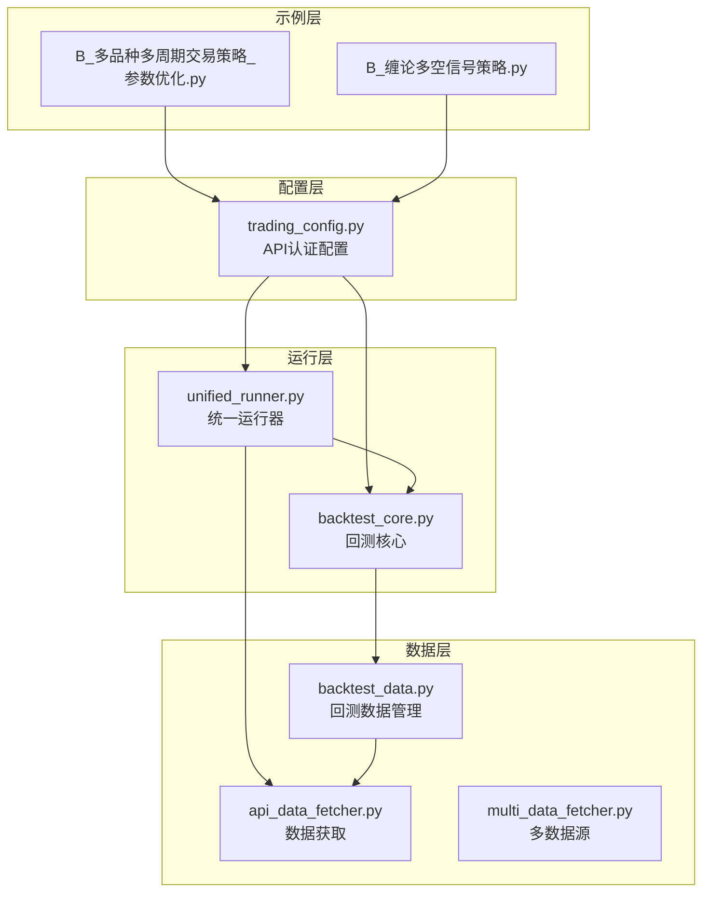

**图表来源**
- [trading_config.py](file://ssquant/config/trading_config.py#L1-L187)
- [api_data_fetcher.py](file://ssquant/data/api_data_fetcher.py#L1-L1031)
- [unified_runner.py](file://ssquant/backtest/unified_runner.py#L1-L379)
- [backtest_core.py](file://ssquant/backtest/backtest_core.py#L1-L579)
- [multi_data_fetcher.py](file://ssquant/data/multi_data_fetcher.py#L1-L139)
- [backtest_data.py](file://ssquant/backtest/backtest_data.py#L1-L246)

**章节来源**
- [README.md](file://README.md#L121-L163)

## 核心组件
本节详细介绍API认证配置的核心组件及其职责。

### API认证配置类
trading_config.py中的API认证配置类负责管理API用户名和密码，提供获取和设置认证信息的接口。

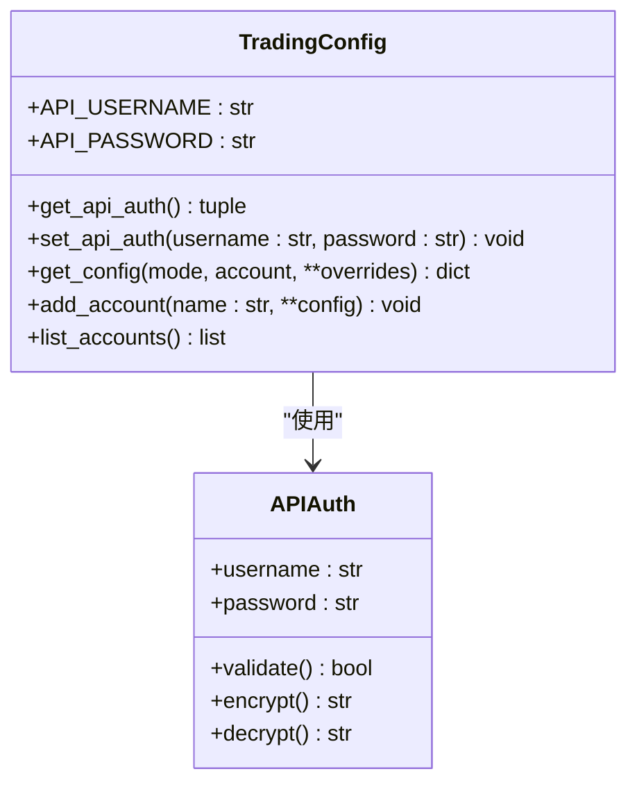

**图表来源**
- [trading_config.py](file://ssquant/config/trading_config.py#L10-L176)

### 数据获取认证流程
数据获取模块通过统一的API接口接收认证信息，确保数据请求的合法性。

```mermaid
sequenceDiagram
participant Runner as "统一运行器"
participant Config as "配置模块"
participant Fetcher as "数据获取器"
participant API as "数据API"
Runner->>Config : get_api_auth()
Config-->>Runner : (API_USERNAME, API_PASSWORD)
Runner->>Fetcher : get_futures_data(symbol, start_date, end_date,
username, password, ...)
Fetcher->>API : 发送认证请求
API-->>Fetcher : 返回认证结果
Fetcher-->>Runner : 返回数据
```

**图表来源**
- [unified_runner.py](file://ssquant/backtest/unified_runner.py#L216-L232)
- [api_data_fetcher.py](file://ssquant/data/api_data_fetcher.py#L627-L794)

**章节来源**
- [trading_config.py](file://ssquant/config/trading_config.py#L10-L176)
- [api_data_fetcher.py](file://ssquant/data/api_data_fetcher.py#L171-L626)

## 架构概览
SSQuant的API认证架构采用分层设计，确保认证信息的安全传递和管理。

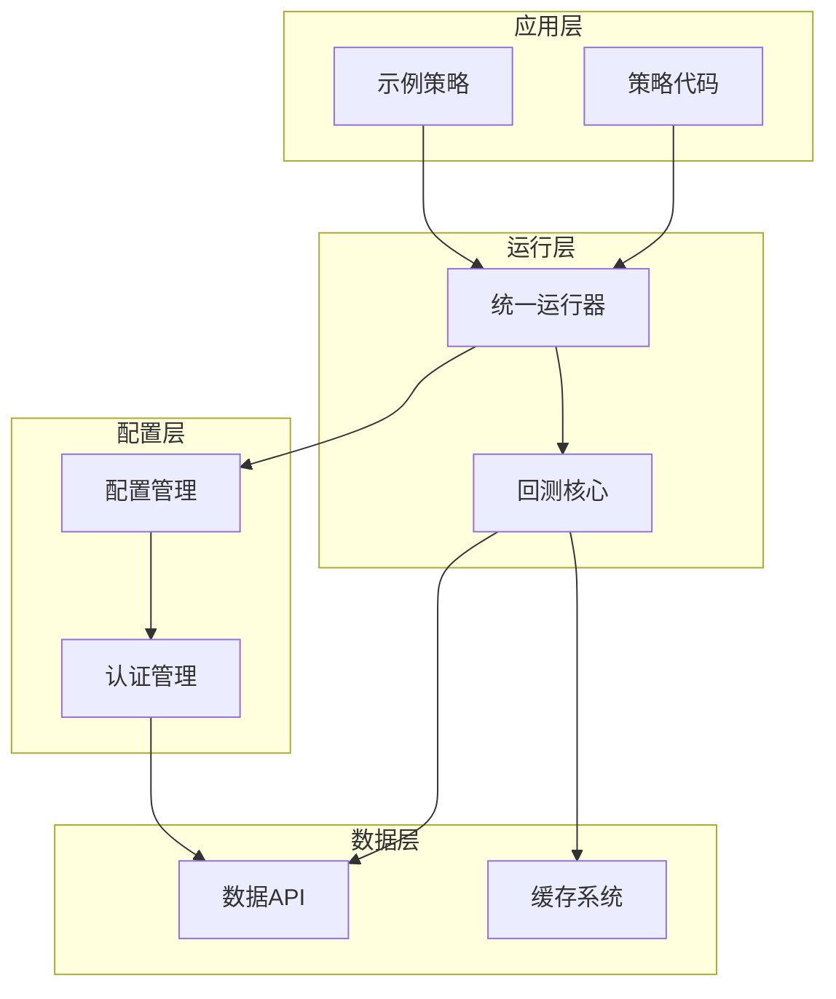

**图表来源**
- [unified_runner.py](file://ssquant/backtest/unified_runner.py#L1-L379)
- [backtest_core.py](file://ssquant/backtest/backtest_core.py#L1-L579)
- [trading_config.py](file://ssquant/config/trading_config.py#L1-L187)

## 详细组件分析

### API认证配置管理
API认证配置通过全局变量和函数接口实现集中管理。

#### 配置文件结构
trading_config.py中的API认证配置采用简洁的结构设计：

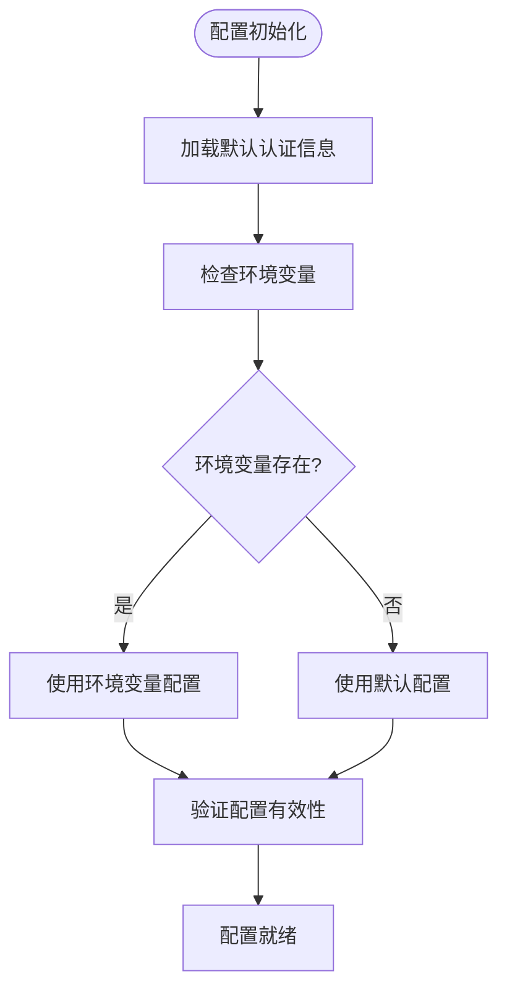

**图表来源**
- [trading_config.py](file://ssquant/config/trading_config.py#L10-L12)

#### 认证信息获取流程
get_api_auth()函数提供统一的认证信息获取接口：

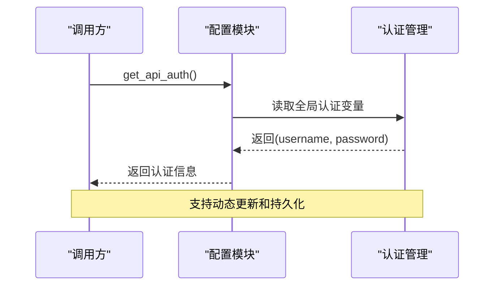

**图表来源**
- [trading_config.py](file://ssquant/config/trading_config.py#L167-L169)

**章节来源**
- [trading_config.py](file://ssquant/config/trading_config.py#L10-L176)

### 数据获取认证实现
数据获取模块实现了完整的认证流程，确保数据请求的安全性。

#### 认证参数传递
数据获取函数通过参数传递认证信息：

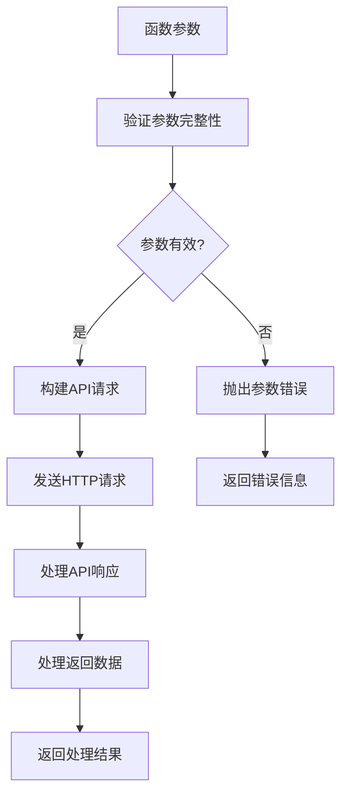

**图表来源**
- [api_data_fetcher.py](file://ssquant/data/api_data_fetcher.py#L171-L268)

#### 错误处理机制
数据获取模块实现了完善的错误处理机制：

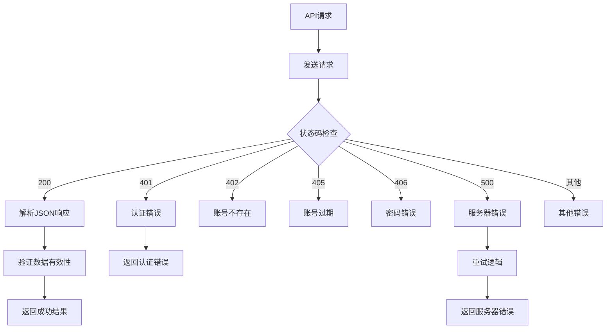

**图表来源**
- [api_data_fetcher.py](file://ssquant/data/api_data_fetcher.py#L773-L793)

**章节来源**
- [api_data_fetcher.py](file://ssquant/data/api_data_fetcher.py#L171-L794)

### 回测运行器集成
统一运行器负责将认证信息传递给回测核心，确保数据获取的完整性。

#### 运行器配置流程
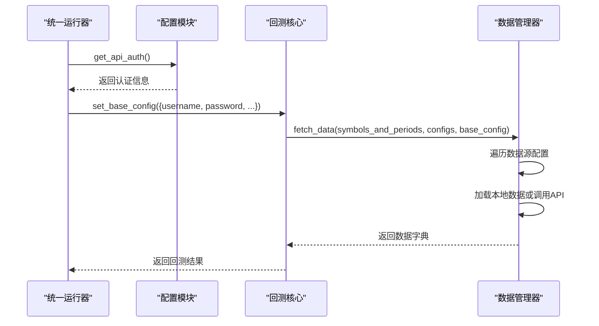

**图表来源**
- [unified_runner.py](file://ssquant/backtest/unified_runner.py#L216-L314)
- [backtest_data.py](file://ssquant/backtest/backtest_data.py#L32-L189)

**章节来源**
- [unified_runner.py](file://ssquant/backtest/unified_runner.py#L216-L314)
- [backtest_data.py](file://ssquant/backtest/backtest_data.py#L32-L189)

### 示例策略中的认证使用
示例策略展示了认证信息在实际应用中的使用方式。

#### 参数优化示例
在参数优化示例中，认证信息通过配置模块获取并传递给回测器：

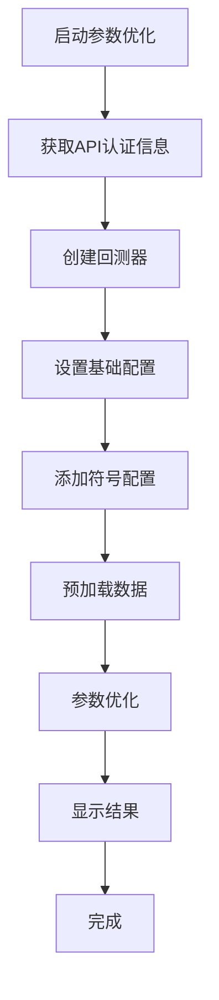

**图表来源**
- [B_多品种多周期交易策略_参数优化.py](file://examples/B_多品种多周期交易策略_参数优化.py#L18-L155)

#### 回测策略示例
在回测策略示例中，认证信息用于决定数据获取策略：

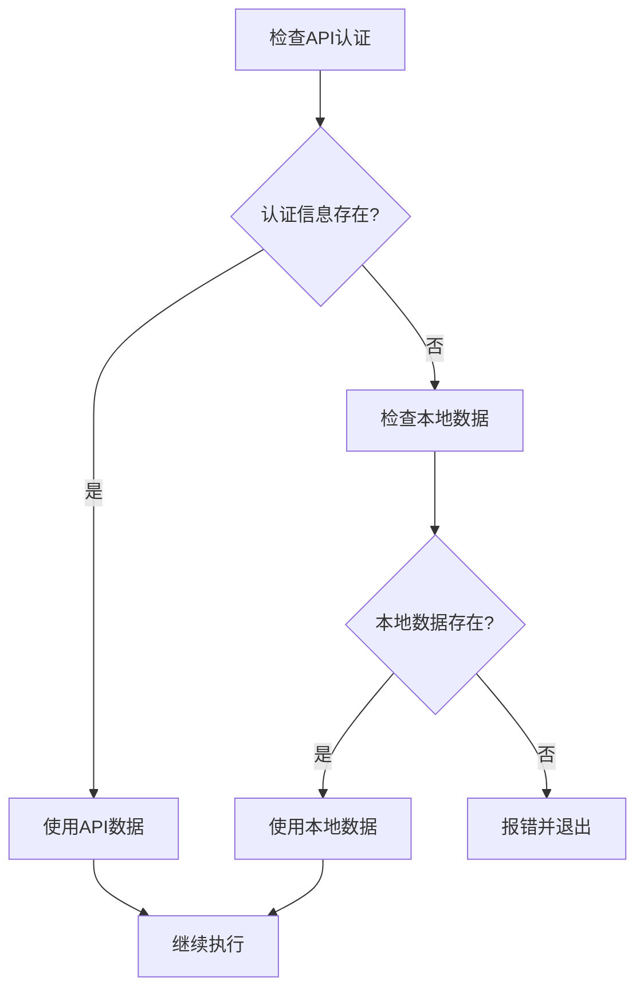

**图表来源**
- [B_缠论多空信号策略.py](file://examples/B_缠论多空信号策略.py#L1330-L1374)

**章节来源**
- [B_多品种多周期交易策略_参数优化.py](file://examples/B_多品种多周期交易策略_参数优化.py#L18-L155)
- [B_缠论多空信号策略.py](file://examples/B_缠论多空信号策略.py#L1330-L1374)

## 依赖关系分析
API认证配置在整个系统中的依赖关系如下：

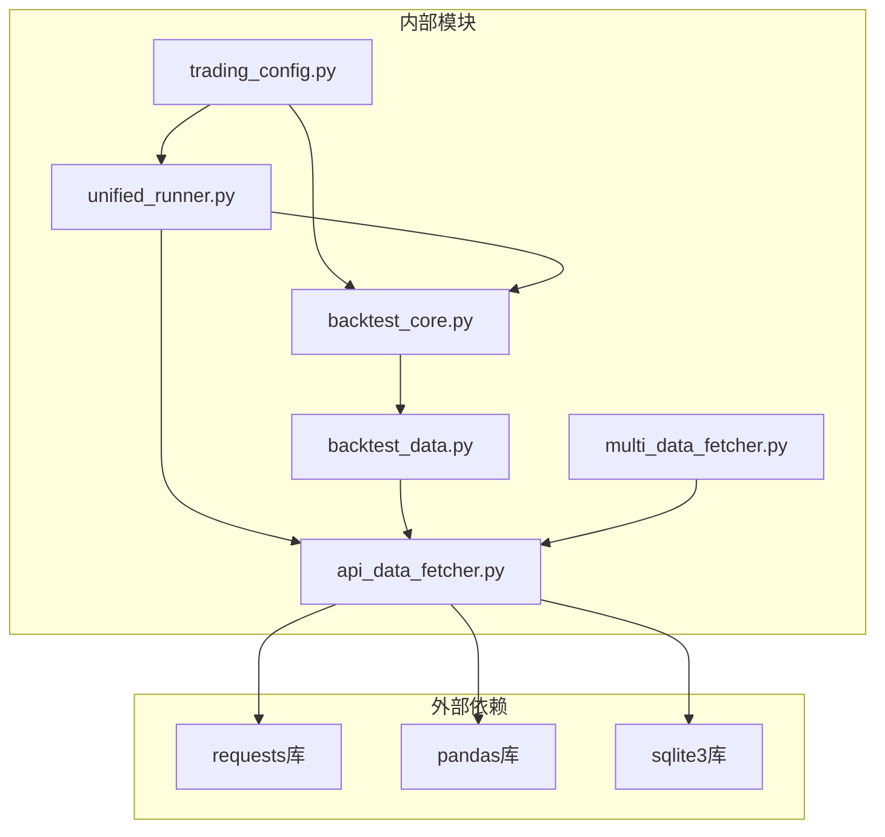

**图表来源**
- [trading_config.py](file://ssquant/config/trading_config.py#L1-L187)
- [api_data_fetcher.py](file://ssquant/data/api_data_fetcher.py#L1-L1031)
- [unified_runner.py](file://ssquant/backtest/unified_runner.py#L1-L379)
- [backtest_core.py](file://ssquant/backtest/backtest_core.py#L1-L579)
- [backtest_data.py](file://ssquant/backtest/backtest_data.py#L1-L246)
- [multi_data_fetcher.py](file://ssquant/data/multi_data_fetcher.py#L1-L139)

**章节来源**
- [trading_config.py](file://ssquant/config/trading_config.py#L1-L187)
- [api_data_fetcher.py](file://ssquant/data/api_data_fetcher.py#L1-L1031)

## 性能考量
API认证配置在性能方面需要考虑以下因素：

### 认证信息缓存
- 认证信息应缓存在内存中，避免频繁的文件I/O操作
- 支持动态更新认证信息，无需重启应用
- 提供认证信息的有效性验证机制

### 数据获取优化
- 实现智能的缓存策略，减少重复的API调用
- 支持批量数据获取，提高数据传输效率
- 实现断线重试机制，增强系统的稳定性

### 并发处理
- 支持多线程并发的数据获取
- 实现连接池管理，优化网络资源使用
- 提供异步数据获取接口

## 故障排除指南
常见API认证问题及解决方案：

### 认证信息错误
**问题症状**：API请求返回认证错误
**可能原因**：
- 用户名或密码错误
- 账号已过期
- 网络连接问题

**解决方案**：
1. 验证用户名和密码的正确性
2. 检查账号状态和有效期
3. 确认网络连接的稳定性

### 数据获取失败
**问题症状**：无法获取历史数据
**可能原因**：
- API认证未配置
- 本地数据文件不存在
- 网络连接失败

**解决方案**：
1. 检查trading_config.py中的API认证配置
2. 验证本地数据文件的存在性和完整性
3. 确认网络连接状态

### 性能问题
**问题症状**：数据获取速度缓慢
**可能原因**：
- 缓存机制未启用
- 网络延迟过高
- 数据量过大

**解决方案**：
1. 启用数据缓存功能
2. 优化网络连接
3. 分批获取大数据量

**章节来源**
- [backtest_core.py](file://ssquant/backtest/backtest_core.py#L202-L213)
- [api_data_fetcher.py](file://ssquant/data/api_data_fetcher.py#L773-L793)

## 结论
SSQuant框架的API认证配置设计合理，通过集中管理认证信息、提供统一的获取接口和完善的错误处理机制，确保了数据获取的稳定性和安全性。用户应遵循最佳实践，妥善保管认证信息，定期更新认证状态，并根据实际需求优化数据获取策略。通过理解认证配置的工作原理和使用方法，用户可以更好地利用SSQuant框架进行量化交易开发。