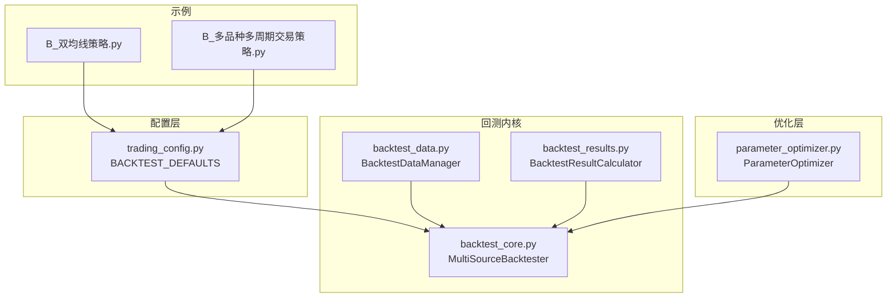
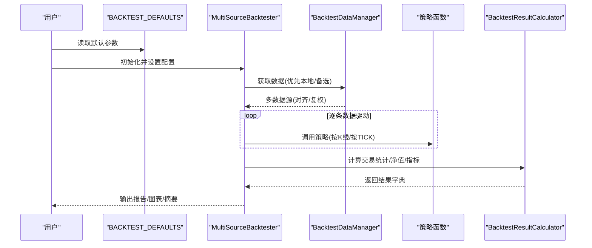
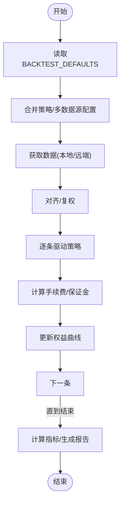
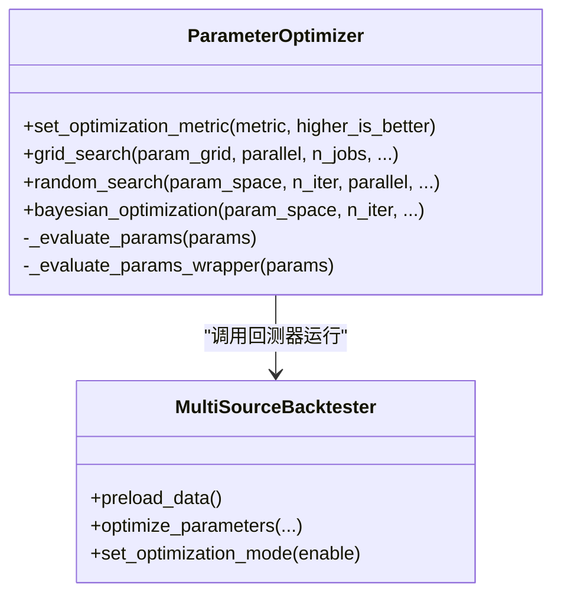
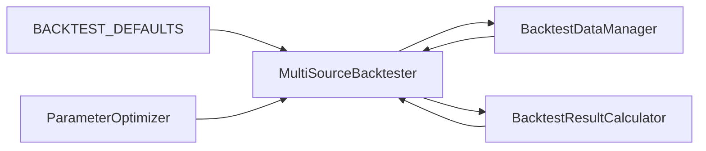

# 回测配置

<cite>
**本文引用的文件**
- [ssquant/config/trading_config.py](file://ssquant/config/trading_config.py)
- [ssquant/backtest/backtest_core.py](file://ssquant/backtest/backtest_core.py)
- [ssquant/backtest/backtest_data.py](file://ssquant/backtest/backtest_data.py)
- [ssquant/backtest/backtest_results.py](file://ssquant/backtest/backtest_results.py)
- [ssquant/backtest/parameter_optimizer.py](file://ssquant/backtest/parameter_optimizer.py)
- [examples/B_双均线策略.py](file://examples/B_双均线策略.py)
- [examples/B_多品种多周期交易策略.py](file://examples/B_多品种多周期交易策略.py)
</cite>

## 目录
1. [简介](#简介)
2. [项目结构](#项目结构)
3. [核心组件](#核心组件)
4. [架构总览](#架构总览)
5. [详细组件分析](#详细组件分析)
6. [依赖关系分析](#依赖关系分析)
7. [性能考量](#性能考量)
8. [故障排查指南](#故障排查指南)
9. [结论](#结论)
10. [附录](#附录)

## 简介
本文围绕 SSQuant 的回测配置展开，重点解释 BACKTEST_DEFAULTS 中的关键参数，并结合回测流程说明其对结果的影响。同时给出不同场景下的推荐配置、参数优化建议与性能注意事项，帮助用户在保证结果可信的前提下提升回测效率。

## 项目结构
与回测配置直接相关的模块分布如下：
- 配置层：统一回测默认参数与运行模式配置
- 回测内核：多数据源回测、运行流程、结果计算
- 数据层：数据获取、本地/远端数据加载、对齐与复权
- 结果层：交易统计、净值曲线、绩效指标
- 优化层：网格/随机/贝叶斯参数优化，支持并行与静默模式

**图表来源**
- [ssquant/config/trading_config.py](file://ssquant/config/trading_config.py#L14-L26)
- [ssquant/backtest/backtest_core.py](file://ssquant/backtest/backtest_core.py#L14-L84)
- [ssquant/backtest/backtest_data.py](file://ssquant/backtest/backtest_data.py#L8-L246)
- [ssquant/backtest/backtest_results.py](file://ssquant/backtest/backtest_results.py#L4-L544)
- [ssquant/backtest/parameter_optimizer.py](file://ssquant/backtest/parameter_optimizer.py#L74-L139)
- [examples/B_双均线策略.py](file://examples/B_双均线策略.py#L144-L163)
- [examples/B_多品种多周期交易策略.py](file://examples/B_多品种多周期交易策略.py#L274-L319)

**章节来源**
- [ssquant/config/trading_config.py](file://ssquant/config/trading_config.py#L14-L26)
- [ssquant/backtest/backtest_core.py](file://ssquant/backtest/backtest_core.py#L14-L84)
- [ssquant/backtest/backtest_data.py](file://ssquant/backtest/backtest_data.py#L8-L246)
- [ssquant/backtest/backtest_results.py](file://ssquant/backtest/backtest_results.py#L4-L544)
- [ssquant/backtest/parameter_optimizer.py](file://ssquant/backtest/parameter_optimizer.py#L74-L139)
- [examples/B_双均线策略.py](file://examples/B_双均线策略.py#L144-L163)
- [examples/B_多品种多周期交易策略.py](file://examples/B_多品种多周期交易策略.py#L274-L319)

## 核心组件
- 配置中心：BACKTEST_DEFAULTS 提供回测默认资金、手续费、保证金、合约乘数、最小跳价、滑点、复权类型以及缓存与数据保存开关。
- 回测器：MultiSourceBacktester 负责数据获取、对齐、运行策略、生成结果与报告。
- 数据管理：BacktestDataManager 负责优先加载本地数据，否则调用远端接口获取，并支持复权与缓存。
- 结果计算：BacktestResultCalculator 基于交易记录与配置参数计算盈亏、手续费、保证金占用、净值曲线与绩效指标。
- 参数优化：ParameterOptimizer 支持网格/随机/贝叶斯搜索，支持并行与静默模式，显著提升优化效率。

**章节来源**
- [ssquant/config/trading_config.py](file://ssquant/config/trading_config.py#L14-L26)
- [ssquant/backtest/backtest_core.py](file://ssquant/backtest/backtest_core.py#L14-L84)
- [ssquant/backtest/backtest_data.py](file://ssquant/backtest/backtest_data.py#L32-L189)
- [ssquant/backtest/backtest_results.py](file://ssquant/backtest/backtest_results.py#L103-L495)
- [ssquant/backtest/parameter_optimizer.py](file://ssquant/backtest/parameter_optimizer.py#L140-L309)

## 架构总览
回测流程从配置读取开始，进入 MultiSourceBacktester，经由 BacktestDataManager 获取并对齐数据，随后逐条驱动策略执行，最后由 BacktestResultCalculator 计算结果与指标。

**图表来源**
- [ssquant/config/trading_config.py](file://ssquant/config/trading_config.py#L14-L26)
- [ssquant/backtest/backtest_core.py](file://ssquant/backtest/backtest_core.py#L144-L306)
- [ssquant/backtest/backtest_data.py](file://ssquant/backtest/backtest_data.py#L32-L189)
- [ssquant/backtest/backtest_results.py](file://ssquant/backtest/backtest_results.py#L103-L495)

## 详细组件分析

### BACKTEST_DEFAULTS 参数详解与影响
- initial_capital（初始资金）
  - 作用：决定权益曲线起点与保证金占用计算基准。
  - 影响：直接影响最大回撤、收益/回撤比、年化收益等指标的绝对值大小；对策略资金管理策略（如固定手数、动态加仓）有直接影响。
  - 推荐：根据策略单笔预期收益与波动设定，兼顾回撤容忍度与交易频率。

- commission（手续费）
  - 作用：按成交金额计收，开平仓分别计费。
  - 影响：降低总净收益与胜率，放大小额交易的侵蚀效应；对高频策略尤为敏感。
  - 推荐：按实盘或模拟盘费率设置，区分开仓/平仓费率时可分设。

- margin_rate（保证金率）
  - 作用：决定每笔交易占用的保证金比例。
  - 影响：影响杠杆效果与最大可承受回撤；过高会限制交易规模，过低增加风险。
  - 推荐：按合约规则设置，注意跨品种差异。

- contract_multiplier（合约乘数）
  - 作用：将点数变动转换为金额变动，影响盈亏与手续费计算。
  - 影响：直接放大/缩小金额盈亏与手续费；对净值曲线幅度有显著影响。
  - 推荐：与标的合约一致，避免放大误差。

- price_tick（最小跳价）
  - 作用：最小价格变动单位，用于报价精度与滑点模拟。
  - 影响：影响下单精度与滑点模拟的真实性；与滑点ticks共同决定模拟成交偏差。
  - 推荐：与标的合约一致，避免人为放大/缩小滑点。

- slippage_ticks（滑点跳数）
  - 作用：模拟成交时的价格偏离跳数，体现流动性与冲击成本。
  - 影响：在窄幅震荡或流动性差时显著影响胜率与收益稳定性；对高频策略尤为敏感。
  - 推荐：从低值起步（如1跳），逐步上调观察稳健性。

- adjust_type（复权方式）
  - 作用：决定K线是否进行复权处理（不复权/后复权）。
  - 影响：复权会影响价格走势与技术指标形态，进而影响信号质量；对长周期回测尤为重要。
  - 推荐：趋势策略倾向后复权，量化多因子研究可对比两种方式。

- use_cache（使用缓存）、save_data（保存数据）
  - 作用：控制数据获取是否使用缓存与是否保存到本地。
  - 影响：use_cache 提升重复回测效率；save_data 便于离线复用与加速参数优化。
  - 推荐：开发阶段开启以提升效率；生产回测建议明确缓存路径与清理策略。

**章节来源**
- [ssquant/config/trading_config.py](file://ssquant/config/trading_config.py#L14-L26)
- [ssquant/backtest/backtest_results.py](file://ssquant/backtest/backtest_results.py#L124-L167)
- [ssquant/backtest/backtest_data.py](file://ssquant/backtest/backtest_data.py#L64-L152)

### 回测流程与参数生效点
- 配置读取：统一通过 get_config(RunMode.BACKTEST) 返回 BACKTEST_DEFAULTS，再叠加策略/多数据源配置。
- 数据获取：BacktestDataManager 优先加载本地文件，否则调用远端接口；受 use_cache/save_data 控制。
- 运行回测：MultiSourceBacktester 逐条推进，依据配置参数计算交易成本与保证金占用。
- 结果计算：BacktestResultCalculator 基于交易记录与配置参数汇总统计与指标。

**图表来源**
- [ssquant/config/trading_config.py](file://ssquant/config/trading_config.py#L151-L164)
- [ssquant/backtest/backtest_data.py](file://ssquant/backtest/backtest_data.py#L32-L189)
- [ssquant/backtest/backtest_core.py](file://ssquant/backtest/backtest_core.py#L144-L306)
- [ssquant/backtest/backtest_results.py](file://ssquant/backtest/backtest_results.py#L225-L447)

**章节来源**
- [ssquant/config/trading_config.py](file://ssquant/config/trading_config.py#L151-L164)
- [ssquant/backtest/backtest_data.py](file://ssquant/backtest/backtest_data.py#L32-L189)
- [ssquant/backtest/backtest_core.py](file://ssquant/backtest/backtest_core.py#L144-L306)
- [ssquant/backtest/backtest_results.py](file://ssquant/backtest/backtest_results.py#L225-L447)

### 不同场景下的推荐配置
- 股指/宽基ETF（低波动、低滑点）
  - initial_capital：按策略单月目标资金设定
  - commission：按实盘万分之二左右
  - margin_rate：按合约规则（通常5%-15%）
  - contract_multiplier：按合约乘数
  - price_tick：按合约最小跳价
  - slippage_ticks：1-2跳
  - adjust_type：后复权
  - use_cache/save_data：开启

- 商品期货（波动较大、滑点敏感）
  - initial_capital：适当提高以覆盖波动
  - commission：考虑双向费率
  - margin_rate：按品种设置
  - contract_multiplier：按合约
  - price_tick：按合约
  - slippage_ticks：2-4跳，观察稳健性
  - adjust_type：对比不复权/后复权
  - use_cache/save_data：开启

- 高频/量化（强调成本与滑点）
  - initial_capital：足够覆盖频繁交易
  - commission：精确到厘
  - margin_rate：严格按合约
  - contract_multiplier：严格按合约
  - price_tick：严格按合约
  - slippage_ticks：1跳起步，逐步上调
  - adjust_type：关注复权对指标的影响
  - use_cache/save_data：开启

- 参数优化场景
  - initial_capital/commission/margin_rate/contract_multiplier：保持与实盘一致
  - price_tick/slippage_ticks：作为优化变量参与网格/随机/贝叶斯搜索
  - adjust_type：分别测试并对比
  - use_cache/save_data：开启以提升效率

**章节来源**
- [examples/B_双均线策略.py](file://examples/B_双均线策略.py#L144-L163)
- [examples/B_多品种多周期交易策略.py](file://examples/B_多品种多周期交易策略.py#L274-L319)
- [ssquant/backtest/parameter_optimizer.py](file://ssquant/backtest/parameter_optimizer.py#L140-L309)

### 参数优化建议与性能考虑
- 优化方法选择
  - 网格搜索：全面但计算量大，适合参数空间较小或收敛较快的场景。
  - 随机搜索：在有限预算下探索更广空间，适合参数较多但计算受限。
  - 贝叶斯优化：基于历史评估结果指导下一步采样，适合昂贵目标函数。

- 静默模式与并行
  - ParameterOptimizer 在优化期间会设置 NO_VISUALIZATION/NO_CONSOLE_LOG，避免生成图表与报告，显著提速。
  - 支持并行（joblib）以充分利用多核资源，缩短优化时间。

- 数据复用
  - MultiSourceBacktester.preload_data 可预加载数据，配合优化器 reuse_data 参数，避免重复IO。

- 指标选择
  - 常用指标：夏普比率、总收益率、最大回撤、胜率、盈亏比等；根据策略特性选择主优化指标。

**图表来源**
- [ssquant/backtest/parameter_optimizer.py](file://ssquant/backtest/parameter_optimizer.py#L74-L139)
- [ssquant/backtest/backtest_core.py](file://ssquant/backtest/backtest_core.py#L526-L579)

**章节来源**
- [ssquant/backtest/parameter_optimizer.py](file://ssquant/backtest/parameter_optimizer.py#L140-L309)
- [ssquant/backtest/backtest_core.py](file://ssquant/backtest/backtest_core.py#L526-L579)

## 依赖关系分析
- 配置依赖：BACKTEST_DEFAULTS 为回测提供默认资金、成本与复权等基础参数。
- 数据依赖：BacktestDataManager 依赖本地/远端数据源，受 use_cache/save_data 与 adjust_type 影响。
- 结果依赖：BacktestResultCalculator 依赖交易记录与配置参数，计算盈亏、手续费、保证金与净值曲线。
- 优化依赖：ParameterOptimizer 依赖回测器的静默运行能力与数据复用机制。

**图表来源**
- [ssquant/config/trading_config.py](file://ssquant/config/trading_config.py#L14-L26)
- [ssquant/backtest/backtest_core.py](file://ssquant/backtest/backtest_core.py#L14-L84)
- [ssquant/backtest/backtest_data.py](file://ssquant/backtest/backtest_data.py#L8-L246)
- [ssquant/backtest/backtest_results.py](file://ssquant/backtest/backtest_results.py#L4-L544)
- [ssquant/backtest/parameter_optimizer.py](file://ssquant/backtest/parameter_optimizer.py#L74-L139)

**章节来源**
- [ssquant/config/trading_config.py](file://ssquant/config/trading_config.py#L14-L26)
- [ssquant/backtest/backtest_core.py](file://ssquant/backtest/backtest_core.py#L14-L84)
- [ssquant/backtest/backtest_data.py](file://ssquant/backtest/backtest_data.py#L8-L246)
- [ssquant/backtest/backtest_results.py](file://ssquant/backtest/backtest_results.py#L4-L544)
- [ssquant/backtest/parameter_optimizer.py](file://ssquant/backtest/parameter_optimizer.py#L74-L139)

## 性能考量
- 数据加载
  - 优先使用本地数据文件，减少网络请求与解析开销。
  - 合理设置 use_cache/save_data，避免重复下载与重复计算。
- 回测运行
  - 在非优化模式下，回测器会输出进度条与日志，优化时建议关闭可视化与日志以提升速度。
  - 多数据源对齐与填充会带来额外成本，尽量减少不必要的周期组合。
- 参数优化
  - 使用并行（joblib）与静默模式，显著降低优化时间。
  - 预加载数据（reuse_data）可避免重复IO。
  - 指标计算（夏普比率、最大回撤等）在大数据集上成本较高，建议合理采样或分段计算。

[本节为通用性能建议，无需特定文件引用]

## 故障排查指南
- 未获取到数据
  - 检查 API 认证信息与网络连通性；确认本地文件路径是否存在。
  - 若本地加载失败，系统会尝试备选数据获取方法，若仍失败，检查参数与权限。
- 数据为空或长度为0
  - 检查起止日期、周期与复权类型是否匹配；确认数据源可用。
- 回测结果异常
  - 检查手续费、保证金、合约乘数与最小跳价是否与合约一致；确认滑点设置是否合理。
  - 对比不复权与后复权结果，确认复权方式是否符合策略需求。
- 优化耗时过长
  - 启用并行与静默模式；开启数据复用；缩小参数空间或减少迭代次数。

**章节来源**
- [ssquant/backtest/backtest_data.py](file://ssquant/backtest/backtest_data.py#L119-L186)
- [ssquant/backtest/backtest_core.py](file://ssquant/backtest/backtest_core.py#L201-L214)
- [ssquant/backtest/backtest_results.py](file://ssquant/backtest/backtest_results.py#L387-L399)
- [ssquant/backtest/parameter_optimizer.py](file://ssquant/backtest/parameter_optimizer.py#L157-L309)

## 结论
BACKTEST_DEFAULTS 提供了回测的核心参数骨架，正确设置这些参数是获得可靠回测结果的前提。结合 MultiSourceBacktester 的数据获取与对齐、BacktestResultCalculator 的指标计算，以及 ParameterOptimizer 的高效优化能力，可在保证结果可信的同时显著提升回测效率。建议在不同市场与策略类型下分别校准参数，并通过对比复权方式与滑点设置验证稳健性。

[本节为总结性内容，无需特定文件引用]

## 附录
- 示例参考
  - 双均线策略：展示了如何在回测模式下设置初始资金、手续费、保证金、合约乘数、最小跳价与滑点跳数。
  - 多品种多周期策略：展示了多数据源配置与参数覆盖方式。

**章节来源**
- [examples/B_双均线策略.py](file://examples/B_双均线策略.py#L144-L163)
- [examples/B_多品种多周期交易策略.py](file://examples/B_多品种多周期交易策略.py#L274-L319)