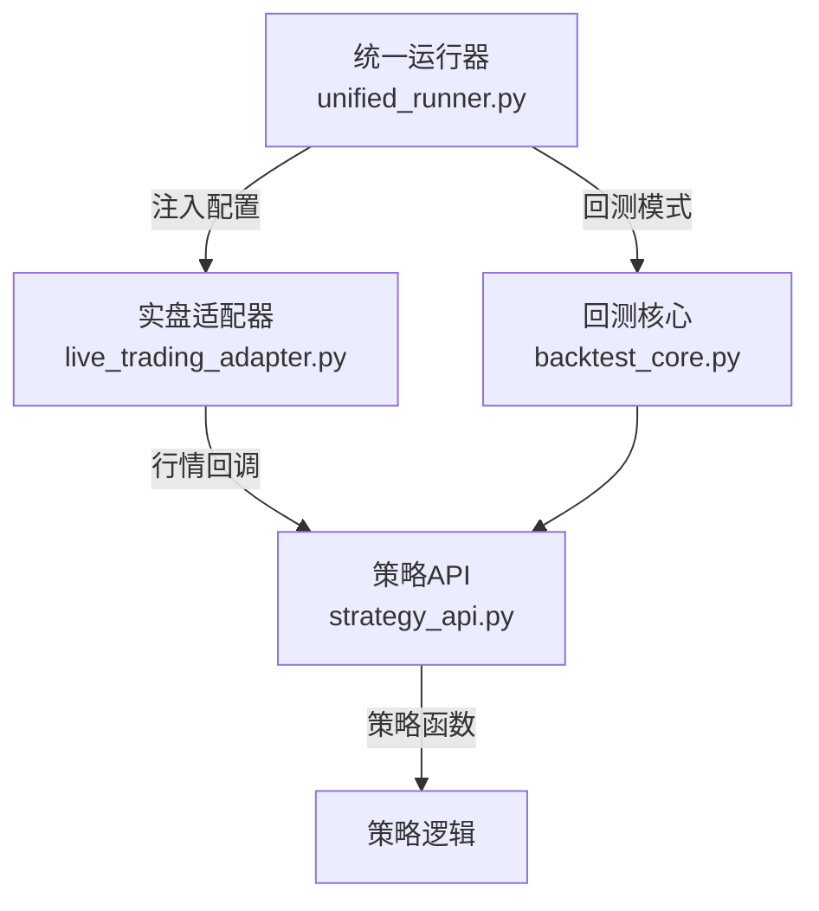
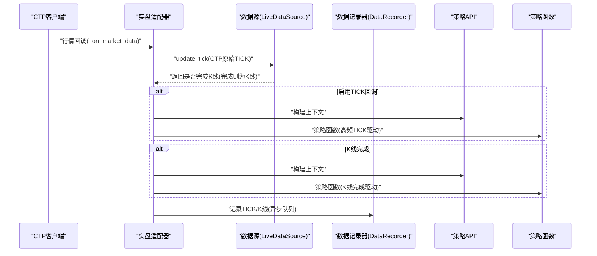
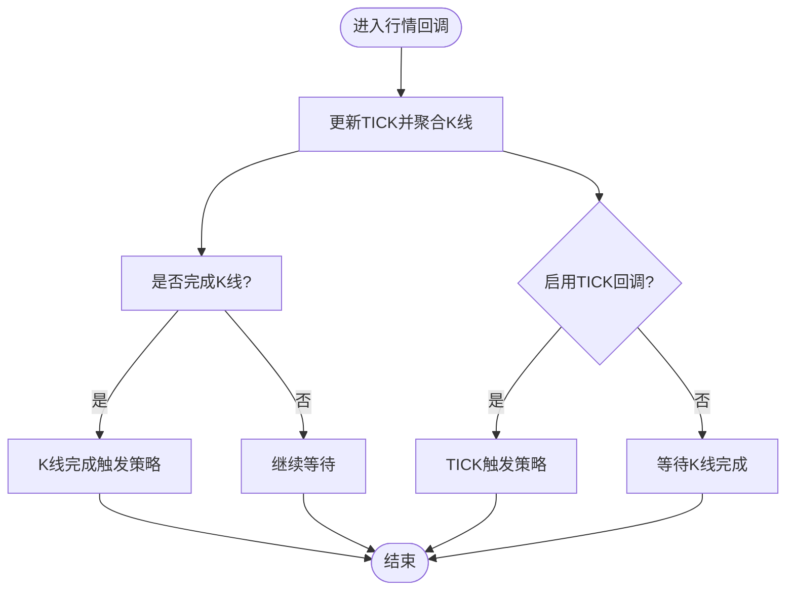
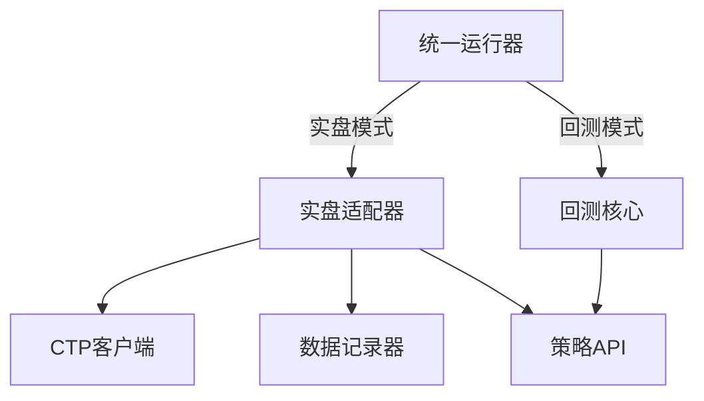

# 回调配置

<cite>
**本文引用的文件**
- [ssquant/backtest/unified_runner.py](file://ssquant/backtest/unified_runner.py)
- [ssquant/backtest/live_trading_adapter.py](file://ssquant/backtest/live_trading_adapter.py)
- [ssquant/api/strategy_api.py](file://ssquant/api/strategy_api.py)
- [ssquant/backtest/backtest_core.py](file://ssquant/backtest/backtest_core.py)
- [examples/A_穿透式测试脚本.py](file://examples/A_穿透式测试脚本.py)
- [examples/A_撤单重发示例.py](file://examples/A_撤单重发示例.py)
- [examples/B_双均线策略.py](file://examples/B_双均线策略.py)
</cite>

## 目录
1. [简介](#简介)
2. [项目结构](#项目结构)
3. [核心组件](#核心组件)
4. [架构总览](#架构总览)
5. [详细组件分析](#详细组件分析)
6. [依赖关系分析](#依赖关系分析)
7. [性能考量](#性能考量)
8. [故障排查指南](#故障排查指南)
9. [结论](#结论)
10. [附录](#附录)

## 简介
本文聚焦于SSQuant框架中的“回调配置”，尤其是TICK回调模式（enable_tick_callback）的配置与使用。我们将系统阐述：
- TICK回调的作用与适用场景
- 回调机制的工作原理（TICK流与K线完成双驱动）
- 实时行情推送的配置方法与性能影响
- 不同运行模式下的最佳实践
- 回调数据的处理方法与性能优化技巧

## 项目结构
围绕回调配置的关键模块与文件如下：
- 统一运行器：负责在回测、SIMNOW模拟与实盘之间切换，并注入回调参数
- 实盘适配器：封装CTP行情/交易回调，实现TICK流与K线完成的双驱动策略执行
- 策略API：为策略提供统一的数据访问与交易接口
- 回测核心：在回测模式下以K线驱动策略执行，不涉及TICK回调

图示来源
- [ssquant/backtest/unified_runner.py](file://ssquant/backtest/unified_runner.py#L162-L214)
- [ssquant/backtest/live_trading_adapter.py](file://ssquant/backtest/live_trading_adapter.py#L1127-L1246)
- [ssquant/backtest/backtest_core.py](file://ssquant/backtest/backtest_core.py#L144-L306)
- [ssquant/api/strategy_api.py](file://ssquant/api/strategy_api.py#L560-L570)

章节来源
- [ssquant/backtest/unified_runner.py](file://ssquant/backtest/unified_runner.py#L162-L214)
- [ssquant/backtest/live_trading_adapter.py](file://ssquant/backtest/live_trading_adapter.py#L1127-L1246)
- [ssquant/backtest/backtest_core.py](file://ssquant/backtest/backtest_core.py#L144-L306)
- [ssquant/api/strategy_api.py](file://ssquant/api/strategy_api.py#L560-L570)

## 核心组件
- 统一运行器（UnifiedStrategyRunner）
  - 支持回测、SIMNOW模拟、实盘三种模式
  - 在实盘模式下接收回调函数（成交、报单、撤单、错误、账户、持仓）
  - 通过配置项 enable_tick_callback 控制是否启用TICK回调驱动
- 实盘适配器（LiveTradingAdapter）
  - 初始化CTP客户端，注册行情与交易回调
  - 在行情回调中实现“TICK流 + K线完成”的双驱动策略执行
  - 支持多数据源（多品种/多周期），并为每个数据源维护独立的记录器
- 策略API（StrategyAPI）
  - 提供统一的数据访问接口（价格、K线、TICK、持仓等）
  - 在多数据源TICK流模式下，可通过 api.get_tick() 获取“触发当前策略执行”的TICK
- 回测核心（MultiSourceBacktester）
  - 以K线驱动策略执行，逐条推进数据，不涉及TICK回调
  - 适合指标计算与策略验证，不适合高频交易场景

章节来源
- [ssquant/backtest/unified_runner.py](file://ssquant/backtest/unified_runner.py#L162-L214)
- [ssquant/backtest/live_trading_adapter.py](file://ssquant/backtest/live_trading_adapter.py#L1127-L1246)
- [ssquant/api/strategy_api.py](file://ssquant/api/strategy_api.py#L493-L557)
- [ssquant/backtest/backtest_core.py](file://ssquant/backtest/backtest_core.py#L144-L306)

## 架构总览
下面的时序图展示了实盘模式下，行情回调如何触发策略执行（含TICK流与K线完成双驱动）。

图示来源
- [ssquant/backtest/live_trading_adapter.py](file://ssquant/backtest/live_trading_adapter.py#L1507-L1574)
- [ssquant/backtest/live_trading_adapter.py](file://ssquant/backtest/live_trading_adapter.py#L1240-L1246)
- [ssquant/backtest/live_trading_adapter.py](file://ssquant/backtest/live_trading_adapter.py#L1530-L1547)

章节来源
- [ssquant/backtest/live_trading_adapter.py](file://ssquant/backtest/live_trading_adapter.py#L1507-L1574)
- [ssquant/backtest/live_trading_adapter.py](file://ssquant/backtest/live_trading_adapter.py#L1240-L1246)

## 详细组件分析

### 组件A：TICK回调配置（enable_tick_callback）
- 作用
  - 控制是否启用“TICK流驱动”的策略执行模式
  - 启用后：每个TICK到达即触发策略执行；同时若K线完成也会触发策略
  - 关闭后：仅在K线完成时触发策略（K线驱动）
- 使用场景
  - 高频策略（如网格、Tick级择时、算法交易）
  - 需要精确把握瞬时行情的策略
  - 需要基于最新TICK字段进行决策的场景
- 配置入口
  - 在统一运行器的配置字典中设置 enable_tick_callback
  - 实盘模式下，实盘适配器读取该配置并生效

章节来源
- [ssquant/backtest/unified_runner.py](file://ssquant/backtest/unified_runner.py#L162-L214)
- [ssquant/backtest/live_trading_adapter.py](file://ssquant/backtest/live_trading_adapter.py#L1240-L1246)
- [examples/A_穿透式测试脚本.py](file://examples/A_穿透式测试脚本.py#L146-L172)
- [examples/A_撤单重发示例.py](file://examples/A_撤单重发示例.py#L339-L370)
- [examples/B_双均线策略.py](file://examples/B_双均线策略.py#L192-L228)

### 组件B：回调机制工作原理（TICK流与K线完成双驱动）
- 行情回调处理
  - 实盘适配器在行情回调中更新数据源的TICK与K线聚合状态
  - 为每个品种维护独立的记录器，实现TICK/K线异步落盘
- 双驱动策略执行
  - 若启用TICK回调：每个TICK到达即执行策略
  - 若关闭TICK回调：仅在K线完成时执行策略
- 多数据源支持
  - 在多数据源模式下，策略API通过 _current_tick 与 _current_tick_symbol 标识“触发当前策略执行”的TICK，便于区分多品种

图示来源
- [ssquant/backtest/live_trading_adapter.py](file://ssquant/backtest/live_trading_adapter.py#L1507-L1574)

章节来源
- [ssquant/backtest/live_trading_adapter.py](file://ssquant/backtest/live_trading_adapter.py#L1507-L1574)

### 组件C：实时行情推送配置方法
- 实盘模式配置要点
  - 设置 enable_tick_callback 控制回调模式
  - 配置订阅列表（单数据源或多数据源）
  - 配置数据保存（TICK/K线CSV/DB，异步队列写入）
- 回调函数注入
  - 在统一运行器的 run 方法中传入 on_trade、on_order、on_cancel、on_order_error、on_cancel_error、on_account、on_position 等回调
  - 实盘适配器在初始化CTP客户端时绑定这些回调

章节来源
- [ssquant/backtest/unified_runner.py](file://ssquant/backtest/unified_runner.py#L162-L214)
- [ssquant/backtest/live_trading_adapter.py](file://ssquant/backtest/live_trading_adapter.py#L1410-L1459)

### 组件D：策略API与TICK数据访问
- 在多数据源TICK流模式下，策略API通过 get_tick() 返回“触发当前策略执行”的TICK，便于策略针对具体品种进行决策
- 在回测模式下，策略执行由K线驱动，不涉及TICK回调

章节来源
- [ssquant/api/strategy_api.py](file://ssquant/api/strategy_api.py#L493-L557)
- [ssquant/backtest/backtest_core.py](file://ssquant/backtest/backtest_core.py#L240-L287)

## 依赖关系分析
- 统一运行器依赖实盘适配器（实盘模式）或回测核心（回测模式）
- 实盘适配器依赖CTP客户端与数据记录器
- 策略API贯穿所有模式，提供统一接口
- 回测核心在回测模式下以K线驱动策略执行，不依赖TICK回调

图示来源
- [ssquant/backtest/unified_runner.py](file://ssquant/backtest/unified_runner.py#L162-L214)
- [ssquant/backtest/live_trading_adapter.py](file://ssquant/backtest/live_trading_adapter.py#L1127-L1246)
- [ssquant/backtest/backtest_core.py](file://ssquant/backtest/backtest_core.py#L144-L306)

章节来源
- [ssquant/backtest/unified_runner.py](file://ssquant/backtest/unified_runner.py#L162-L214)
- [ssquant/backtest/live_trading_adapter.py](file://ssquant/backtest/live_trading_adapter.py#L1127-L1246)
- [ssquant/backtest/backtest_core.py](file://ssquant/backtest/backtest_core.py#L144-L306)

## 性能考量
- TICK回调的性能影响
  - 启用TICK回调会显著增加策略函数的调用频率，带来更高的CPU占用与内存压力
  - 适用于高频策略；对于低频策略（如日线/小时线）应关闭以降低开销
- 异步数据落盘
  - 数据记录器采用类级别共享队列与后台线程，避免阻塞行情回调
  - 建议合理配置保存开关（save_tick_csv/save_tick_db/save_kline_csv/save_kline_db），避免磁盘IO成为瓶颈
- 多数据源与多周期
  - 多数据源模式下，每个数据源独立维护记录器，注意资源占用与磁盘空间
  - K线周期与复权类型会影响数据库表命名与写入开销

章节来源
- [ssquant/backtest/live_trading_adapter.py](file://ssquant/backtest/live_trading_adapter.py#L26-L184)
- [ssquant/backtest/live_trading_adapter.py](file://ssquant/backtest/live_trading_adapter.py#L1240-L1246)

## 故障排查指南
- 回调未触发
  - 检查 enable_tick_callback 配置是否正确
  - 确认CTP客户端已成功连接并注册回调
- 策略执行异常
  - 查看策略执行错误日志，定位异常点
  - 在多数据源模式下，确认 _current_tick 与 _current_tick_symbol 是否正确设置
- 数据落盘问题
  - 检查数据记录器的保存开关与路径配置
  - 确认后台写入线程正常运行，必要时手动停止并重启

章节来源
- [ssquant/backtest/live_trading_adapter.py](file://ssquant/backtest/live_trading_adapter.py#L1507-L1574)
- [ssquant/backtest/live_trading_adapter.py](file://ssquant/backtest/live_trading_adapter.py#L106-L112)

## 结论
- enable_tick_callback 是实盘模式下控制策略执行频率的核心配置
- TICK回调适合高频策略，但需关注性能与资源消耗
- 实盘适配器通过“TICK流 + K线完成”双驱动，兼顾实时性与稳定性
- 回测模式以K线驱动策略执行，不涉及TICK回调，适合指标验证与策略验证

## 附录

### 不同运行模式下的回调设置建议
- 回测模式
  - 不涉及TICK回调；策略以K线驱动执行
  - 建议关闭enable_tick_callback（无意义）
- SIMNOW模拟
  - 可根据策略需求选择是否启用TICK回调
  - 建议在高频策略中启用，低频策略中关闭
- 实盘模式
  - 高频策略建议启用TICK回调
  - 注意性能与资源开销，合理配置数据保存

章节来源
- [ssquant/backtest/unified_runner.py](file://ssquant/backtest/unified_runner.py#L162-L214)
- [ssquant/backtest/live_trading_adapter.py](file://ssquant/backtest/live_trading_adapter.py#L1240-L1246)
- [examples/A_穿透式测试脚本.py](file://examples/A_穿透式测试脚本.py#L146-L172)
- [examples/A_撤单重发示例.py](file://examples/A_撤单重发示例.py#L339-L370)
- [examples/B_双均线策略.py](file://examples/B_双均线策略.py#L192-L228)