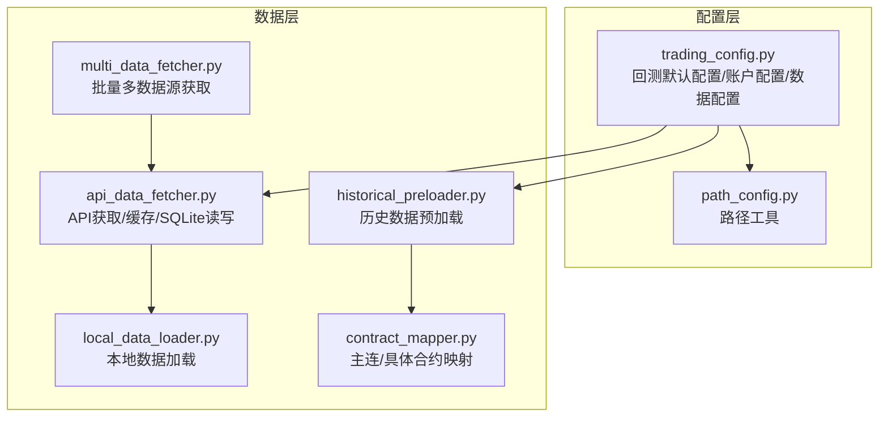
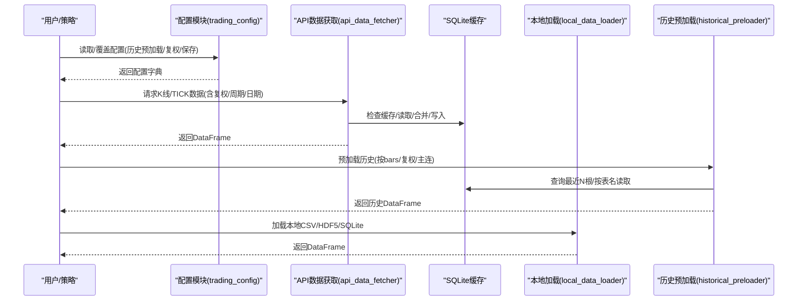
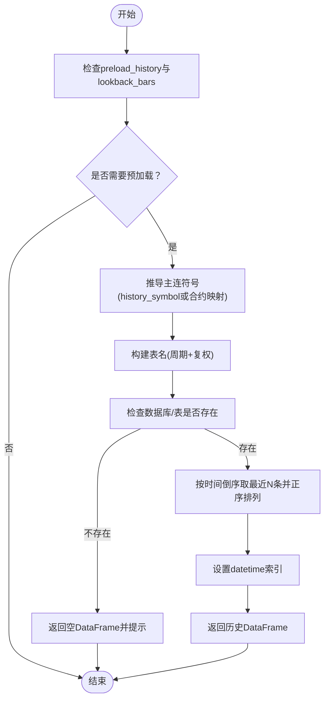
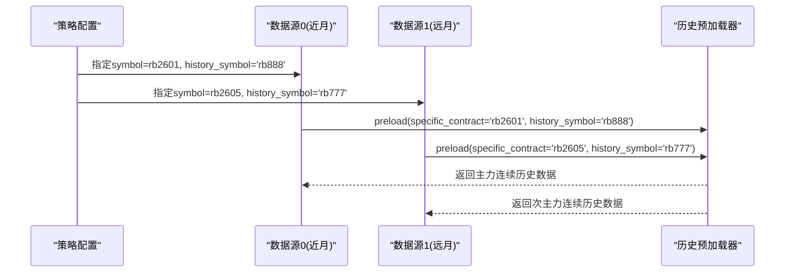
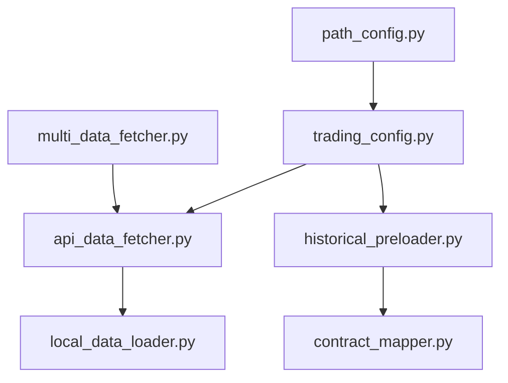

# 数据配置

<cite>
**本文引用的文件**
- [ssquant/config/trading_config.py](file://ssquant/config/trading_config.py)
- [ssquant/data/historical_preloader.py](file://ssquant/data/historical_preloader.py)
- [ssquant/data/api_data_fetcher.py](file://ssquant/data/api_data_fetcher.py)
- [ssquant/data/local_data_loader.py](file://ssquant/data/local_data_loader.py)
- [ssquant/data/contract_mapper.py](file://ssquant/data/contract_mapper.py)
- [ssquant/data/multi_data_fetcher.py](file://ssquant/data/multi_data_fetcher.py)
- [ssquant/config/path_config.py](file://ssquant/config/path_config.py)
- [examples/B_跨期套利策略.py](file://examples/B_跨期套利策略.py)
- [examples/B_多品种多周期交易策略.py](file://examples/B_多品种多周期交易策略.py)
</cite>

## 目录
1. [简介](#简介)
2. [项目结构](#项目结构)
3. [核心组件](#核心组件)
4. [架构总览](#架构总览)
5. [详细组件分析](#详细组件分析)
6. [依赖分析](#依赖分析)
7. [性能考量](#性能考量)
8. [故障排查指南](#故障排查指南)
9. [结论](#结论)
10. [附录](#附录)

## 简介
本章节面向SSQuant项目的数据配置，围绕以下主题展开：历史数据预加载配置（preload_history、history_lookback_bars）、复权类型设置（adjust_type）、数据保存配置（save_kline_csv、save_kline_db、save_tick_csv、save_tick_db）、数据路径配置（data_save_path、db_path）、跨期套利的数据源指定方法（history_symbol）。同时提供最佳实践建议，帮助在大数据量场景下高效处理与存储。

## 项目结构
SSQuant的数据配置主要分布在配置模块与数据模块中：
- 配置层：trading_config.py 定义回测默认配置、账户配置、数据配置与路径配置；path_config.py 提供项目根目录与缓存目录等路径工具。
- 数据层：api_data_fetcher.py 提供从API获取K线/TICK数据、缓存与SQLite读写；historical_preloader.py 提供实盘/SIMNOW模式的历史数据预加载；local_data_loader.py 提供本地CSV/HDF5/SQLite/TXT等格式数据加载；multi_data_fetcher.py 提供批量多数据源获取；contract_mapper.py 提供主连与具体合约映射。

图表来源
- [ssquant/config/trading_config.py](file://ssquant/config/trading_config.py#L15-L110)
- [ssquant/config/path_config.py](file://ssquant/config/path_config.py#L10-L30)
- [ssquant/data/api_data_fetcher.py](file://ssquant/data/api_data_fetcher.py#L171-L626)
- [ssquant/data/historical_preloader.py](file://ssquant/data/historical_preloader.py#L11-L133)
- [ssquant/data/local_data_loader.py](file://ssquant/data/local_data_loader.py#L5-L174)
- [ssquant/data/multi_data_fetcher.py](file://ssquant/data/multi_data_fetcher.py#L4-L76)
- [ssquant/data/contract_mapper.py](file://ssquant/data/contract_mapper.py#L66-L94)

章节来源
- [ssquant/config/trading_config.py](file://ssquant/config/trading_config.py#L15-L110)
- [ssquant/config/path_config.py](file://ssquant/config/path_config.py#L10-L30)

## 核心组件
- 历史数据预加载器：负责在实盘/SIMNOW模式启动时，按需从SQLite数据库读取历史K线/TICK数据，支持复权类型与主连符号推导。
- API数据获取器：负责从外部API拉取K线/TICK数据，具备缓存、交易日校验、时区转换、重复数据处理与SQLite持久化能力。
- 本地数据加载器：支持CSV/HDF5/SQLite/7z等多种格式，自动校验字段并按日期范围筛选。
- 合约映射器：提供主连符号（如rb888）与具体合约（如rb2601）之间的映射，用于历史数据表名推导与跨期套利。
- 批量数据获取器：支持多品种、多周期、多复权类型的批量数据抓取与汇总。
- 配置与路径：统一管理回测默认配置、账户配置、数据配置、路径配置与缓存目录。

章节来源
- [ssquant/data/historical_preloader.py](file://ssquant/data/historical_preloader.py#L11-L133)
- [ssquant/data/api_data_fetcher.py](file://ssquant/data/api_data_fetcher.py#L171-L626)
- [ssquant/data/local_data_loader.py](file://ssquant/data/local_data_loader.py#L5-L174)
- [ssquant/data/contract_mapper.py](file://ssquant/data/contract_mapper.py#L66-L94)
- [ssquant/data/multi_data_fetcher.py](file://ssquant/data/multi_data_fetcher.py#L4-L76)
- [ssquant/config/trading_config.py](file://ssquant/config/trading_config.py#L15-L110)
- [ssquant/config/path_config.py](file://ssquant/config/path_config.py#L10-L30)

## 架构总览
SSQuant的数据配置贯穿“配置—获取—缓存—加载—预加载”全链路，如下图所示：

图表来源
- [ssquant/config/trading_config.py](file://ssquant/config/trading_config.py#L115-L164)
- [ssquant/data/api_data_fetcher.py](file://ssquant/data/api_data_fetcher.py#L171-L626)
- [ssquant/data/historical_preloader.py](file://ssquant/data/historical_preloader.py#L23-L133)
- [ssquant/data/local_data_loader.py](file://ssquant/data/local_data_loader.py#L5-L174)

## 详细组件分析

### 历史数据预加载配置（preload_history、history_lookback_bars）
- preload_history：控制是否在实盘/SIMNOW模式启动时预加载历史数据。
- history_lookback_bars：控制预加载的历史K线条数，决定回看窗口大小。
- 预加载流程要点：
  - 依据history_symbol或合约映射推导主连符号（如rb888）。
  - 根据周期与复权类型构造表名（K线：{symbol}_{period}_{hfq|raw}；TICK：{symbol}_tick）。
  - 从SQLite数据库按时间倒序取最近N条，再正序排列，确保索引为datetime。
  - 若数据库或表不存在，返回空DataFrame并给出提示。

图表来源
- [ssquant/data/historical_preloader.py](file://ssquant/data/historical_preloader.py#L23-L133)
- [ssquant/data/contract_mapper.py](file://ssquant/data/contract_mapper.py#L66-L94)

章节来源
- [ssquant/data/historical_preloader.py](file://ssquant/data/historical_preloader.py#L23-L133)
- [ssquant/data/contract_mapper.py](file://ssquant/data/contract_mapper.py#L66-L94)

### 复权类型设置（adjust_type）
- 支持'0'（不复权）与'1'（后复权）两种类型。
- 影响表名后缀：'1'对应'hfq'，'0'对应'raw'。
- 在API获取与本地加载时均需保持一致，否则预加载会提示不一致并返回空数据。

章节来源
- [ssquant/data/historical_preloader.py](file://ssquant/data/historical_preloader.py#L52-L56)
- [ssquant/data/api_data_fetcher.py](file://ssquant/data/api_data_fetcher.py#L810-L823)
- [ssquant/data/local_data_loader.py](file://ssquant/data/local_data_loader.py#L68-L96)

### 数据保存配置（save_kline_csv、save_kline_db、save_tick_csv、save_tick_db）
- save_kline_csv/save_tick_csv：是否将K线/TICK数据保存为CSV文件（路径由data_save_path指定）。
- save_kline_db/save_tick_db：是否将K线/TICK数据保存到SQLite数据库（路径由db_path指定）。
- 保存行为通常发生在API获取数据时，若use_cache或save_data为True则写入SQLite；也可通过本地加载器读取本地文件。

章节来源
- [ssquant/config/trading_config.py](file://ssquant/config/trading_config.py#L61-L67)
- [ssquant/config/trading_config.py](file://ssquant/config/trading_config.py#L102-L108)
- [ssquant/data/api_data_fetcher.py](file://ssquant/data/api_data_fetcher.py#L825-L888)
- [ssquant/data/local_data_loader.py](file://ssquant/data/local_data_loader.py#L5-L22)

### 数据路径配置（data_save_path、db_path）
- data_save_path：CSV文件保存路径（默认'./live_data'）。
- db_path：SQLite数据库路径（默认'data_cache/backtest_data.db'）。
- 路径工具：提供项目根目录、缓存目录、回测结果目录、回测日志目录等统一管理。

章节来源
- [ssquant/config/trading_config.py](file://ssquant/config/trading_config.py#L66-L67)
- [ssquant/config/trading_config.py](file://ssquant/config/trading_config.py#L107-L108)
- [ssquant/config/path_config.py](file://ssquant/config/path_config.py#L10-L30)

### 跨期套利的数据源指定（history_symbol）
- 在跨期套利策略中，可通过data_sources中每个数据源的history_symbol明确指定历史数据来源：
  - 主力连续：'rb888'
  - 次主力连续：'rb777'
- 预加载器会据此推导表名并读取对应主连的历史数据。

图表来源
- [examples/B_跨期套利策略.py](file://examples/B_跨期套利策略.py#L233-L266)
- [ssquant/data/historical_preloader.py](file://ssquant/data/historical_preloader.py#L23-L66)

章节来源
- [examples/B_跨期套利策略.py](file://examples/B_跨期套利策略.py#L233-L266)
- [ssquant/data/historical_preloader.py](file://ssquant/data/historical_preloader.py#L42-L48)

### API数据获取与缓存机制
- 交易日历：基于akshare或基本规则生成交易日历，确保请求日期落在交易日范围内。
- 缓存策略：优先读取SQLite缓存，若缓存不完全覆盖请求范围，则分段从API获取并合并，最后写回缓存。
- 时区与时序：API返回的datetime统一转换为北京时间并去除时区，分钟/小时周期的K线时间会向前回拨以对齐K线开始时间。
- 错误处理：对认证失败、服务器错误、单日请求扩展、日期越界等情况进行提示与降级处理。

章节来源
- [ssquant/data/api_data_fetcher.py](file://ssquant/data/api_data_fetcher.py#L18-L169)
- [ssquant/data/api_data_fetcher.py](file://ssquant/data/api_data_fetcher.py#L171-L626)
- [ssquant/data/api_data_fetcher.py](file://ssquant/data/api_data_fetcher.py#L810-L888)

### 本地数据加载与日期筛选
- 支持CSV/HDF5/SQLite/7z格式，自动校验字段（K线必须包含datetime/open/high/low/close；TICK必须包含datetime与价格字段）。
- 支持按start_date/end_date进行日期范围筛选，输出筛选前后统计信息。

章节来源
- [ssquant/data/local_data_loader.py](file://ssquant/data/local_data_loader.py#L5-L174)

### 批量多数据源获取
- 支持多品种、多周期、多复权类型的批量数据抓取，自动汇总为字典并可导出CSV。

章节来源
- [ssquant/data/multi_data_fetcher.py](file://ssquant/data/multi_data_fetcher.py#L4-L76)

## 依赖分析
- 配置模块依赖运行模式与账户配置，提供回测默认值与账户模板。
- 历史预加载器依赖合约映射器推导主连符号，并依赖SQLite数据库读写。
- API数据获取器依赖交易日历、SQLite读写与网络请求。
- 本地加载器依赖SQLite读写与多种文件格式解析。
- 批量数据获取器依赖API数据获取器。

图表来源
- [ssquant/config/trading_config.py](file://ssquant/config/trading_config.py#L115-L164)
- [ssquant/data/historical_preloader.py](file://ssquant/data/historical_preloader.py#L40-L48)
- [ssquant/data/api_data_fetcher.py](file://ssquant/data/api_data_fetcher.py#L171-L626)
- [ssquant/data/local_data_loader.py](file://ssquant/data/local_data_loader.py#L5-L174)
- [ssquant/data/multi_data_fetcher.py](file://ssquant/data/multi_data_fetcher.py#L4-L76)
- [ssquant/config/path_config.py](file://ssquant/config/path_config.py#L10-L30)

章节来源
- [ssquant/config/trading_config.py](file://ssquant/config/trading_config.py#L115-L164)
- [ssquant/data/historical_preloader.py](file://ssquant/data/historical_preloader.py#L40-L48)
- [ssquant/data/api_data_fetcher.py](file://ssquant/data/api_data_fetcher.py#L171-L626)
- [ssquant/data/local_data_loader.py](file://ssquant/data/local_data_loader.py#L5-L174)
- [ssquant/data/multi_data_fetcher.py](file://ssquant/data/multi_data_fetcher.py#L4-L76)
- [ssquant/config/path_config.py](file://ssquant/config/path_config.py#L10-L30)

## 性能考量
- 大数据量处理
  - 使用历史预加载时，合理设置history_lookback_bars，避免一次性加载过多K线导致内存压力。
  - 对TICK数据，建议分批加载与分页查询，避免单次读取过大。
- 存储优化
  - SQLite写入采用事务与去重策略，尽量减少重复写入与磁盘碎片。
  - 缓存策略优先使用现有缓存，仅在缺失范围内增量获取，降低网络与数据库压力。
- 复权一致性
  - 回测与实盘/模拟的复权类型需保持一致，避免预加载提示不一致并返回空数据。
- 日期范围与交易日
  - 使用交易日历自动过滤非交易日，减少无效数据请求与存储。

[本节为通用指导，不直接分析具体文件]

## 故障排查指南
- 预加载返回空数据
  - 检查db_path是否存在与表名是否正确（周期+复权后缀）。
  - 确认adjust_type与回测时一致。
  - 检查history_symbol是否正确，或是否应使用合约映射推导的主连符号。
- TICK数据无法读取
  - 确认已通过SIMNOW模式采集TICK数据并开启save_tick_db。
  - 检查数据库中是否存在{symbol}_tick表。
- API获取失败
  - 检查用户名/密码是否正确，关注认证错误与服务器内部错误。
  - 检查请求日期范围是否仅包含非交易日，必要时扩展日期范围。
- 本地加载报错
  - 确认文件格式与必需字段（K线/价格字段/TICK字段）齐全。
  - 检查日期范围筛选是否导致结果为空。

章节来源
- [ssquant/data/historical_preloader.py](file://ssquant/data/historical_preloader.py#L67-L132)
- [ssquant/data/api_data_fetcher.py](file://ssquant/data/api_data_fetcher.py#L206-L263)
- [ssquant/data/local_data_loader.py](file://ssquant/data/local_data_loader.py#L144-L174)

## 结论
SSQuant的数据配置围绕“预加载—复权—缓存—加载—路径”形成闭环：通过trading_config集中管理配置，api_data_fetcher提供可靠的缓存与网络获取，historical_preloader保障实盘/SIMNOW启动时的历史数据可用性，contract_mapper确保主连与具体合约映射正确，local_data_loader与multi_data_fetcher完善本地与批量数据处理。遵循本文的最佳实践，可在保证数据一致性的同时提升大数据量场景下的处理效率与稳定性。

[本节为总结性内容，不直接分析具体文件]

## 附录
- 示例策略展示了跨期套利与多品种多周期场景下的数据配置用法，可作为实际部署参考。

章节来源
- [examples/B_跨期套利策略.py](file://examples/B_跨期套利策略.py#L233-L266)
- [examples/B_多品种多周期交易策略.py](file://examples/B_多品种多周期交易策略.py#L329-L390)