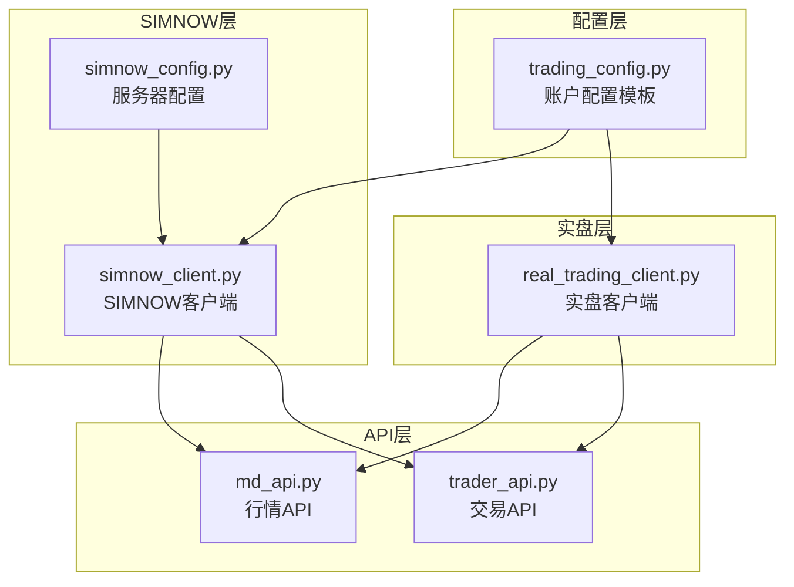
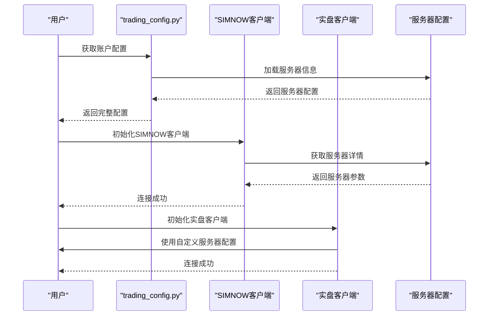
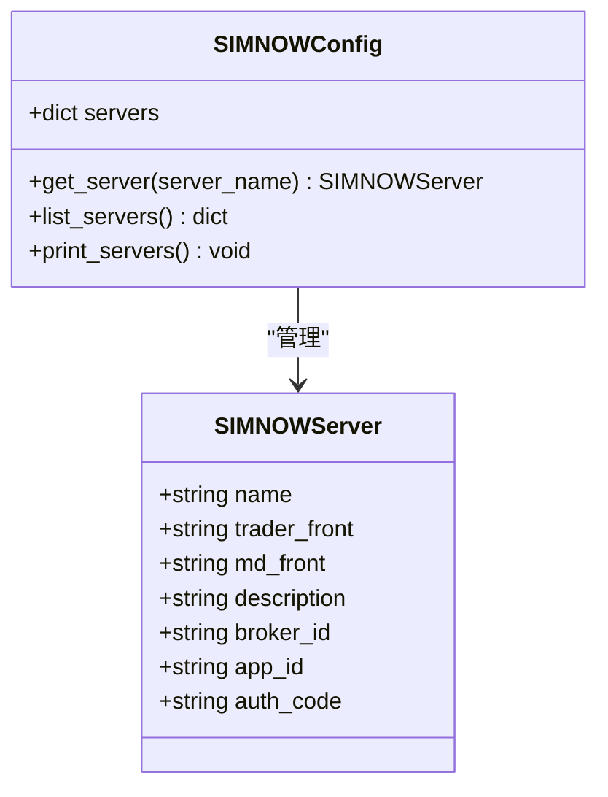
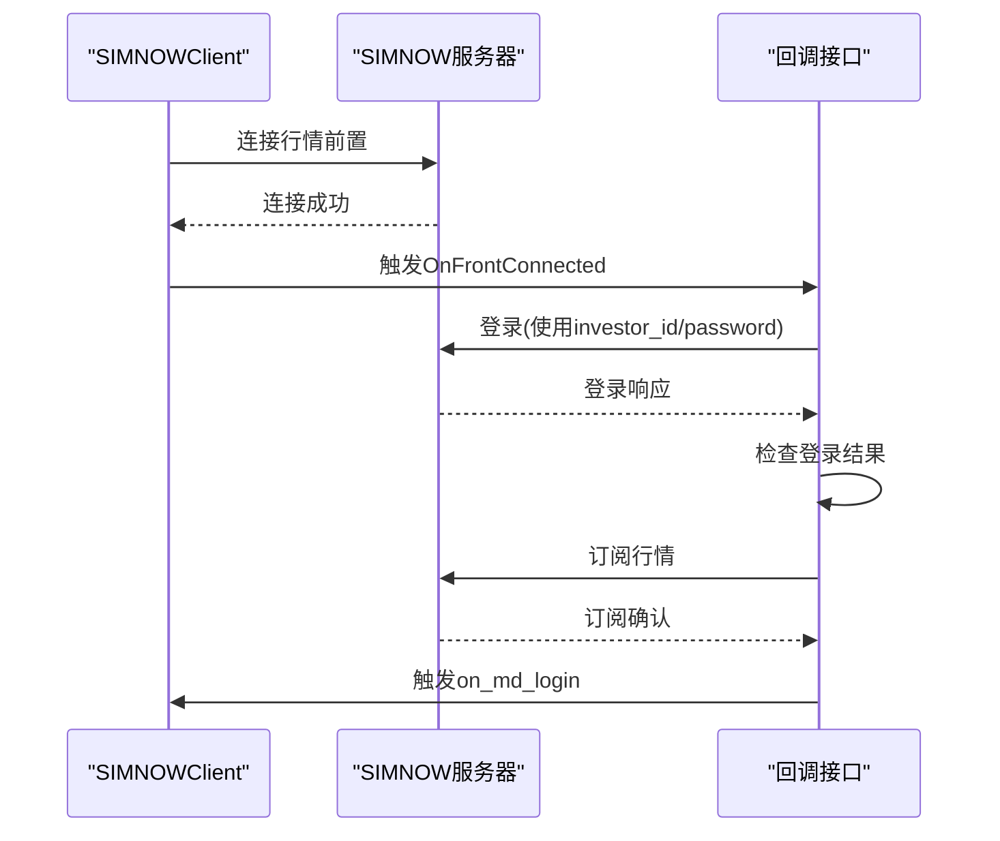
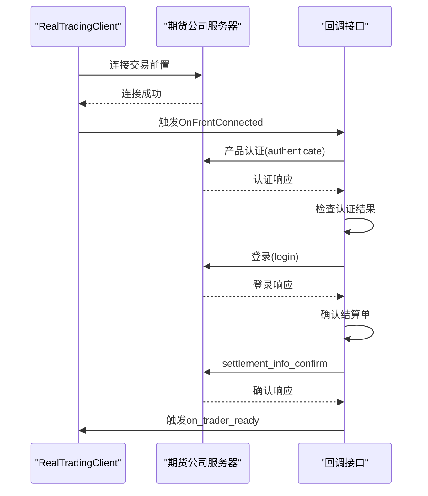
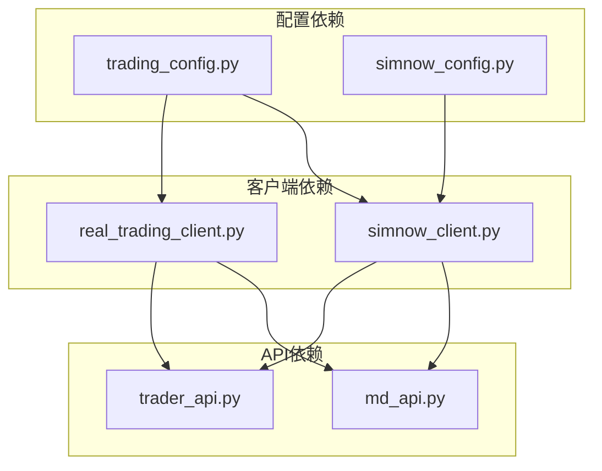
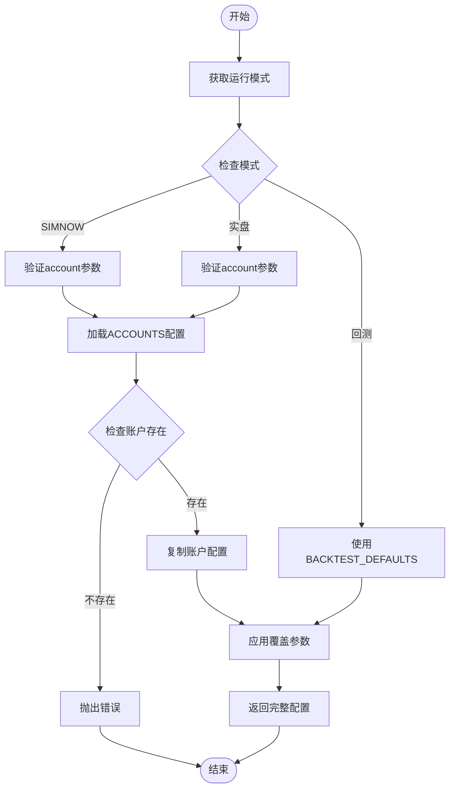
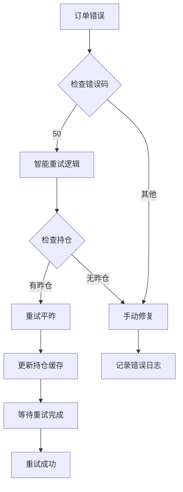

# 账户配置

<cite>
**本文引用的文件**
- [simnow_config.py](file://ssquant/pyctp/simnow_config.py)
- [trading_config.py](file://ssquant/config/trading_config.py)
- [simnow_client.py](file://ssquant/pyctp/simnow_client.py)
- [real_trading_client.py](file://ssquant/pyctp/real_trading_client.py)
- [md_api.py](file://ssquant/pyctp/md_api.py)
- [trader_api.py](file://ssquant/pyctp/trader_api.py)
- [B_双均线策略.py](file://examples/B_双均线策略.py)
- [README.md](file://README.md)
</cite>

## 目录
1. [简介](#简介)
2. [项目结构](#项目结构)
3. [核心组件](#核心组件)
4. [架构概览](#架构概览)
5. [详细组件分析](#详细组件分析)
6. [依赖关系分析](#依赖关系分析)
7. [性能考虑](#性能考虑)
8. [故障排除指南](#故障排除指南)
9. [结论](#结论)

## 简介
本文档详细说明SSQuant框架中的账户配置，重点涵盖SIMNOW模拟账户和实盘账户的配置参数。我们将解释认证信息（investor_id、password、broker_id等）、交易参数（kline_period、price_tick、order_offset_ticks）、智能算法交易配置（algo_trading、order_timeout、retry_limit）以及账户切换方法和最佳实践。

## 项目结构
SSQuant采用分层架构设计，账户配置主要涉及以下模块：
- 配置层：trading_config.py定义账户模板和默认配置
- SIMNOW层：simnow_config.py提供服务器配置，simnow_client.py实现SIMNOW客户端
- 实盘层：real_trading_client.py实现实盘客户端
- API层：md_api.py和trader_api.py封装CTP接口

**图表来源**
- [trading_config.py](file://ssquant/config/trading_config.py#L29-L110)
- [simnow_config.py](file://ssquant/pyctp/simnow_config.py#L24-L160)
- [simnow_client.py](file://ssquant/pyctp/simnow_client.py#L590-L815)
- [real_trading_client.py](file://ssquant/pyctp/real_trading_client.py#L538-L755)

**章节来源**
- [trading_config.py](file://ssquant/config/trading_config.py#L1-L187)
- [simnow_config.py](file://ssquant/pyctp/simnow_config.py#L1-L160)

## 核心组件
SSQuant账户配置的核心组件包括：

### 账户配置模板
框架提供了两个主要的账户配置模板：
- SIMNOW模拟账户模板：用于模拟交易环境
- 实盘账户模板：用于真实市场交易

### 服务器配置
SIMNOW提供多种服务器选择，包括电信1、电信2、移动、TEST、N视界和24小时环境等。

### 交易参数
关键交易参数包括：
- kline_period：K线周期（'1m','5m','15m','30m','1h','1d'）
- price_tick：最小变动价位
- order_offset_ticks：委托价格偏移跳数

### 智能算法交易配置
智能算法交易提供高级功能：
- algo_trading：是否启用算法交易
- order_timeout：订单超时时间（秒）
- retry_limit：最大重试次数
- retry_offset_ticks：重试时的超价跳数

**章节来源**
- [trading_config.py](file://ssquant/config/trading_config.py#L29-L110)
- [simnow_config.py](file://ssquant/pyctp/simnow_config.py#L127-L152)

## 架构概览
SSQuant的账户配置架构采用分层设计，确保配置的灵活性和可扩展性：

**图表来源**
- [trading_config.py](file://ssquant/config/trading_config.py#L115-L164)
- [simnow_config.py](file://ssquant/pyctp/simnow_config.py#L97-L135)
- [simnow_client.py](file://ssquant/pyctp/simnow_client.py#L590-L684)

## 详细组件分析

### SIMNOW模拟账户配置

#### 配置参数详解
SIMNOW模拟账户的完整配置包括以下字段：

| 参数名称 | 类型 | 必填 | 描述 | 默认值 |
|---------|------|------|------|--------|
| investor_id | string | 是 | SIMNOW账号 | 空字符串 |
| password | string | 是 | SIMNOW密码 | 空字符串 |
| server_name | string | 是 | 服务器选择 | '24hour' |
| subscribe_list | list | 否 | 订阅合约列表 | [] |
| md_flow_path | string | 否 | 行情流文件路径 | 'simnow_md_flow/' |
| td_flow_path | string | 否 | 交易流文件路径 | 'simnow_td_flow/' |

#### 服务器配置
SIMNOW提供多种服务器选择：

**图表来源**
- [simnow_config.py](file://ssquant/pyctp/simnow_config.py#L12-L95)

#### 认证流程
SIMNOW客户端的认证流程如下：

**图表来源**
- [simnow_client.py](file://ssquant/pyctp/simnow_client.py#L19-L74)

**章节来源**
- [simnow_config.py](file://ssquant/pyctp/simnow_config.py#L127-L135)
- [simnow_client.py](file://ssquant/pyctp/simnow_client.py#L590-L684)

### 实盘账户配置

#### 配置参数详解
实盘账户的完整配置包括：

| 参数名称 | 类型 | 必填 | 描述 | 示例值 |
|---------|------|------|------|--------|
| broker_id | string | 是 | 期货公司代码 | '9999' |
| investor_id | string | 是 | 资金账号 | '123456789' |
| password | string | 是 | 交易密码 | 'password' |
| md_server | string | 是 | 行情服务器地址 | 'tcp://180.168.146.187:10211' |
| td_server | string | 是 | 交易服务器地址 | 'tcp://180.168.146.187:10201' |
| app_id | string | 是 | 应用ID | 'your_app_id' |
| auth_code | string | 是 | 授权码 | 'your_auth_code' |
| subscribe_list | list | 否 | 订阅合约列表 | ['au2602'] |
| md_flow_path | string | 否 | 行情流文件路径 | 'real_md_flow/' |
| td_flow_path | string | 否 | 交易流文件路径 | 'real_td_flow/' |

#### 认证流程
实盘客户端的认证流程更加复杂，包含产品认证步骤：

**图表来源**
- [real_trading_client.py](file://ssquant/pyctp/real_trading_client.py#L114-L196)

**章节来源**
- [real_trading_client.py](file://ssquant/pyctp/real_trading_client.py#L538-L658)

### 交易参数配置

#### K线周期配置
支持的K线周期包括：
- '1m'：1分钟
- '5m'：5分钟  
- '15m'：15分钟
- '30m'：30分钟
- '1h'：1小时
- '1d'：1天

#### 价格跳数配置
价格跳数配置影响订单的成交概率：
- 正值：超价下单，提高成交概率
- 负值：低于市价，可能影响成交
- 0值：按市价下单

#### 智能算法交易配置
智能算法交易提供以下功能：
- 自动超时撤单：防止订单长时间挂单
- 智能重试：平今失败时自动尝试平昨
- 追价机制：在重试时使用更激进的价格

**章节来源**
- [trading_config.py](file://ssquant/config/trading_config.py#L40-L49)
- [simnow_client.py](file://ssquant/pyctp/simnow_client.py#L312-L343)

## 依赖关系分析

### 组件依赖图

**图表来源**
- [trading_config.py](file://ssquant/config/trading_config.py#L1-L20)
- [simnow_client.py](file://ssquant/pyctp/simnow_client.py#L14-L16)
- [real_trading_client.py](file://ssquant/pyctp/real_trading_client.py#L14-L15)

### 配置获取流程

**图表来源**
- [trading_config.py](file://ssquant/config/trading_config.py#L115-L164)

**章节来源**
- [trading_config.py](file://ssquant/config/trading_config.py#L115-L164)

## 性能考虑
在账户配置和交易过程中，需要考虑以下性能因素：

### 服务器选择
- **网络延迟**：选择地理位置接近的服务器可减少延迟
- **带宽限制**：高并发时注意服务器带宽限制
- **稳定性**：24小时环境适合长时间测试

### 订单执行效率
- **价格跳数**：合理的超价跳数平衡成交速度和成本
- **重试机制**：智能重试避免不必要的订单积压
- **超时控制**：设置合适的超时时间防止长时间挂单

### 资源管理
- **流文件管理**：合理设置流文件路径避免磁盘空间不足
- **连接池**：复用连接减少资源消耗
- **内存管理**：及时清理不再使用的数据结构

## 故障排除指南

### 常见配置错误
1. **账户不存在**：检查trading_config.py中的ACCOUNTS配置
2. **服务器配置错误**：验证server_name是否在SIMNOWConfig中
3. **认证失败**：检查investor_id、password、app_id、auth_code
4. **网络连接问题**：确认防火墙设置和网络连通性

### 错误处理机制
框架提供了完善的错误处理机制：

**图表来源**
- [simnow_client.py](file://ssquant/pyctp/simnow_client.py#L312-L343)

### 调试技巧
- **启用详细日志**：观察连接状态和交易过程
- **监控网络状况**：使用ping和traceroute工具
- **检查服务器状态**：确认SIMNOW服务器可用性
- **验证账户权限**：确保账户具有相应交易权限

**章节来源**
- [simnow_client.py](file://ssquant/pyctp/simnow_client.py#L517-L583)
- [real_trading_client.py](file://ssquant/pyctp/real_trading_client.py#L470-L535)

## 结论
SSQuant的账户配置系统提供了灵活而强大的交易环境支持。通过清晰的配置模板、完善的错误处理机制和智能算法交易功能，用户可以在SIMNOW模拟环境和实盘环境中无缝切换。

关键要点：
- **配置简洁**：通过trading_config.py统一管理所有账户配置
- **灵活切换**：同一套策略代码可在三种环境下运行
- **智能交易**：提供高级算法交易功能提升交易效率
- **安全可靠**：完善的错误处理和重试机制保障交易安全

建议的最佳实践：
1. 在开发阶段优先使用SIMNOW模拟账户进行测试
2. 实盘前充分验证策略在模拟环境的表现
3. 合理设置交易参数以平衡成交速度和成本
4. 建立完善的监控和日志系统
5. 定期备份配置和交易数据