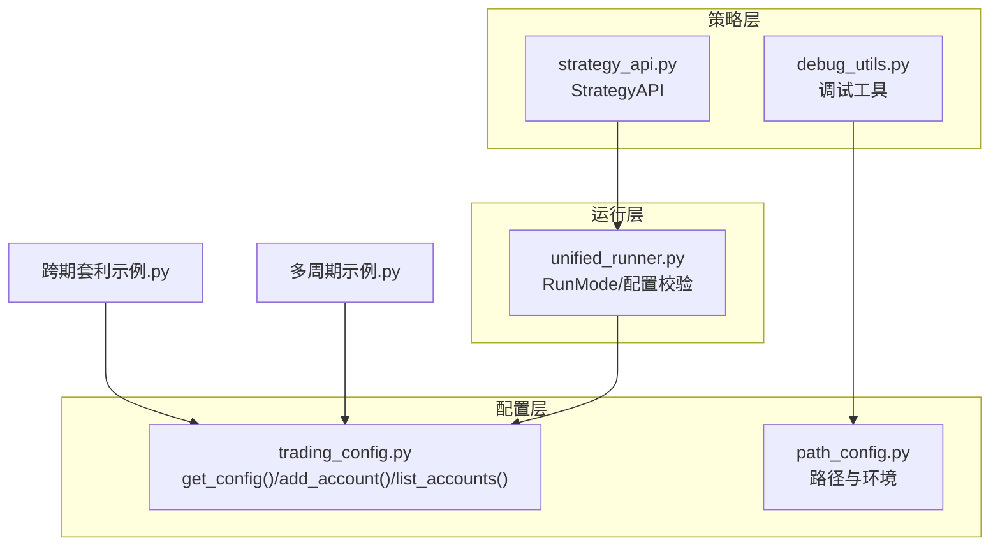
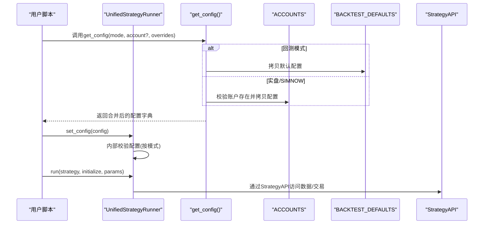
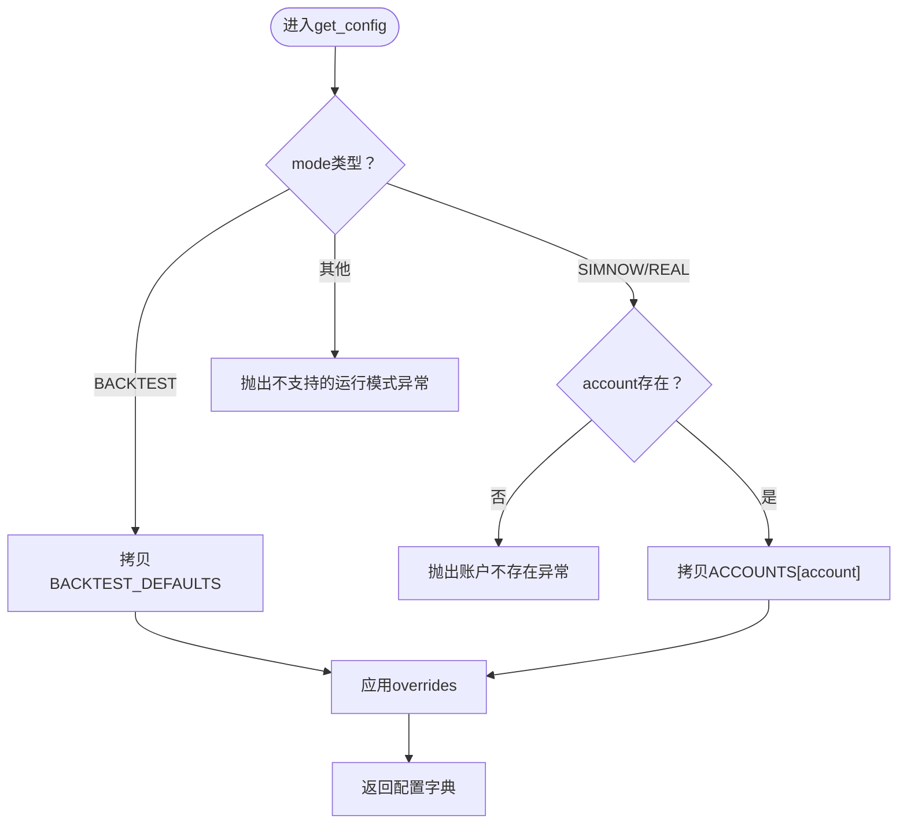
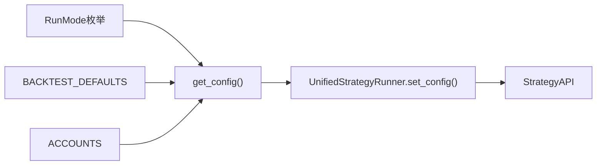

# 配置管理API

<cite>
**本文引用的文件**
- [ssquant/config/trading_config.py](file://ssquant/config/trading_config.py)
- [ssquant/config/path_config.py](file://ssquant/config/path_config.py)
- [ssquant/backtest/unified_runner.py](file://ssquant/backtest/unified_runner.py)
- [ssquant/api/strategy_api.py](file://ssquant/api/strategy_api.py)
- [ssquant/api/debug_utils.py](file://ssquant/api/debug_utils.py)
- [examples/B_跨期套利策略.py](file://examples/B_跨期套利策略.py)
- [examples/B_多品种多周期交易策略.py](file://examples/B_多品种多周期交易策略.py)
- [README.md](file://README.md)
</cite>

## 目录
1. [简介](#简介)
2. [项目结构](#项目结构)
3. [核心组件](#核心组件)
4. [架构总览](#架构总览)
5. [详细组件分析](#详细组件分析)
6. [依赖关系分析](#依赖关系分析)
7. [性能考量](#性能考量)
8. [故障排查指南](#故障排查指南)
9. [结论](#结论)
10. [附录](#附录)

## 简介
本文件面向SSQuant的配置管理API，重点围绕以下目标展开：
- 详细说明get_config()函数的使用方法，包括参数说明（mode、account、overrides）和返回值
- 解释配置覆盖机制和参数优先级
- 提供add_account()、list_accounts()等辅助函数的使用方法
- 包含完整的配置调用示例和错误处理方法
- 说明配置验证和调试技巧

## 项目结构
配置管理API主要集中在config子模块，配合运行器与策略API协同工作：
- 配置生成与账户管理：ssquant/config/trading_config.py
- 路径与环境配置：ssquant/config/path_config.py
- 统一运行器与配置校验：ssquant/backtest/unified_runner.py
- 策略API与调试工具：ssquant/api/strategy_api.py、ssquant/api/debug_utils.py
- 示例策略展示配置用法：examples/B_跨期套利策略.py、examples/B_多品种多周期交易策略.py
- 顶层说明与快速开始：README.md

图表来源
- [ssquant/config/trading_config.py](file://ssquant/config/trading_config.py#L115-L187)
- [ssquant/config/path_config.py](file://ssquant/config/path_config.py#L10-L30)
- [ssquant/backtest/unified_runner.py](file://ssquant/backtest/unified_runner.py#L19-L24)
- [ssquant/api/strategy_api.py](file://ssquant/api/strategy_api.py#L1-L570)
- [ssquant/api/debug_utils.py](file://ssquant/api/debug_utils.py#L1-L136)
- [examples/B_跨期套利策略.py](file://examples/B_跨期套利策略.py#L176-L331)
- [examples/B_多品种多周期交易策略.py](file://examples/B_多品种多周期交易策略.py#L262-L482)

章节来源
- [ssquant/config/trading_config.py](file://ssquant/config/trading_config.py#L1-L187)
- [ssquant/config/path_config.py](file://ssquant/config/path_config.py#L1-L30)
- [ssquant/backtest/unified_runner.py](file://ssquant/backtest/unified_runner.py#L1-L379)
- [ssquant/api/strategy_api.py](file://ssquant/api/strategy_api.py#L1-L570)
- [ssquant/api/debug_utils.py](file://ssquant/api/debug_utils.py#L1-L136)
- [examples/B_跨期套利策略.py](file://examples/B_跨期套利策略.py#L176-L331)
- [examples/B_多品种多周期交易策略.py](file://examples/B_多品种多周期交易策略.py#L262-L482)
- [README.md](file://README.md#L121-L242)

## 核心组件
- get_config(mode, account=None, **overrides)
  - 作用：根据运行模式与账户配置生成最终配置字典
  - 参数：
    - mode：运行模式（RunMode.BACKTEST、RunMode.SIMNOW、RunMode.REAL_TRADING）
    - account：账户名（SIMNOW/实盘模式必填，从ACCOUNTS中选择）
    - **overrides：覆盖参数（如symbol、kline_period、preload_history等）
  - 返回：配置字典（回测使用BACKTEST_DEFAULTS，实盘/SIMNOW使用ACCOUNTS[account]的拷贝，随后应用overrides）
- add_account(name, **config)
  - 作用：动态添加账户配置
- list_accounts()
  - 作用：列出所有账户名
- get_api_auth()/set_api_auth()
  - 作用：获取/设置数据API认证信息（用户名/密码）

章节来源
- [ssquant/config/trading_config.py](file://ssquant/config/trading_config.py#L115-L187)

## 架构总览
配置管理API与统一运行器、策略API的关系如下：

图表来源
- [ssquant/config/trading_config.py](file://ssquant/config/trading_config.py#L115-L164)
- [ssquant/backtest/unified_runner.py](file://ssquant/backtest/unified_runner.py#L79-L161)
- [ssquant/api/strategy_api.py](file://ssquant/api/strategy_api.py#L1-L570)

## 详细组件分析

### get_config()函数详解
- 参数说明
  - mode：运行模式枚举，决定配置来源与行为
  - account：账户名（仅在SIMNOW/实盘模式需要），必须存在于ACCOUNTS中
  - overrides：任意关键字参数，用于覆盖默认配置或账户配置
- 返回值
  - 字典：包含回测或交易所需的全部配置项
- 覆盖机制与优先级
  - 回测：从BACKTEST_DEFAULTS拷贝，再应用overrides
  - 实盘/SIMNOW：从ACCOUNTS[account]拷贝，再应用overrides
  - overrides优先级最高，可覆盖所有默认值
- 错误处理
  - 不支持的mode会抛出异常
  - SIMNOW/实盘模式未提供account会抛出异常
  - account不存在会抛出异常并提示可用账户列表

图表来源
- [ssquant/config/trading_config.py](file://ssquant/config/trading_config.py#L115-L164)

章节来源
- [ssquant/config/trading_config.py](file://ssquant/config/trading_config.py#L115-L164)

### 账户配置与动态管理
- 预置账户
  - simnow_default：SIMNOW模拟交易账户模板
  - real_default：实盘账户模板
- 动态添加账户
  - add_account(name, **config)：将新账户加入ACCOUNTS
- 列出账户
  - list_accounts()：返回ACCOUNTS的键列表

章节来源
- [ssquant/config/trading_config.py](file://ssquant/config/trading_config.py#L29-L110)
- [ssquant/config/trading_config.py](file://ssquant/config/trading_config.py#L179-L186)

### 配置覆盖与参数优先级
- 优先级顺序（从低到高）
  1. BACKTEST_DEFAULTS（回测）
  2. ACCOUNTS[account]（实盘/SIMNOW）
  3. overrides（用户显式传入，最高优先级）
- 典型覆盖参数
  - symbol：合约代码
  - kline_period：K线周期
  - preload_history/history_lookback_bars：历史数据预加载
  - history_symbol：跨期套利时指定主力/次主力连续
  - data_sources：多数据源配置（单/多数据源）
- 多数据源场景
  - data_sources：数组形式，每个元素为一个数据源配置
  - 跨期套利示例展示了如何为不同数据源指定不同的history_symbol

章节来源
- [ssquant/config/trading_config.py](file://ssquant/config/trading_config.py#L115-L164)
- [examples/B_跨期套利策略.py](file://examples/B_跨期套利策略.py#L190-L331)
- [examples/B_多品种多周期交易策略.py](file://examples/B_多品种多周期交易策略.py#L274-L482)

### 辅助函数：add_account()与list_accounts()
- add_account(name, **config)
  - 用途：在运行时动态注册账户，便于临时测试或按需扩展
  - 注意：新增账户需确保字段与ACCOUNTS模板一致
- list_accounts()
  - 用途：快速查看当前可用账户列表，便于调试与排障

章节来源
- [ssquant/config/trading_config.py](file://ssquant/config/trading_config.py#L179-L186)

### API认证与数据源
- get_api_auth()/set_api_auth()
  - 用途：获取或设置数据API的用户名/密码
  - 位置：API_USERNAME/API_PASSWORD
  - 重要性：回测与实盘数据拉取依赖此认证

章节来源
- [ssquant/config/trading_config.py](file://ssquant/config/trading_config.py#L167-L177)

### 配置调用示例与最佳实践
- 回测示例
  - 单数据源：指定symbol、start_date、end_date、kline_period等
  - 多数据源：通过data_sources数组配置多个symbol及周期
- SIMNOW/实盘示例
  - 指定account（如simnow_default或real_default）
  - 指定symbol（具体合约月份）
  - 可选：server_name、enable_tick_callback、数据保存开关等
- 跨期套利
  - 通过data_sources为近月/远月分别指定history_symbol（主力/次主力连续）
- 多品种多周期
  - 通过data_sources为不同品种/周期组合配置

章节来源
- [examples/B_跨期套利策略.py](file://examples/B_跨期套利策略.py#L176-L331)
- [examples/B_多品种多周期交易策略.py](file://examples/B_多品种多周期交易策略.py#L262-L482)
- [README.md](file://README.md#L197-L242)

## 依赖关系分析
- get_config()依赖
  - RunMode（统一运行器中定义）
  - BACKTEST_DEFAULTS（回测默认配置）
  - ACCOUNTS（账户配置字典）
- 统一运行器对配置的二次校验
  - 根据mode校验必需字段（如回测需symbol/start_date/end_date/kline_period或data_sources；实盘需broker_id等）
- 策略API与配置的交互
  - StrategyAPI通过上下文访问数据源与日志，配置决定数据源与交易行为

图表来源
- [ssquant/backtest/unified_runner.py](file://ssquant/backtest/unified_runner.py#L19-L24)
- [ssquant/config/trading_config.py](file://ssquant/config/trading_config.py#L115-L164)
- [ssquant/api/strategy_api.py](file://ssquant/api/strategy_api.py#L1-L570)

章节来源
- [ssquant/backtest/unified_runner.py](file://ssquant/backtest/unified_runner.py#L79-L161)
- [ssquant/config/trading_config.py](file://ssquant/config/trading_config.py#L115-L164)
- [ssquant/api/strategy_api.py](file://ssquant/api/strategy_api.py#L1-L570)

## 性能考量
- 预加载历史数据
  - preload_history与history_lookback_bars影响回测/实盘历史数据加载量
  - 建议在多数据源场景合理设置，避免过大内存占用
- 复权类型与滑点
  - adjust_type与slippage_ticks影响回测精度与手续费估算
- 数据保存
  - save_kline_csv/save_tick_csv等开关影响I/O开销，建议在调试阶段开启，实盘/回测默认关闭

## 故障排查指南
- 常见错误与定位
  - 不支持的运行模式：确认mode是否为RunMode.BACKTEST/SIMNOW/REAL_TRADING
  - 账户不存在：使用list_accounts()核对账户名，或通过add_account()添加
  - 缺少必填参数：根据统一运行器的校验规则补齐（回测/实盘/SIMNOW各有不同）
- 调试技巧
  - 使用debug_utils检查模块与路径加载情况
  - 在策略中打印config的关键字段（如symbol、data_sources、kline_period等）
  - 分阶段验证：先回测，再SIMNOW，最后实盘
- 配置验证
  - 回测：确保start_date/end_date/symbol/kline_period或data_sources齐全
  - 实盘/SIMNOW：确保账户字段（如investor_id/password、server_name等）完整

章节来源
- [ssquant/backtest/unified_runner.py](file://ssquant/backtest/unified_runner.py#L122-L161)
- [ssquant/api/debug_utils.py](file://ssquant/api/debug_utils.py#L104-L133)

## 结论
SSQuant的配置管理API通过get_config()实现了“一次编写，多处运行”的核心能力。其覆盖机制清晰、优先级明确，结合统一运行器的配置校验与策略API的数据访问，能够支撑从回测到实盘的全链路开发与部署。建议在实际使用中：
- 明确运行模式与账户配置
- 合理设置overrides，确保覆盖参数与业务需求一致
- 在多数据源场景下，为不同数据源指定合适的周期与历史数据源
- 使用list_accounts()与debug_utils()进行账户与模块加载的快速排障

## 附录
- 快速参考
  - get_config(mode, account=None, **overrides)
  - add_account(name, **config)
  - list_accounts()
  - get_api_auth()/set_api_auth()

章节来源
- [ssquant/config/trading_config.py](file://ssquant/config/trading_config.py#L115-L187)
- [README.md](file://README.md#L197-L242)