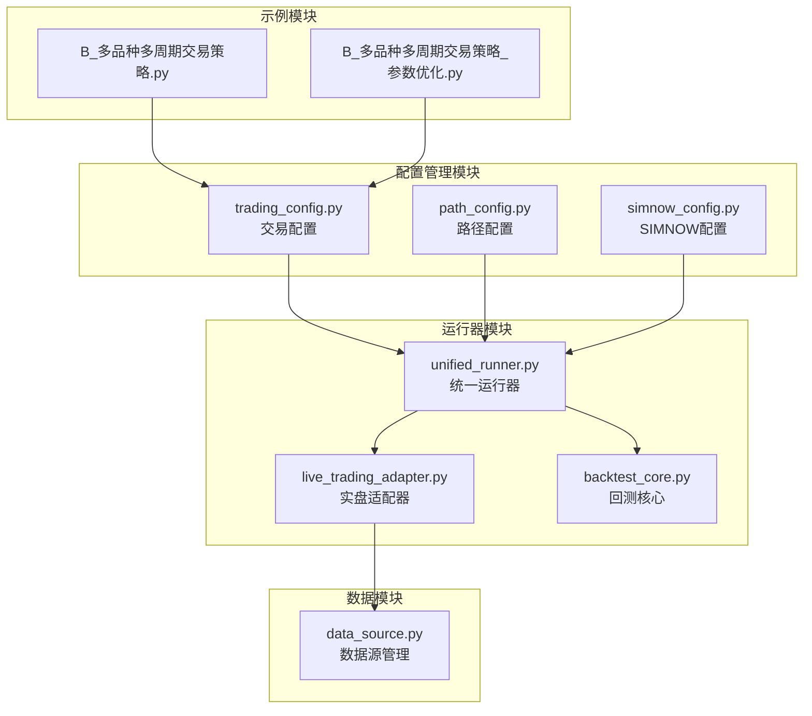
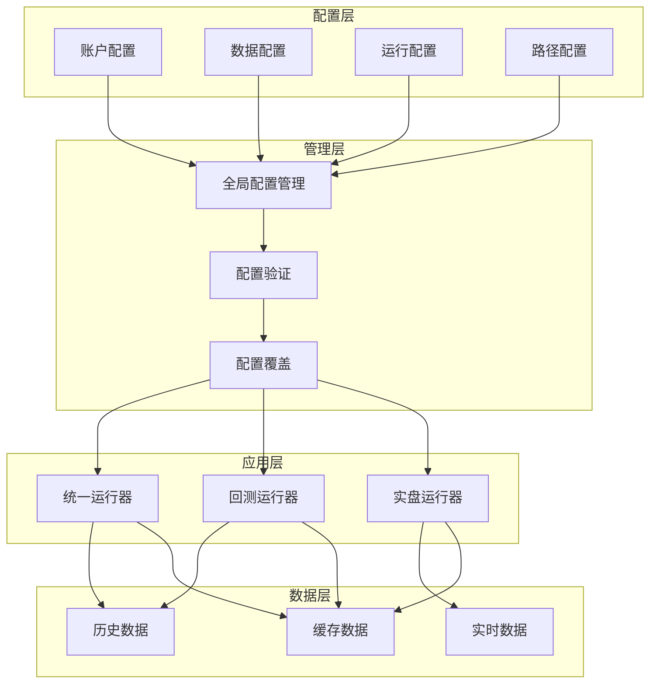
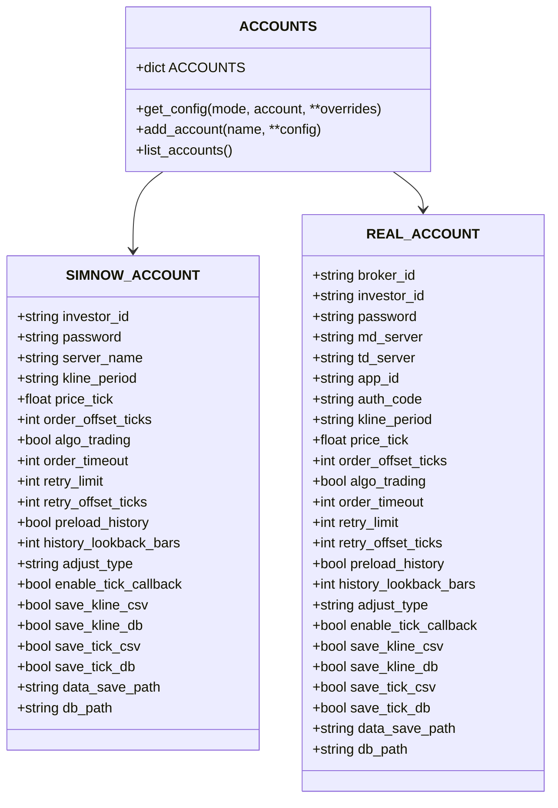
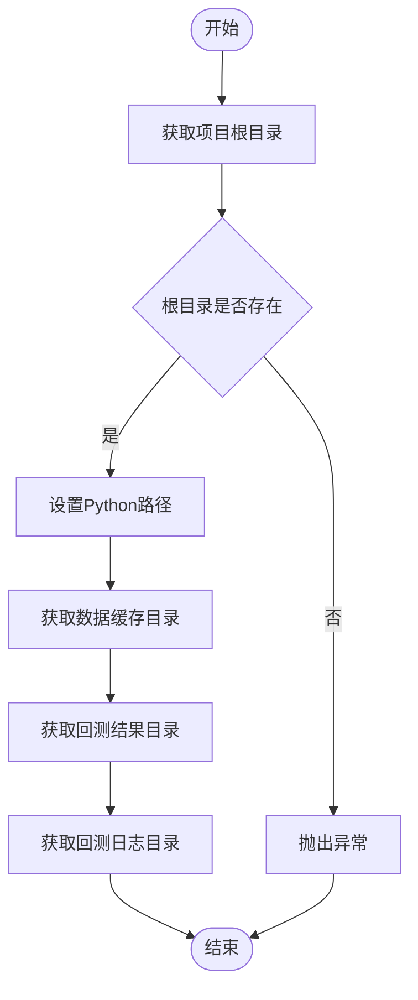
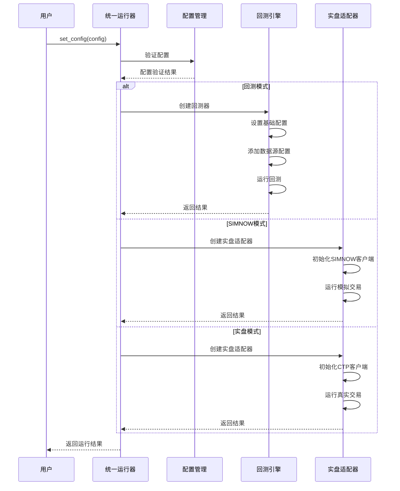
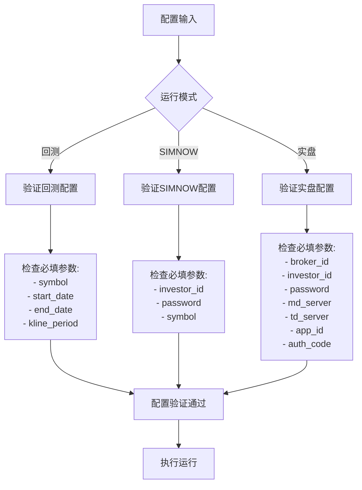
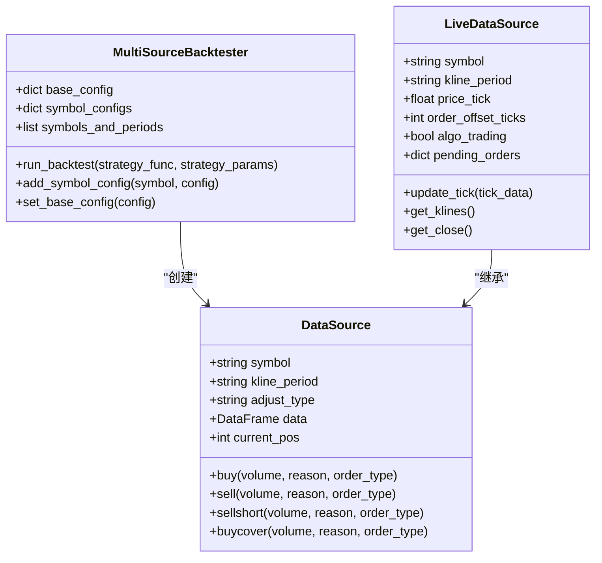
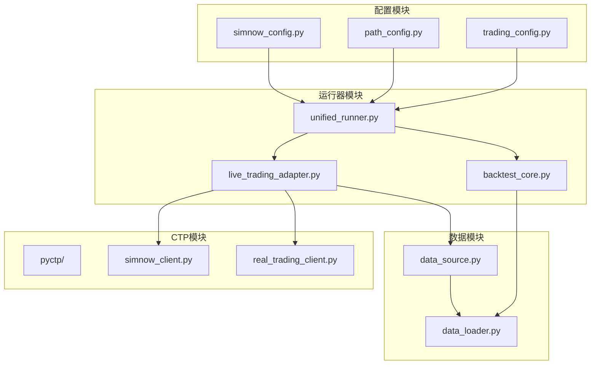
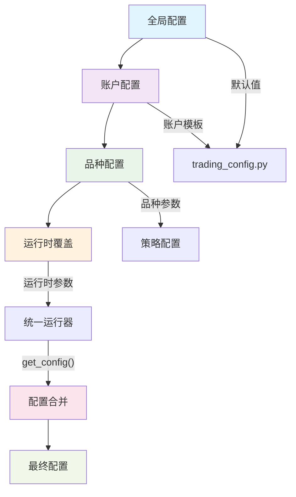

# 配置管理系统

<cite>
**本文档引用的文件**
- [ssquant/config/trading_config.py](file://ssquant/config/trading_config.py)
- [ssquant/config/path_config.py](file://ssquant/config/path_config.py)
- [ssquant/backtest/unified_runner.py](file://ssquant/backtest/unified_runner.py)
- [ssquant/backtest/live_trading_adapter.py](file://ssquant/backtest/live_trading_adapter.py)
- [ssquant/backtest/backtest_core.py](file://ssquant/backtest/backtest_core.py)
- [ssquant/pyctp/simnow_config.py](file://ssquant/pyctp/simnow_config.py)
- [ssquant/data/data_source.py](file://ssquant/data/data_source.py)
- [examples/B_多品种多周期交易策略.py](file://examples/B_多品种多周期交易策略.py)
- [examples/B_多品种多周期交易策略_参数优化.py](file://examples/B_多品种多周期交易策略_参数优化.py)
- [README.md](file://README.md)
- [用户手册.md](file://用户手册.md)
</cite>

## 目录
1. [简介](#简介)
2. [项目结构](#项目结构)
3. [核心组件](#核心组件)
4. [架构概览](#架构概览)
5. [详细组件分析](#详细组件分析)
6. [依赖关系分析](#依赖关系分析)
7. [性能考虑](#性能考虑)
8. [故障排除指南](#故障排除指南)
9. [结论](#结论)
10. [附录](#附录)

## 简介
SSQuant配置管理系统是一个完整的量化交易框架配置解决方案，支持回测、SIMNOW模拟交易和实盘交易三种运行模式。该系统提供了灵活的配置体系，包括账户配置、数据源配置、运行参数配置等，能够满足从初学者到高级用户的各种需求。

## 项目结构
SSQuant配置管理系统主要分布在以下模块中：



**图表来源**
- [ssquant/config/trading_config.py](file://ssquant/config/trading_config.py#L1-L187)
- [ssquant/backtest/unified_runner.py](file://ssquant/backtest/unified_runner.py#L1-L379)

**章节来源**
- [ssquant/config/trading_config.py](file://ssquant/config/trading_config.py#L1-L187)
- [ssquant/backtest/unified_runner.py](file://ssquant/backtest/unified_runner.py#L1-L379)

## 核心组件
配置管理系统的核心组件包括：

### 1. 交易配置管理
- **API认证配置**：管理数据API的用户名和密码
- **回测默认配置**：提供回测的基础参数设置
- **账户配置**：支持SIMNOW模拟账户和实盘账户的配置

### 2. 路径配置管理
- **项目根目录**：统一管理项目根目录路径
- **Python路径**：自动设置Python模块路径
- **数据缓存目录**：管理数据缓存文件夹
- **回测结果目录**：管理回测结果输出路径

### 3. 运行模式管理
- **统一运行器**：支持三种运行模式的统一接口
- **实盘适配器**：将CTP实盘接口适配为统一API
- **多数据源回测**：支持多品种、多周期的回测功能

**章节来源**
- [ssquant/config/trading_config.py](file://ssquant/config/trading_config.py#L10-L187)
- [ssquant/config/path_config.py](file://ssquant/config/path_config.py#L1-L30)
- [ssquant/backtest/unified_runner.py](file://ssquant/backtest/unified_runner.py#L19-L379)

## 架构概览
配置管理系统采用分层架构设计，确保配置的灵活性和可扩展性：



**图表来源**
- [ssquant/config/trading_config.py](file://ssquant/config/trading_config.py#L115-L164)
- [ssquant/backtest/unified_runner.py](file://ssquant/backtest/unified_runner.py#L79-L121)

## 详细组件分析

### 交易配置系统

#### 账户配置结构
系统支持两种主要的账户配置模式：



**图表来源**
- [ssquant/config/trading_config.py](file://ssquant/config/trading_config.py#L29-L110)

#### 配置参数详解

##### 回测默认配置参数
| 参数名 | 类型 | 默认值 | 描述 |
|--------|------|--------|------|
| initial_capital | float | 20000 | 初始资金 |
| commission | float | 0.0001 | 手续费率 |
| margin_rate | float | 0.1 | 保证金率 |
| contract_multiplier | int | 10 | 合约乘数 |
| price_tick | float | 1.0 | 最小变动价位 |
| slippage_ticks | int | 1 | 滑点跳数 |
| adjust_type | str | '1' | 复权类型 |
| use_cache | bool | True | 是否使用缓存 |
| save_data | bool | True | 是否保存数据 |
| debug | bool | False | 调试模式 |

##### 账户配置参数
| 参数名 | 类型 | 默认值 | 描述 |
|--------|------|--------|------|
| investor_id | str | '' | SIMNOW账号 |
| password | str | '' | SIMNOW密码 |
| server_name | str | '电信1' | 服务器名称 |
| broker_id | str | '' | 期货公司代码 |
| md_server | str | '' | 行情服务器地址 |
| td_server | str | '' | 交易服务器地址 |
| app_id | str | '' | 应用ID |
| auth_code | str | '' | 授权码 |
| kline_period | str | '1m'/'1d' | K线周期 |
| price_tick | float | 1.0 | 最小变动价位 |
| order_offset_ticks | int | 5 | 委托价格偏移跳数 |
| algo_trading | bool | False | 是否启用算法交易 |
| order_timeout | int | 10 | 订单超时时间(秒) |
| retry_limit | int | 3 | 最大重试次数 |
| retry_offset_ticks | int | 5 | 重试时的超价跳数 |

**章节来源**
- [ssquant/config/trading_config.py](file://ssquant/config/trading_config.py#L14-L110)

### 路径配置系统

#### 路径管理功能
路径配置系统提供统一的路径管理服务：



**图表来源**
- [ssquant/config/path_config.py](file://ssquant/config/path_config.py#L10-L30)

**章节来源**
- [ssquant/config/path_config.py](file://ssquant/config/path_config.py#L1-L30)

### 运行器配置系统

#### 统一运行器架构
统一运行器支持三种运行模式，提供统一的配置接口：



**图表来源**
- [ssquant/backtest/unified_runner.py](file://ssquant/backtest/unified_runner.py#L79-L121)
- [ssquant/backtest/unified_runner.py](file://ssquant/backtest/unified_runner.py#L215-L372)

#### 配置验证机制
统一运行器实现了严格的配置验证机制：



**图表来源**
- [ssquant/backtest/unified_runner.py](file://ssquant/backtest/unified_runner.py#L122-L161)

**章节来源**
- [ssquant/backtest/unified_runner.py](file://ssquant/backtest/unified_runner.py#L19-L379)

### 数据源配置系统

#### 多数据源支持
系统支持多品种、多周期的数据源配置：



**图表来源**
- [ssquant/backtest/backtest_core.py](file://ssquant/backtest/backtest_core.py#L14-L131)
- [ssquant/data/data_source.py](file://ssquant/data/data_source.py#L6-L800)

**章节来源**
- [ssquant/backtest/backtest_core.py](file://ssquant/backtest/backtest_core.py#L14-L200)
- [ssquant/data/data_source.py](file://ssquant/data/data_source.py#L6-L800)

## 依赖关系分析

### 配置系统依赖图
配置管理系统各模块之间的依赖关系如下：



**图表来源**
- [ssquant/config/trading_config.py](file://ssquant/config/trading_config.py#L7-L7)
- [ssquant/backtest/unified_runner.py](file://ssquant/backtest/unified_runner.py#L15-L16)

### 配置优先级和覆盖规则

#### 配置层次结构
配置系统采用多层配置结构，支持灵活的优先级管理：



**图表来源**
- [ssquant/config/trading_config.py](file://ssquant/config/trading_config.py#L115-L164)
- [ssquant/backtest/unified_runner.py](file://ssquant/backtest/unified_runner.py#L79-L121)

#### 配置覆盖机制
配置系统支持多种覆盖方式：

1. **运行时覆盖**：通过`get_config()`函数的`**overrides`参数
2. **账户继承**：从`ACCOUNTS`字典中继承配置
3. **默认回退**：使用`BACKTEST_DEFAULTS`作为回退配置

**章节来源**
- [ssquant/config/trading_config.py](file://ssquant/config/trading_config.py#L115-L164)
- [ssquant/backtest/unified_runner.py](file://ssquant/backtest/unified_runner.py#L79-L121)

## 性能考虑
配置管理系统在性能方面采用了多项优化措施：

### 1. 数据缓存优化
- **缓存策略**：支持历史数据缓存，避免重复下载
- **预加载机制**：多数据源回测支持数据预加载，提高优化效率
- **异步写入**：实盘数据落盘采用异步队列写入，减少阻塞

### 2. 内存管理
- **数据源池化**：复用数据源实例，减少内存分配
- **缓冲区管理**：合理设置K线和TICK数据的缓冲区大小
- **垃圾回收**：及时清理不再使用的数据对象

### 3. 网络优化
- **连接池**：CTP客户端连接复用
- **批量操作**：支持批量数据获取和处理
- **超时控制**：合理的网络超时设置

## 故障排除指南

### 常见配置问题及解决方案

#### 1. 账户配置问题
**问题**：SIMNOW连接失败
**解决方案**：
- 检查服务器名称是否正确
- 验证账号密码是否正确
- 尝试更换服务器节点
- 确认网络连接稳定

**问题**：实盘连接失败
**解决方案**：
- 检查期货公司代码是否正确
- 验证服务器地址格式
- 确认AppID和授权码有效
- 检查防火墙设置

#### 2. 数据配置问题
**问题**：找不到历史数据
**解决方案**：
- 检查合约代码是否正确
- 验证日期范围是否有效
- 确认API认证信息正确
- 检查数据缓存目录权限

#### 3. 运行配置问题
**问题**：策略不执行
**解决方案**：
- 检查数据长度是否足够
- 确认订单类型设置正确
- 添加日志调试信息
- 验证参数范围合理性

### 调试方法

#### 1. 配置验证
```python
# 启用调试模式
config = get_config(mode, account, debug=True)

# 检查配置内容
print("配置详情:", config)
```

#### 2. 日志监控
- **回测日志**：查看回测过程中的详细信息
- **实盘日志**：监控实盘交易的执行情况
- **错误日志**：记录异常和错误信息

#### 3. 性能分析
- **内存使用**：监控内存占用情况
- **CPU使用**：分析CPU使用率
- **网络延迟**：测量网络响应时间

**章节来源**
- [ssquant/backtest/unified_runner.py](file://ssquant/backtest/unified_runner.py#L122-L161)
- [用户手册.md](file://用户手册.md#L587-L640)

## 结论
SSQuant配置管理系统提供了一个完整、灵活且高性能的配置解决方案。通过分层架构设计、严格的配置验证机制和完善的错误处理系统，该系统能够满足从初学者到高级用户的各种配置需求。

系统的主要优势包括：
- **统一接口**：一套代码支持三种运行模式
- **灵活配置**：多层次配置支持，满足复杂需求
- **性能优化**：多项性能优化措施确保高效运行
- **易于维护**：清晰的模块划分和文档支持

## 附录

### 配置模板

#### 回测配置模板
```python
config = get_config(
    mode=RunMode.BACKTEST,
    symbol='rb888',
    start_date='2025-01-01',
    end_date='2025-11-30',
    kline_period='1h',
    initial_capital=100000,
    commission=0.0001,
    margin_rate=0.1,
    price_tick=1.0,
    contract_multiplier=10,
    slippage_ticks=1,
    adjust_type='1'
)
```

#### SIMNOW配置模板
```python
config = get_config(
    mode=RunMode.SIMNOW,
    account='simnow_default',
    symbol='rb2601',
    kline_period='1m',
    price_tick=1.0,
    order_offset_ticks=5,
    algo_trading=True,
    order_timeout=10,
    retry_limit=3,
    retry_offset_ticks=5,
    preload_history=True,
    history_lookback_bars=100,
    adjust_type='1',
    enable_tick_callback=False,
    save_kline_csv=True,
    save_tick_csv=True
)
```

#### 实盘配置模板
```python
config = get_config(
    mode=RunMode.REAL_TRADING,
    account='real_default',
    symbol='rb2601',
    kline_period='1m',
    price_tick=1.0,
    order_offset_ticks=5,
    algo_trading=False,
    order_timeout=0,
    retry_limit=0,
    retry_offset_ticks=0,
    preload_history=True,
    history_lookback_bars=100,
    adjust_type='1',
    enable_tick_callback=False,
    save_kline_csv=False,
    save_tick_csv=False
)
```

### 最佳实践建议

#### 1. 配置管理
- **分层配置**：使用分层配置结构，便于管理和维护
- **参数验证**：在配置阶段进行参数验证，避免运行时错误
- **文档记录**：详细记录每个配置参数的作用和取值范围

#### 2. 性能优化
- **数据缓存**：合理使用数据缓存，提高回测效率
- **内存管理**：及时释放不再使用的数据对象
- **网络优化**：优化网络连接和超时设置

#### 3. 安全考虑
- **敏感信息保护**：将账号密码等敏感信息存储在安全的地方
- **权限控制**：合理设置文件和目录权限
- **审计日志**：记录重要的配置变更和运行事件

#### 4. 故障预防
- **备份配置**：定期备份配置文件
- **监控告警**：建立配置变更和运行状态的监控机制
- **应急预案**：制定配置错误和系统故障的应急处理方案

**章节来源**
- [examples/B_多品种多周期交易策略.py](file://examples/B_多品种多周期交易策略.py#L261-L521)
- [examples/B_多品种多周期交易策略_参数优化.py](file://examples/B_多品种多周期交易策略_参数优化.py#L18-L155)
- [用户手册.md](file://用户手册.md#L667-L716)