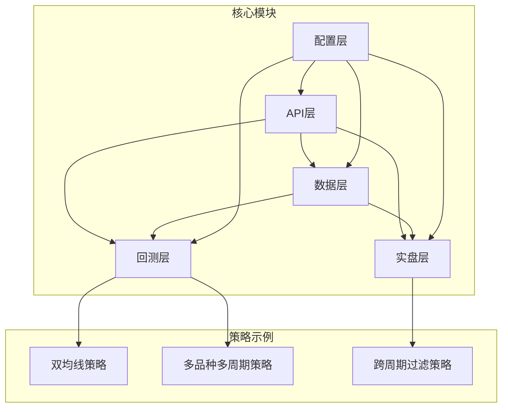
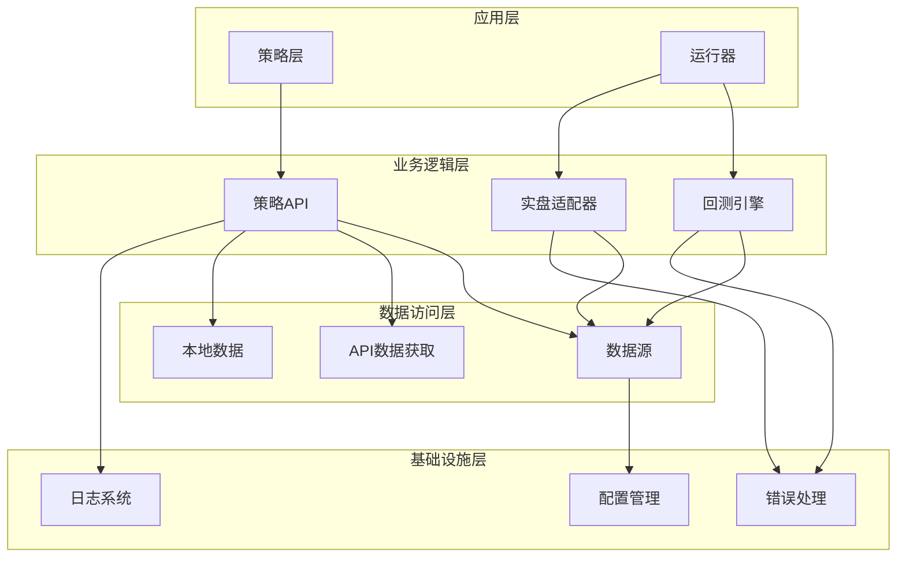
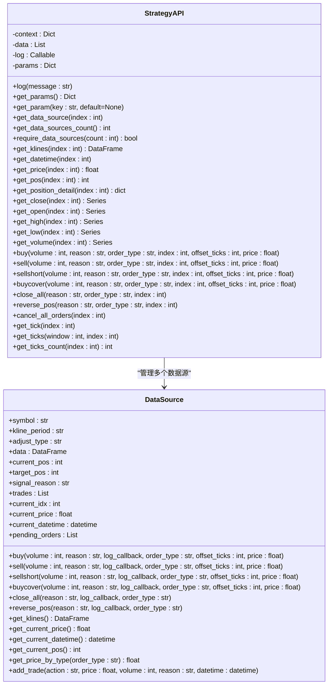
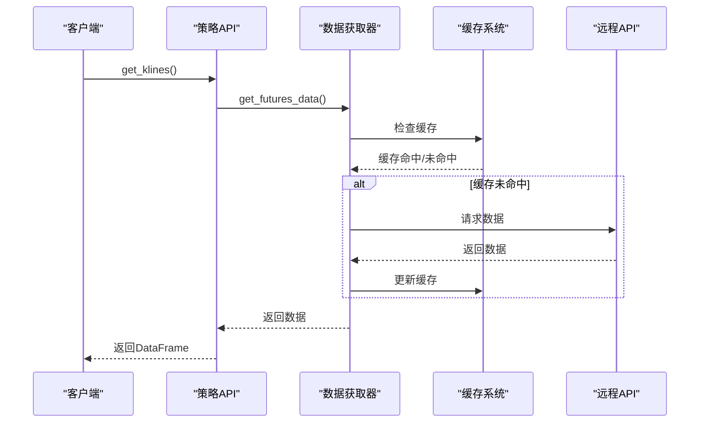
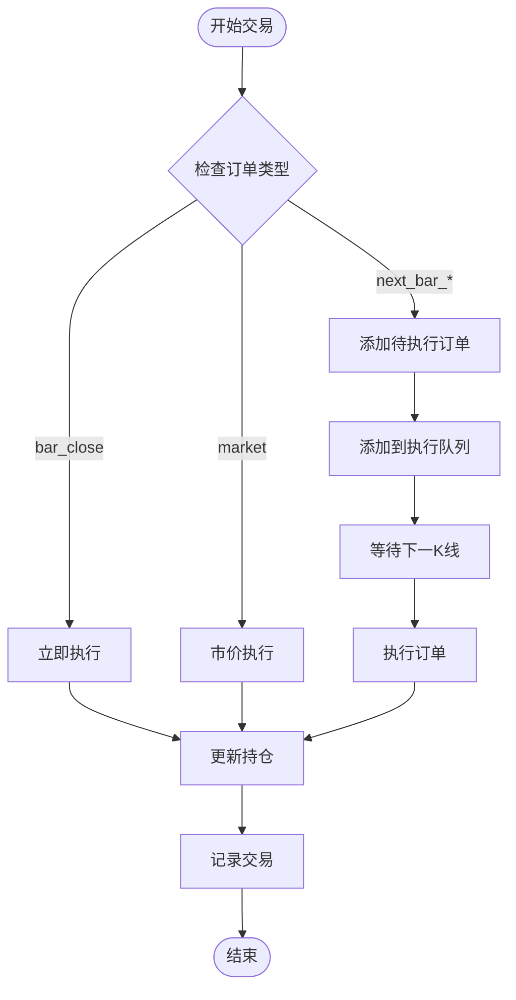
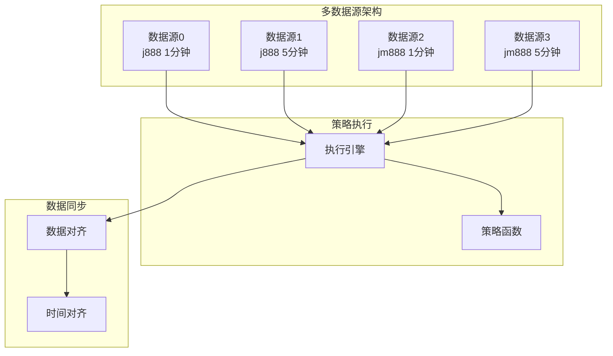
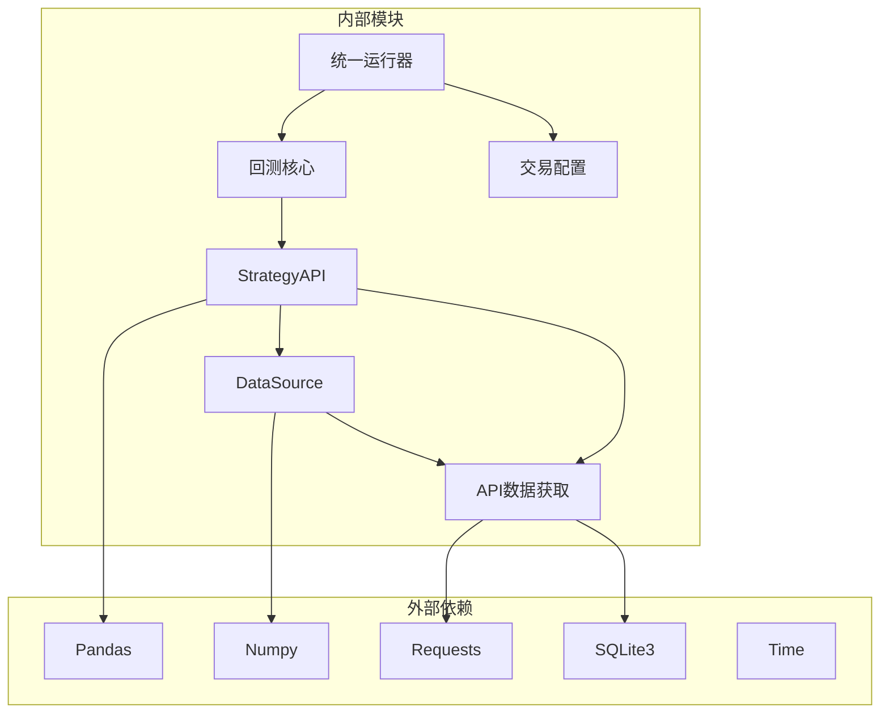

# API概览

<cite>
**本文档引用的文件**
- [ssquant/__init__.py](file://ssquant/__init__.py)
- [ssquant/api/__init__.py](file://ssquant/api/__init__.py)
- [ssquant/api/strategy_api.py](file://ssquant/api/strategy_api.py)
- [ssquant/data/api_data_fetcher.py](file://ssquant/data/api_data_fetcher.py)
- [ssquant/data/data_source.py](file://ssquant/data/data_source.py)
- [ssquant/backtest/function_api.py](file://ssquant/backtest/function_api.py)
- [ssquant/backtest/backtest_core.py](file://ssquant/backtest/backtest_core.py)
- [ssquant/backtest/unified_runner.py](file://ssquant/backtest/unified_runner.py)
- [ssquant/config/trading_config.py](file://ssquant/config/trading_config.py)
- [examples/B_双均线策略.py](file://examples/B_双均线策略.py)
- [examples/B_多品种多周期交易策略.py](file://examples/B_多品种多周期交易策略.py)
- [README.md](file://README.md)
</cite>

## 目录
1. [简介](#简介)
2. [项目结构](#项目结构)
3. [核心组件](#核心组件)
4. [架构概览](#架构概览)
5. [详细组件分析](#详细组件分析)
6. [依赖关系分析](#依赖关系分析)
7. [性能考量](#性能考量)
8. [故障排除指南](#故障排除指南)
9. [结论](#结论)
10. [附录](#附录)

## 简介
SSQuant是一个专业的期货量化交易框架，支持回测、SIMNOW模拟交易和实盘CTP交易三种运行模式。该框架提供统一的API接口，让开发者能够一次编写策略代码，在三种环境中无缝运行。

## 项目结构
SSQuant采用模块化设计，主要包含以下核心模块：



**图表来源**
- [ssquant/__init__.py](file://ssquant/__init__.py#L1-L18)
- [ssquant/api/__init__.py](file://ssquant/api/__init__.py#L1-L12)

**章节来源**
- [ssquant/__init__.py](file://ssquant/__init__.py#L1-L18)
- [README.md](file://README.md#L297-L321)

## 核心组件
SSQuant框架的核心组件包括策略API、数据获取、交易执行和多数据源管理四个主要部分。

### 策略API核心功能
策略API是框架的核心接口，提供统一的数据访问和交易操作能力：

- **数据获取接口**：支持K线数据、TICK数据、价格序列等
- **持仓查询接口**：支持净持仓、多头持仓、空头持仓等
- **交易操作接口**：支持买入开仓、卖出平仓、卖出开仓、买入平仓等
- **多数据源支持**：支持同时管理多个数据源

### 数据获取机制
框架提供多种数据获取方式：
- **API数据获取**：通过远程API获取历史数据
- **本地数据加载**：支持SQLite数据库和CSV文件
- **实时数据流**：支持TICK数据流模式
- **多周期数据**：支持不同周期的数据并行处理

### 交易执行系统
交易执行系统包含完整的订单管理：
- **订单类型**：限价单、市价单、延迟执行等
- **订单管理**：订单跟踪、撤单、重发机制
- **风险控制**：滑点、手续费、保证金等
- **实时回调**：成交、报单、撤单等事件通知

**章节来源**
- [ssquant/api/strategy_api.py](file://ssquant/api/strategy_api.py#L4-L570)
- [ssquant/data/api_data_fetcher.py](file://ssquant/data/api_data_fetcher.py#L171-L626)
- [ssquant/data/data_source.py](file://ssquant/data/data_source.py#L6-L922)

## 架构概览
SSQuant采用分层架构设计，确保代码的可维护性和扩展性：



**图表来源**
- [ssquant/backtest/backtest_core.py](file://ssquant/backtest/backtest_core.py#L14-L579)
- [ssquant/backtest/unified_runner.py](file://ssquant/backtest/unified_runner.py#L26-L379)

## 详细组件分析

### 策略API组件分析
策略API是框架的核心接口，提供统一的策略开发体验：



**图表来源**
- [ssquant/api/strategy_api.py](file://ssquant/api/strategy_api.py#L4-L570)
- [ssquant/data/data_source.py](file://ssquant/data/data_source.py#L6-L922)

#### API方法分类

**数据获取方法**
- `get_klines(index=0)` - 获取指定数据源的K线数据
- `get_close(index=0)` - 获取收盘价序列
- `get_open(index=0)` - 获取开盘价序列
- `get_high(index=0)` - 获取最高价序列
- `get_low(index=0)` - 获取最低价序列
- `get_volume(index=0)` - 获取成交量序列
- `get_tick(index=0)` - 获取当前TICK数据
- `get_ticks(window=100, index=0)` - 获取最近window条TICK数据

**持仓查询方法**
- `get_pos(index=0)` - 获取当前净持仓
- `get_long_pos(index=0)` - 获取多头持仓
- `get_short_pos(index=0)` - 获取空头持仓
- `get_position_detail(index=0)` - 获取详细持仓信息

**交易操作方法**
- `buy(volume=1, reason="", order_type='bar_close', index=0)` - 买入开仓
- `sell(volume=None, reason="", order_type='bar_close', index=0)` - 卖出平仓
- `sellshort(volume=1, reason="", order_type='bar_close', index=0)` - 卖出开仓
- `buycover(volume=None, reason="", order_type='bar_close', index=0)` - 买入平仓
- `close_all(reason="", order_type='bar_close', index=0)` - 平仓所有持仓
- `reverse_pos(reason="", order_type='bar_close', index=0)` - 反转持仓

**章节来源**
- [ssquant/api/strategy_api.py](file://ssquant/api/strategy_api.py#L91-L515)

### 数据获取组件分析
数据获取组件提供灵活的数据访问机制：



**图表来源**
- [ssquant/data/api_data_fetcher.py](file://ssquant/data/api_data_fetcher.py#L171-L626)

#### 数据获取流程
1. **缓存检查**：首先检查本地缓存是否存在所需数据
2. **远程获取**：如果缓存不存在或不完整，从远程API获取数据
3. **数据处理**：对获取的数据进行格式转换和时间处理
4. **缓存更新**：将处理后的数据保存到本地缓存
5. **返回结果**：向调用者返回最终的数据

**章节来源**
- [ssquant/data/api_data_fetcher.py](file://ssquant/data/api_data_fetcher.py#L305-L625)

### 交易执行组件分析
交易执行组件提供完整的订单管理功能：



**图表来源**
- [ssquant/data/data_source.py](file://ssquant/data/data_source.py#L222-L705)

#### 订单执行机制
1. **订单类型判断**：根据order_type参数决定执行方式
2. **立即执行**：对于当前K线收盘价的订单，立即更新持仓
3. **延迟执行**：对于下一K线开盘价等订单，添加到待执行队列
4. **市价执行**：根据TICK数据或收盘价进行市价成交
5. **订单跟踪**：记录所有交易明细和状态变化

**章节来源**
- [ssquant/data/data_source.py](file://ssquant/data/data_source.py#L137-L705)

### 多数据源管理分析
多数据源管理支持同时处理多个品种和周期的数据：



**图表来源**
- [examples/B_多品种多周期交易策略.py](file://examples/B_多品种多周期交易策略.py#L48-L260)

#### 多数据源特点
- **独立管理**：每个数据源独立管理自己的数据和状态
- **统一接口**：通过index参数访问不同数据源
- **并行处理**：多个数据源可以并行处理，提高效率
- **灵活配置**：支持不同品种、不同周期的数据源组合

**章节来源**
- [examples/B_多品种多周期交易策略.py](file://examples/B_多品种多周期交易策略.py#L74-L260)

## 依赖关系分析



**图表来源**
- [ssquant/api/strategy_api.py](file://ssquant/api/strategy_api.py#L1-L2)
- [ssquant/data/api_data_fetcher.py](file://ssquant/data/api_data_fetcher.py#L1-L8)
- [ssquant/backtest/backtest_core.py](file://ssquant/backtest/backtest_core.py#L1-L13)

### 关键依赖关系
- **Pandas/Numpy**：用于数据处理和数值计算
- **Requests**：用于HTTP请求和API通信
- **SQLite3**：用于本地数据缓存
- **策略API依赖数据源**：策略API通过数据源访问数据
- **回测核心依赖策略API**：回测引擎通过策略API执行交易

**章节来源**
- [ssquant/api/strategy_api.py](file://ssquant/api/strategy_api.py#L1-L2)
- [ssquant/data/api_data_fetcher.py](file://ssquant/data/api_data_fetcher.py#L1-L8)

## 性能考量
SSQuant框架在设计时充分考虑了性能优化：

### 缓存策略
- **本地缓存**：使用SQLite数据库缓存历史数据
- **智能更新**：自动检测数据完整性，增量更新
- **多级缓存**：内存缓存+磁盘缓存结合

### 数据处理优化
- **向量化操作**：使用Pandas的向量化操作提高性能
- **延迟执行**：订单延迟执行减少不必要的交易
- **批量处理**：多数据源并行处理提高效率

### 内存管理
- **数据分片**：大数据集分片处理避免内存溢出
- **垃圾回收**：及时释放不再使用的数据对象
- **内存监控**：监控内存使用情况防止泄漏

## 故障排除指南

### 常见问题及解决方案

**API认证失败**
- 检查API_USERNAME和API_PASSWORD配置
- 确认网络连接正常
- 验证账户状态和权限

**数据获取异常**
- 检查数据源配置是否正确
- 验证日期范围是否合理
- 确认缓存文件权限

**交易执行失败**
- 检查账户资金和保证金
- 验证合约代码和周期配置
- 确认交易权限和风控设置

**多数据源同步问题**
- 检查数据对齐配置
- 验证时间戳一致性
- 确认数据源加载顺序

**章节来源**
- [ssquant/config/trading_config.py](file://ssquant/config/trading_config.py#L10-L187)
- [ssquant/data/api_data_fetcher.py](file://ssquant/data/api_data_fetcher.py#L627-L800)

## 结论
SSQuant期货量化交易框架提供了一个完整、灵活且高性能的量化交易解决方案。其核心优势包括：

1. **统一API设计**：一套代码支持三种运行模式
2. **多数据源支持**：灵活处理多品种、多周期数据
3. **完善的交易系统**：支持多种订单类型和风险管理
4. **强大的回测功能**：提供完整的策略回测和优化能力
5. **良好的扩展性**：模块化设计便于功能扩展

该框架适合从初学者到专业交易员的各种用户，能够满足从策略开发到实盘交易的完整需求。

## 附录

### API使用示例

**基本数据获取**
```python
# 获取收盘价序列
close = api.get_close()

# 获取当前价格
current_price = api.get_price()

# 获取K线数据
klines = api.get_klines()
```

**持仓查询**
```python
# 获取净持仓
pos = api.get_pos()

# 获取多头持仓
long_pos = api.get_long_pos()

# 获取详细持仓信息
position_detail = api.get_position_detail()
```

**交易操作**
```python
# 买入开仓
api.buy(volume=1, reason="均线金叉")

# 卖出平仓
api.sell(reason="均线死叉")

# 反转持仓
api.reverse_pos(reason="趋势反转")
```

**多数据源使用**
```python
# 访问第二个数据源
api.get_close(index=1)
api.buy(volume=1, index=1)

# 检查数据源数量
count = api.get_data_sources_count()
```

### 最佳实践建议

1. **参数管理**：使用`get_param()`方法统一管理策略参数
2. **数据验证**：始终验证数据长度和有效性
3. **风险控制**：设置合理的止损和仓位管理
4. **日志记录**：使用`api.log()`记录重要交易事件
5. **性能优化**：合理使用缓存和批量处理

### 版本兼容性说明

SSQuant框架遵循语义化版本控制，主要版本变更包括：

- **v0.3.x**：引入多数据源支持和TICK流双驱动
- **v0.2.x**：重构交易系统和回测引擎
- **v0.1.x**：初始版本，基础功能实现

**章节来源**
- [README.md](file://README.md#L413-L436)
- [examples/B_双均线策略.py](file://examples/B_双均线策略.py#L39-L130)
- [examples/B_多品种多周期交易策略.py](file://examples/B_多品种多周期交易策略.py#L48-L260)