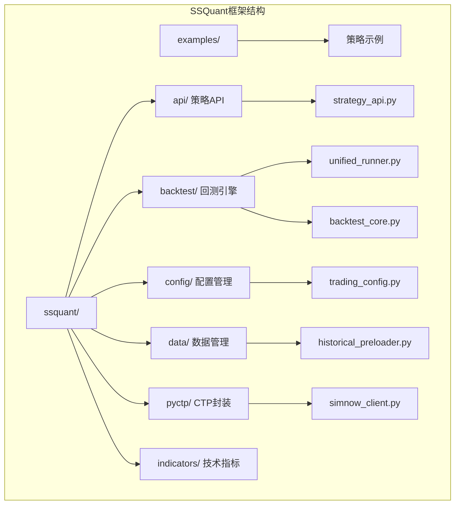
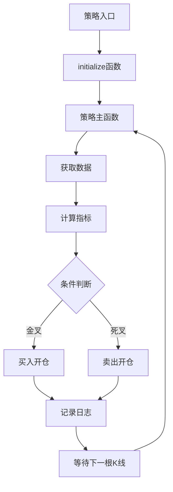
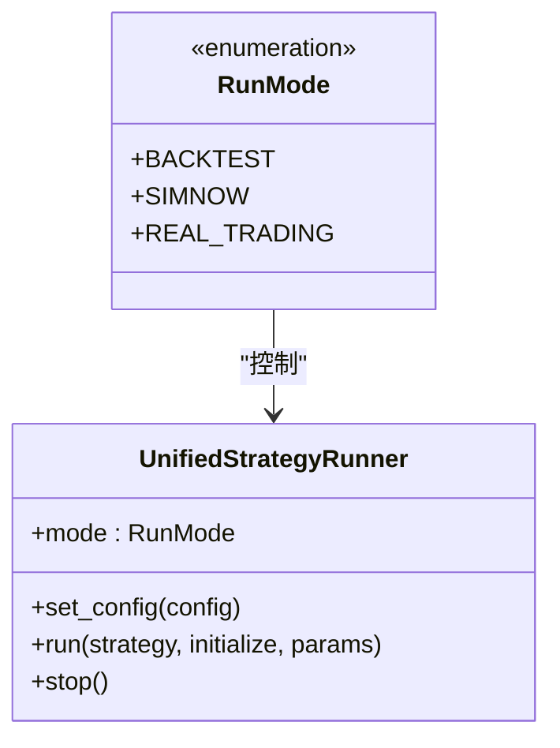
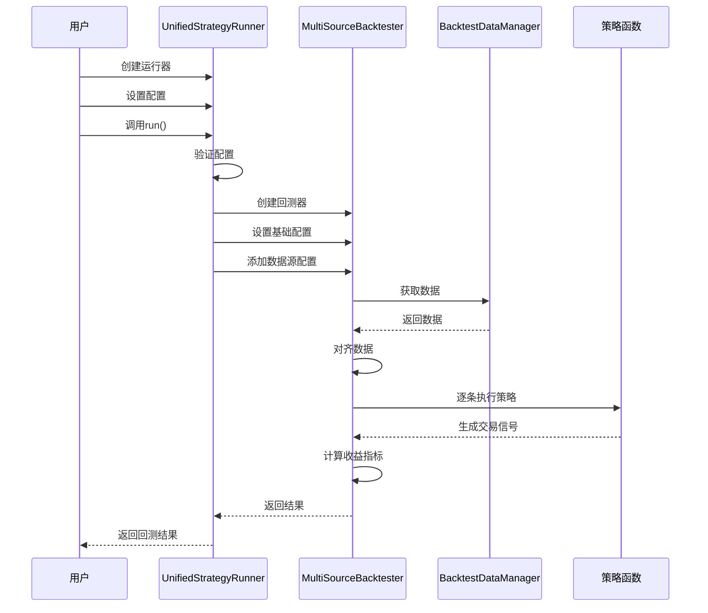
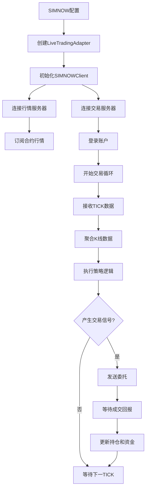

# 快速开始

<cite>
**本文档引用的文件**
- [README.md](file://README.md)
- [B_双均线策略.py](file://examples/B_双均线策略.py)
- [unified_runner.py](file://ssquant/backtest/unified_runner.py)
- [trading_config.py](file://ssquant/config/trading_config.py)
- [strategy_api.py](file://ssquant/api/strategy_api.py)
- [live_trading_adapter.py](file://ssquant/backtest/live_trading_adapter.py)
- [simnow_client.py](file://ssquant/pyctp/simnow_client.py)
- [backtest_core.py](file://ssquant/backtest/backtest_core.py)
- [historical_preloader.py](file://ssquant/data/historical_preloader.py)
- [requirements.txt](file://requirements.txt)
- [setup_and_run.bat](file://setup_and_run.bat)
- [运行_缠论5分钟回测.bat](file://运行_缠论5分钟回测.bat)
</cite>

## 目录
1. [简介](#简介)
2. [项目结构概览](#项目结构概览)
3. [安装与环境准备](#安装与环境准备)
4. [账户配置](#账户配置)
5. [编写第一个策略](#编写第一个策略)
6. [运行模式切换](#运行模式切换)
7. [回测运行](#回测运行)
8. [SIMNOW模拟交易](#simnow模拟交易)
9. [实盘交易](#实盘交易)
10. [配置参数详解](#配置参数详解)
11. [最佳实践建议](#最佳实践建议)
12. [故障排除](#故障排除)
13. [总结](#总结)

## 简介

SSQuant是一个专业的期货量化交易框架，支持"一次编写，三处运行"的策略开发模式。该框架提供了完整的回测、SIMNOW模拟交易和实盘CTP交易能力，让投资者能够在同一个策略代码基础上体验三种不同的运行环境。

### 核心特性

- **统一策略框架**：一套代码可在回测、SIMNOW模拟、实盘CTP三种环境下运行
- **强大的数据支持**：K线数据（1m/5m/15m/30m/1h/4h/1d）+ TICK逐笔数据
- **多品种多周期**：同时交易多个品种，使用不同周期数据
- **自动开平仓管理**：智能识别开平仓、今昨仓
- **智能算法交易**：支持限价单排队、超时撤单、追价重发等高级逻辑
- **丰富的策略示例**：19个完整策略示例，涵盖趋势、套利、轮动、期权、机器学习等类型

## 项目结构概览



**图表来源**
- [README.md](file://README.md#L297-L320)
- [unified_runner.py](file://ssquant/backtest/unified_runner.py#L1-L80)

## 安装与环境准备

### 系统要求

- **操作系统**：Windows 10+（⚠️ 目前仅支持 Windows，Linux 版本待更新）
- **Python**：3.9 ~ 3.14
- **内存**：4GB+
- **网络**：稳定连接（实盘/SIMNOW）

### 安装方式

#### 方式一：使用 pip 安装（推荐）

```bash
pip install ssquant
```

#### 方式二：从源码安装

1. 下载源码压缩包或通过 git clone 获取代码
2. 打开终端进入项目目录
3. 运行安装命令：

```bash
pip install -e .
```

### 依赖库安装

框架的主要依赖包括：

- **核心依赖**：numpy>=1.20.0, pandas>=1.3.0, requests>=2.25.0
- **可视化依赖**：matplotlib>=3.5.0, scipy>=1.7.0, Pillow>=8.0.0, akshare>=1.10.0

**章节来源**
- [README.md](file://README.md#L43-L51)
- [requirements.txt](file://requirements.txt#L1-L16)

## 账户配置

### 数据API配置（回测必需）

框架使用松鼠俱乐部会员远程数据库，会员填入账号密码后，回测和实盘自动预拉取数据到本地：

```python
# ========== 数据API认证 (松鼠俱乐部会员) ==========
API_USERNAME = "你的会员账号"
API_PASSWORD = "你的会员密码"
```

### 交易账户配置（模拟/实盘）

#### SIMNOW模拟账户配置

```python
ACCOUNTS = {
    'simnow_default': {
        'investor_id': '你的SIMNOW账号',
        'password': '你的密码',
        'server_name': '电信1',  # 电信1/电信2/移动/TEST
        # ...
    },
}
```

#### 实盘账户配置

```python
ACCOUNTS = {
    'real_default': {
        'broker_id': '期货公司代码',
        'investor_id': '资金账号',
        'password': '密码',
        'md_server': 'tcp://xxx:port',
        'td_server': 'tcp://xxx:port',
        'app_id': 'AppID',
        'auth_code': '授权码',
        # ...
    },
}
```

**章节来源**
- [README.md](file://README.md#L121-L163)
- [trading_config.py](file://ssquant/config/trading_config.py#L29-L110)

## 编写第一个策略

让我们以最简单的双均线策略为例，逐步解释每个代码行的作用和含义。

### 策略基本结构



**图表来源**
- [B_双均线策略.py](file://examples/B_双均线策略.py#L26-L130)

### 关键代码行解释

#### 1. 导入必要模块

```python
from ssquant.api.strategy_api import StrategyAPI
from ssquant.backtest.unified_runner import UnifiedStrategyRunner, RunMode
from ssquant.config.trading_config import get_config
```

这些导入语句引入了策略API、统一运行器和配置管理的核心组件。

#### 2. 策略初始化函数

```python
def initialize(api: StrategyAPI):
    api.log("双均线交叉策略初始化")
    fast_ma = api.get_param('fast_ma', 5)
    slow_ma = api.get_param('slow_ma', 10)
    api.log(f"参数设置 - 快线周期: {fast_ma}, 慢线周期: {slow_ma}")
```

初始化函数用于设置策略参数和记录初始化信息。

#### 3. 主策略函数

```python
def ma_cross_strategy(api: StrategyAPI):
    # 获取参数
    fast_ma = api.get_param('fast_ma', 5)
    slow_ma = api.get_param('slow_ma', 10)
    
    # 获取当前索引
    current_idx = api.get_idx()
    
    # 获取收盘价和计算均线
    close = api.get_close()
    fast_ma_values = close.rolling(fast_ma).mean()
    slow_ma_values = close.rolling(slow_ma).mean()
    
    # 获取当前持仓
    current_pos = api.get_pos()
    
    # 均线金叉：快线上穿慢线
    if fast_ma_values.iloc[-2] <= slow_ma_values.iloc[-2] and fast_ma_values.iloc[-1] > slow_ma_values.iloc[-1]:
        if current_pos <= 0:
            if current_pos < 0:
                api.buycover(volume=1, order_type='next_bar_open')
            api.buy(volume=1, order_type='next_bar_open')
            api.log(f"均线金叉：快线({fast_ma_values.iloc[-1]:.2f})上穿慢线({slow_ma_values.iloc[-1]:.2f})，买入")
    
    # 均线死叉：快线下穿慢线
    elif fast_ma_values.iloc[-2] >= slow_ma_values.iloc[-2] and fast_ma_values.iloc[-1] < slow_ma_values.iloc[-1]:
        if current_pos >= 0:
            if current_pos > 0:
                api.sell(order_type='next_bar_open')
            api.sellshort(volume=1, order_type='next_bar_open')
            api.log(f"均线死叉：快线({fast_ma_values.iloc[-1]:.2f})下穿慢线({slow_ma_values.iloc[-1]:.2f})，卖出")
```

**章节来源**
- [B_双均线策略.py](file://examples/B_双均线策略.py#L26-L130)

## 运行模式切换

SSQuant框架支持三种运行模式，只需修改配置参数即可切换：

### 运行模式枚举



**图表来源**
- [unified_runner.py](file://ssquant/backtest/unified_runner.py#L19-L24)
- [unified_runner.py](file://ssquant/backtest/unified_runner.py#L26-L61)

### 模式切换示例

#### 回测模式配置

```python
config = get_config(
    RunMode.BACKTEST,
    symbol='rb888',
    start_date='2025-01-01',
    end_date='2025-11-30',
    kline_period='1h',
    price_tick=1.0,
    contract_multiplier=10,
)
```

#### SIMNOW模拟配置

```python
config = get_config(
    RunMode.SIMNOW,
    account='simnow_default',
    symbol='rb2601',
    kline_period='1m',
)
```

#### 实盘交易配置

```python
config = get_config(
    RunMode.REAL_TRADING,
    account='real_default',
    symbol='rb2601',
    kline_period='1m',
)
```

**章节来源**
- [README.md](file://README.md#L215-L242)
- [unified_runner.py](file://ssquant/backtest/unified_runner.py#L19-L24)

## 回测运行

### 回测配置详解

#### 基础配置参数

| 参数名 | 类型 | 描述 | 默认值 |
|--------|------|------|--------|
| symbol | str | 合约代码 | 必填 |
| start_date | str | 回测开始日期 | 必填 |
| end_date | str | 回测结束日期 | 必填 |
| kline_period | str | K线周期 | 必填 |
| adjust_type | str | 复权类型 | '1' |
| initial_capital | float | 初始资金 | 100000 |
| commission | float | 手续费率 | 0.0001 |
| margin_rate | float | 保证金率 | 0.1 |
| contract_multiplier | int | 合约乘数 | 10 |
| price_tick | float | 最小变动价位 | 1.0 |
| slippage_ticks | int | 滑点跳数 | 1 |

### 回测执行流程



**图表来源**
- [unified_runner.py](file://ssquant/backtest/unified_runner.py#L215-L314)
- [backtest_core.py](file://ssquant/backtest/backtest_core.py#L144-L306)

**章节来源**
- [B_双均线策略.py](file://examples/B_双均线策略.py#L144-L163)
- [backtest_core.py](file://ssquant/backtest/backtest_core.py#L14-L81)

## SIMNOW模拟交易

### SIMNOW配置参数

#### 账户配置

| 参数名 | 类型 | 描述 | 默认值 |
|--------|------|------|--------|
| account | str | 账户名称 | 必填 |
| server_name | str | 服务器名称 | '电信1' |
| kline_period | str | K线周期 | '1m' |
| price_tick | float | 最小变动价位 | 1.0 |
| order_offset_ticks | int | 委托偏移跳数 | 5 |

#### 智能算法交易配置

| 参数名 | 类型 | 描述 | 默认值 |
|--------|------|------|--------|
| algo_trading | bool | 是否启用算法交易 | False |
| order_timeout | int | 订单超时时间(秒) | 10 |
| retry_limit | int | 最大重试次数 | 3 |
| retry_offset_ticks | int | 重试时的超价跳数 | 5 |

### SIMNOW执行流程



**图表来源**
- [live_trading_adapter.py](file://ssquant/backtest/live_trading_adapter.py#L590-L661)
- [simnow_client.py](file://ssquant/pyctp/simnow_client.py#L662-L701)

**章节来源**
- [B_双均线策略.py](file://examples/B_双均线策略.py#L165-L200)
- [simnow_client.py](file://ssquant/pyctp/simnow_client.py#L1-L800)

## 实盘交易

### 实盘配置参数

#### 账户配置

| 参数名 | 类型 | 描述 | 默认值 |
|--------|------|------|--------|
| account | str | 账户名称 | 必填 |
| broker_id | str | 期货公司代码 | 必填 |
| investor_id | str | 资金账号 | 必填 |
| password | str | 交易密码 | 必填 |
| md_server | str | 行情服务器地址 | 必填 |
| td_server | str | 交易服务器地址 | 必填 |
| app_id | str | 应用ID | 必填 |
| auth_code | str | 授权码 | 必填 |

#### 交易参数

| 参数名 | 类型 | 描述 | 默认值 |
|--------|------|------|--------|
| kline_period | str | K线周期 | '1d' |
| price_tick | float | 最小变动价位 | 1.0 |
| order_offset_ticks | int | 委托偏移跳数 | 5 |

**章节来源**
- [B_双均线策略.py](file://examples/B_双均线策略.py#L202-L235)
- [trading_config.py](file://ssquant/config/trading_config.py#L70-L110)

## 配置参数详解

### 策略参数

| 参数名 | 类型 | 描述 | 示例值 |
|--------|------|------|--------|
| fast_ma | int | 快线周期 | 5 |
| slow_ma | int | 慢线周期 | 20 |

### 订单类型

| 订单类型 | 描述 | 使用场景 |
|----------|------|----------|
| 'bar_close' | 当前K线收盘价 | 标准回测和实盘 |
| 'next_bar_open' | 下一K线开盘价 | 避免跳空影响 |
| 'next_bar_close' | 下一K线收盘价 | 精确成交价 |
| 'next_bar_high' | 下一K线最高价 | 做多时确保成交 |
| 'next_bar_low' | 下一K线最低价 | 做空时确保成交 |
| 'market' | 市价单 | 高流动性市场 |

### 数据源配置

#### 单数据源模式

```python
config = get_config(
    RunMode.BACKTEST,
    symbol='rb888',
    start_date='2025-01-01',
    end_date='2025-11-30',
    kline_period='1h'
)
```

#### 多数据源模式

```python
config = get_config(
    RunMode.BACKTEST,
    start_date='2025-01-01',
    end_date='2025-11-30',
    data_sources=[
        {
            'symbol': 'rb888',
            'kline_period': '1h',
            'adjust_type': '1'
        },
        {
            'symbol': 'rb888',
            'kline_period': '1d',
            'adjust_type': '1'
        }
    ]
)
```

**章节来源**
- [unified_runner.py](file://ssquant/backtest/unified_runner.py#L234-L305)
- [B_双均线策略.py](file://examples/B_双均线策略.py#L144-L235)

## 最佳实践建议

### 策略开发建议

1. **参数化设计**：将策略参数通过 `get_param()` 方法获取，便于参数优化
2. **风险控制**：始终检查持仓状态，避免过度交易
3. **数据验证**：在使用技术指标前检查数据长度
4. **日志记录**：使用 `api.log()` 记录重要事件和决策过程

### 回测建议

1. **数据质量**：确保回测期间的数据完整性
2. **滑点设置**：合理设置滑点参数模拟真实交易成本
3. **手续费计算**：考虑双向手续费对策略的影响
4. **复权处理**：根据策略需求选择合适的复权方式

### 实盘建议

1. **模拟验证**：在实盘前至少进行1周的SIMNOW模拟
2. **资金管理**：使用小资金验证策略有效性
3. **监控机制**：建立完善的交易监控和报警机制
4. **应急预案**：制定策略失效时的应急处理方案

### 性能优化建议

1. **数据预加载**：使用历史数据预加载功能提高启动速度
2. **参数优化**：利用框架的参数优化功能寻找最优参数组合
3. **内存管理**：合理设置数据缓存大小，避免内存溢出
4. **并发处理**：利用多数据源功能同时监控多个合约

## 故障排除

### 常见问题及解决方案

#### ModuleNotFoundError: No module named 'ssquant'

**原因**：ssquant 未安装或已被卸载

**解决方案**：
1. 检查是否已安装：`pip list | findstr ssquant`
2. 重新安装：`pip install ssquant`
3. 验证安装：`python -c "from ssquant.api.strategy_api import StrategyAPI; print('ssquant 导入成功!')"`

#### CTP登录报错乱码

**原因**：Windows下GBK/GB18030解码问题

**解决方案**：
1. 框架已内置解码逻辑，自动处理乱码
2. 确保使用正确的CTP版本（6.7.7 ~ 6.7.10）
3. 检查服务器配置是否正确

#### 数据获取失败

**原因**：API认证未配置或网络连接问题

**解决方案**：
1. 检查 `trading_config.py` 中的API用户名和密码
2. 确保网络连接稳定
3. 验证数据源服务器状态

#### 订单执行异常

**原因**：平今仓位不足或价格超出涨跌停板

**解决方案**：
1. 检查持仓明细，区分今仓和昨仓
2. 设置合理的委托价格偏移
3. 监控涨跌停板限制

**章节来源**
- [README.md](file://README.md#L90-L119)
- [simnow_client.py](file://ssquant/pyctp/simnow_client.py#L517-L583)

## 总结

SSQuant期货量化交易框架为用户提供了一个完整、易用的量化交易解决方案。通过"一次编写，三处运行"的理念，用户可以在回测、SIMNOW模拟和实盘交易之间无缝切换，快速验证和部署自己的交易策略。

### 快速上手步骤

1. **环境准备**：安装Python 3.9+和必要的依赖库
2. **框架安装**：使用pip安装ssquant框架
3. **账户配置**：配置数据API和交易账户信息
4. **策略编写**：基于双均线策略模板编写自己的策略
5. **回测验证**：使用历史数据验证策略有效性
6. **模拟交易**：在SIMNOW上进行模拟交易测试
7. **实盘部署**：在严格风控下进行实盘交易

### 学习资源

- **用户手册**：完整的使用教程和最佳实践
- **API参考手册**：详细的API说明和使用示例
- **策略示例**：19个不同类型的真实策略案例
- **社区支持**：活跃的用户社区和技术支持

通过遵循本快速开始指南，新用户应该能够在30分钟内成功运行第一个策略，建立对SSQuant框架的基本认知和使用信心。随着经验的积累，用户可以进一步探索框架的高级功能，如多数据源、参数优化、机器学习策略等。