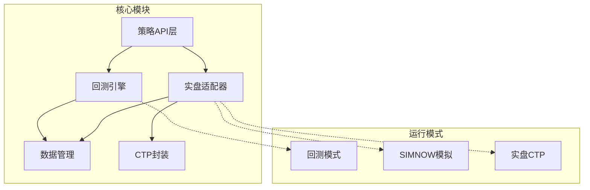
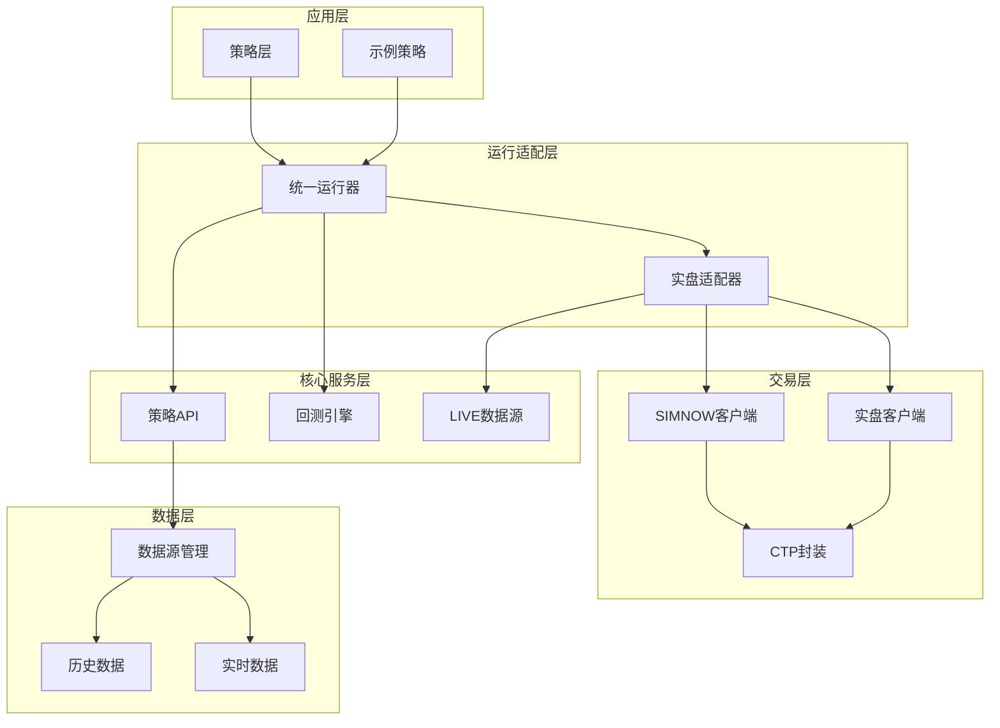
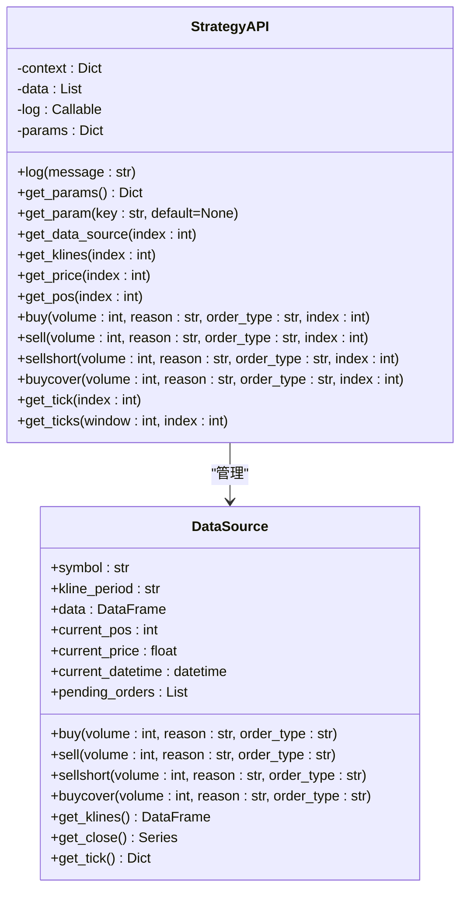
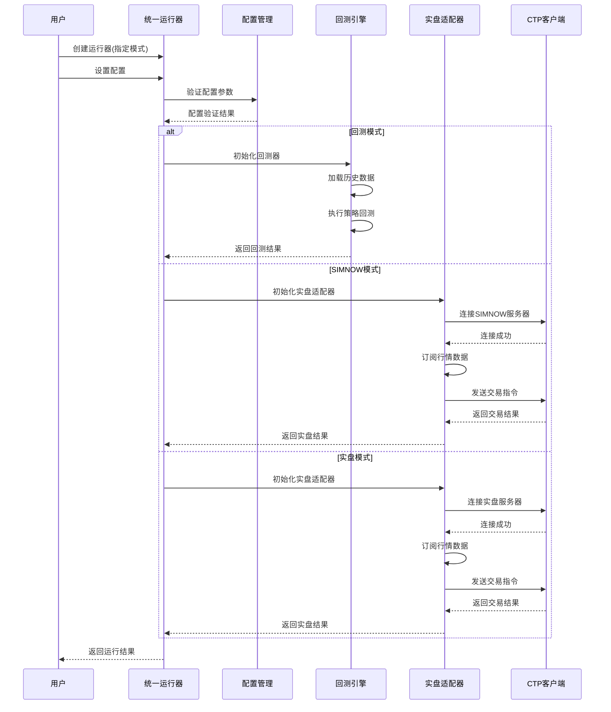
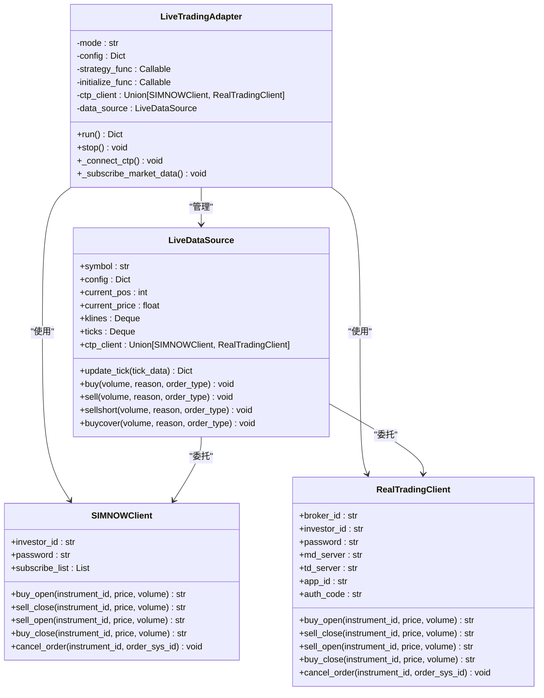
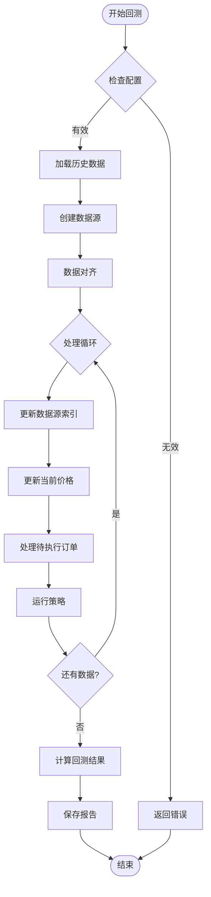
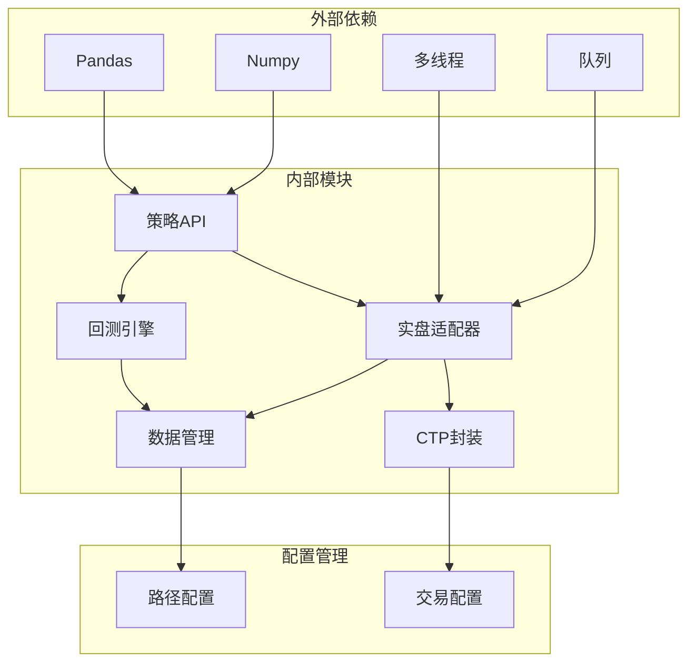

# 核心特性

<cite>
**本文档引用的文件**
- [README.md](file://README.md)
- [ssquant/__init__.py](file://ssquant/__init__.py)
- [ssquant/api/strategy_api.py](file://ssquant/api/strategy_api.py)
- [ssquant/backtest/unified_runner.py](file://ssquant/backtest/unified_runner.py)
- [ssquant/backtest/backtest_core.py](file://ssquant/backtest/backtest_core.py)
- [ssquant/data/data_source.py](file://ssquant/data/data_source.py)
- [ssquant/backtest/live_trading_adapter.py](file://ssquant/backtest/live_trading_adapter.py)
- [ssquant/pyctp/simnow_client.py](file://ssquant/pyctp/simnow_client.py)
- [ssquant/pyctp/real_trading_client.py](file://ssquant/pyctp/real_trading_client.py)
- [examples/B_双均线策略.py](file://examples/B_双均线策略.py)
- [examples/B_多品种多周期交易策略.py](file://examples/B_多品种多周期交易策略.py)
- [examples/C_纯Tick高频交易策略.py](file://examples/C_纯Tick高频交易策略.py)
</cite>

## 目录
1. [简介](#简介)
2. [项目结构](#项目结构)
3. [核心组件](#核心组件)
4. [架构概览](#架构概览)
5. [详细组件分析](#详细组件分析)
6. [依赖关系分析](#依赖关系分析)
7. [性能考虑](#性能考虑)
8. [故障排除指南](#故障排除指南)
9. [结论](#结论)

## 简介

SSQuant期货量化交易框架是一个专业的期货CTP量化交易系统，其核心特色是"一套代码三处运行"的独特设计理念。该框架实现了统一的策略框架，支持在同一份策略代码下无缝切换运行于回测、SIMNOW模拟交易和实盘CTP交易三种环境。

框架的主要优势包括：
- **统一策略框架**：一套代码三处运行，支持回测、SIMNOW模拟、实盘CTP三种运行模式
- **完整的数据支持**：K线数据（1m/5m/15m/30m/1h/4h/1d）+ TICK逐笔数据
- **多品种多周期**：同时交易多个品种，使用不同周期数据
- **强大的交易功能**：自动开平仓管理、智能算法交易、实时回调系统、TICK流双驱动模式

## 项目结构

SSQuant框架采用模块化设计，主要包含以下核心模块：

**图表来源**
- [ssquant/api/strategy_api.py](file://ssquant/api/strategy_api.py#L1-L570)
- [ssquant/backtest/unified_runner.py](file://ssquant/backtest/unified_runner.py#L1-L379)
- [ssquant/backtest/live_trading_adapter.py](file://ssquant/backtest/live_trading_adapter.py#L1-L800)

**章节来源**
- [README.md](file://README.md#L297-L321)

## 核心组件

### 统一策略API

StrategyAPI是整个框架的核心接口层，提供了统一的策略开发接口：

- **数据访问**：get_close()、get_open()、get_high()、get_low()、get_volume()、get_klines()、get_tick()
- **持仓查询**：get_pos()、get_long_pos()、get_short_pos()、get_position_detail()
- **交易操作**：buy()、sell()、sellshort()、buycover()、close_all()、reverse_pos()
- **多数据源支持**：支持index参数访问不同数据源

### 统一运行器

UnifiedStrategyRunner实现了"一套代码三处运行"的核心机制：

- **运行模式枚举**：BACKTEST、SIMNOW、REAL_TRADING
- **配置验证**：根据不同模式验证必需参数
- **策略执行**：统一的策略运行接口

### 多数据源回测器

MultiSourceBacktester支持多品种、多周期的复杂回测需求：

- **多数据源管理**：支持同时处理多个品种和周期的数据
- **数据对齐**：自动处理不同周期数据的时间对齐
- **参数优化**：内置参数优化功能

**章节来源**
- [ssquant/api/strategy_api.py](file://ssquant/api/strategy_api.py#L1-L570)
- [ssquant/backtest/unified_runner.py](file://ssquant/backtest/unified_runner.py#L1-L379)
- [ssquant/backtest/backtest_core.py](file://ssquant/backtest/backtest_core.py#L1-L579)

## 架构概览

SSQuant框架采用分层架构设计，实现了高度的模块化和可扩展性：

**图表来源**
- [ssquant/backtest/unified_runner.py](file://ssquant/backtest/unified_runner.py#L26-L57)
- [ssquant/backtest/live_trading_adapter.py](file://ssquant/backtest/live_trading_adapter.py#L235-L322)
- [ssquant/data/data_source.py](file://ssquant/data/data_source.py#L6-L32)

## 详细组件分析

### 统一策略API深度分析

StrategyAPI类设计遵循单一职责原则，专注于提供策略开发所需的核心功能：

**图表来源**
- [ssquant/api/strategy_api.py](file://ssquant/api/strategy_api.py#L4-L570)
- [ssquant/data/data_source.py](file://ssquant/data/data_source.py#L6-L800)

#### API设计特点

1. **统一接口**：所有数据访问和交易操作都通过StrategyAPI统一入口
2. **多数据源支持**：通过index参数支持多个数据源的并行访问
3. **参数化配置**：支持动态参数注入和获取
4. **日志集成**：内置日志系统，便于调试和监控

**章节来源**
- [ssquant/api/strategy_api.py](file://ssquant/api/strategy_api.py#L1-L570)

### 统一运行器工作流程

UnifiedStrategyRunner实现了运行模式的无缝切换：

**图表来源**
- [ssquant/backtest/unified_runner.py](file://ssquant/backtest/unified_runner.py#L162-L213)
- [ssquant/backtest/live_trading_adapter.py](file://ssquant/backtest/live_trading_adapter.py#L631-L657)

#### 运行模式切换机制

1. **配置验证**：根据运行模式验证必需参数
2. **组件初始化**：根据模式选择相应的执行组件
3. **策略执行**：统一的策略调用接口
4. **结果返回**：标准化的结果数据结构

**章节来源**
- [ssquant/backtest/unified_runner.py](file://ssquant/backtest/unified_runner.py#L79-L161)

### 实盘适配器架构

LiveTradingAdapter是连接策略代码和CTP交易系统的桥梁：

**图表来源**
- [ssquant/backtest/live_trading_adapter.py](file://ssquant/backtest/live_trading_adapter.py#L235-L322)
- [ssquant/pyctp/simnow_client.py](file://ssquant/pyctp/simnow_client.py#L590-L800)
- [ssquant/pyctp/real_trading_client.py](file://ssquant/pyctp/real_trading_client.py#L538-L755)

#### 实盘适配器功能特性

1. **双模式支持**：同时支持SIMNOW模拟和实盘CTP交易
2. **数据聚合**：将TICK数据聚合为K线数据
3. **智能算法**：支持订单超时检测和自动重发
4. **数据记录**：异步数据落盘功能

**章节来源**
- [ssquant/backtest/live_trading_adapter.py](file://ssquant/backtest/live_trading_adapter.py#L1-L800)

### 多数据源回测系统

MultiSourceBacktester实现了复杂的多品种、多周期回测功能：

**图表来源**
- [ssquant/backtest/backtest_core.py](file://ssquant/backtest/backtest_core.py#L144-L306)

#### 多数据源处理机制

1. **数据加载**：支持本地文件和远程API两种数据源
2. **数据对齐**：自动处理不同周期数据的时间对齐
3. **多周期支持**：同时处理多个周期的数据
4. **性能优化**：支持数据预加载和参数优化

**章节来源**
- [ssquant/backtest/backtest_core.py](file://ssquant/backtest/backtest_core.py#L1-L579)

## 依赖关系分析

SSQuant框架的依赖关系体现了清晰的分层架构：

**图表来源**
- [ssquant/__init__.py](file://ssquant/__init__.py#L1-L18)
- [ssquant/backtest/unified_runner.py](file://ssquant/backtest/unified_runner.py#L1-L379)

### 关键依赖特性

1. **轻量级设计**：主要依赖Pandas和Numpy，减少第三方依赖
2. **模块化架构**：各模块职责清晰，耦合度低
3. **可扩展性**：支持新的数据源和交易接口
4. **向后兼容**：保持API稳定性

**章节来源**
- [ssquant/__init__.py](file://ssquant/__init__.py#L1-L18)

## 性能考虑

SSQuant框架在性能方面采用了多项优化措施：

### 数据处理优化

1. **数据预加载**：支持历史数据预加载，提高回测效率
2. **内存管理**：使用deque数据结构管理历史数据，控制内存使用
3. **异步写入**：数据记录采用异步队列写入，避免阻塞主流程

### 策略执行优化

1. **参数优化**：内置参数优化功能，支持网格搜索、随机搜索、贝叶斯优化
2. **进度监控**：回测过程显示进度条和性能指标
3. **环境变量控制**：支持通过环境变量控制可视化和日志输出

### 实盘交易优化

1. **订单防重复**：防止同一操作频繁下单
2. **智能算法**：支持订单超时检测和自动重发
3. **多线程处理**：使用多线程处理行情和交易数据

## 故障排除指南

### 常见问题及解决方案

#### CTP功能不可用

**问题描述**：Python版本不匹配导致CTP功能不可用

**解决方案**：
1. 检查Python版本是否在支持范围内（3.9-3.14）
2. 确认相应版本的CTP文件是否存在
3. 重新安装框架以获取正确的CTP文件

#### 回测数据加载失败

**问题描述**：API认证失败或本地数据文件不存在

**解决方案**：
1. 检查trading_config.py中的API认证信息
2. 确认本地数据文件路径配置正确
3. 验证网络连接状态

#### 实盘连接问题

**问题描述**：SIMNOW或实盘连接失败

**解决方案**：
1. 检查账户配置信息（broker_id、investor_id、password等）
2. 验证服务器地址和端口配置
3. 确认网络连接稳定

**章节来源**
- [ssquant/__init__.py](file://ssquant/__init__.py#L14-L18)

## 结论

SSQuant期货量化交易框架通过"一套代码三处运行"的设计理念，成功实现了策略开发的一致性和运行环境的灵活性。框架的核心优势体现在：

1. **统一性**：通过StrategyAPI提供统一的策略开发接口
2. **灵活性**：支持回测、SIMNOW模拟、实盘CTP三种运行模式
3. **完整性**：提供完整的数据支持和交易功能
4. **易用性**：简洁的配置接口和丰富的示例策略

该框架特别适合需要在不同市场阶段验证策略效果的量化投资者，既可以在安全的回测环境中快速验证策略思路，又可以在SIMNOW模拟环境中进行更真实的交易测试，最终在实盘环境中进行真实交易。

通过模块化的设计和清晰的分层架构，SSQuant为期货量化交易提供了一个强大而灵活的基础设施，支持从简单的趋势跟踪策略到复杂的多品种多周期套利策略等各种交易场景。