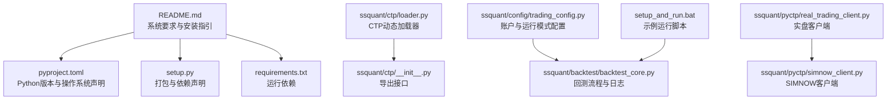
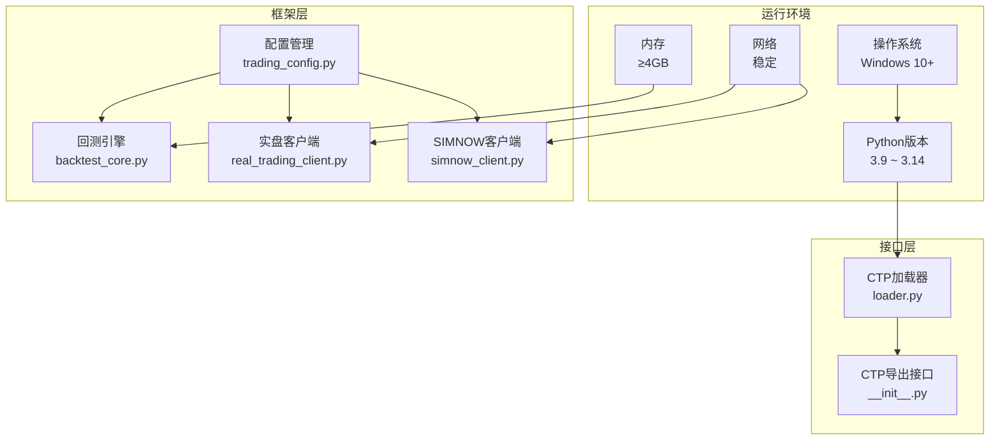
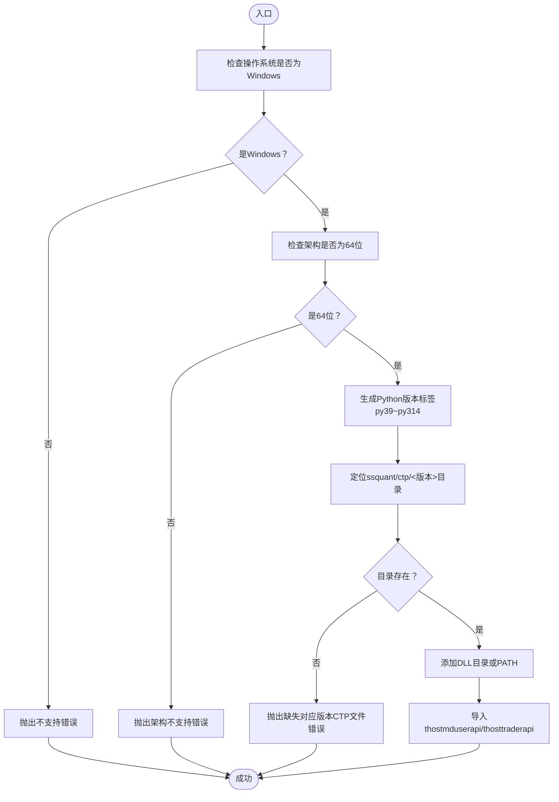
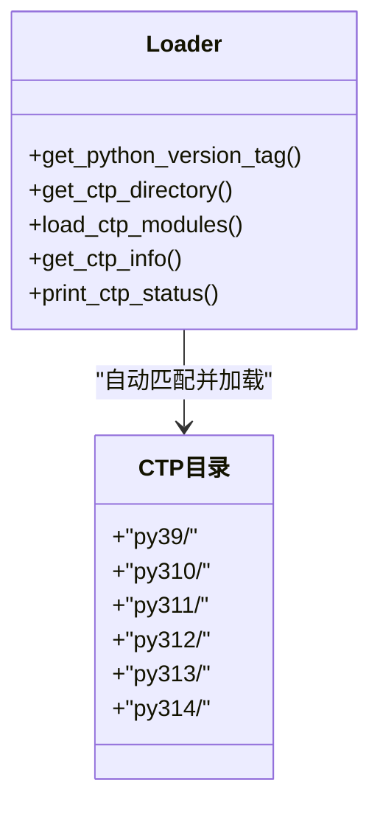
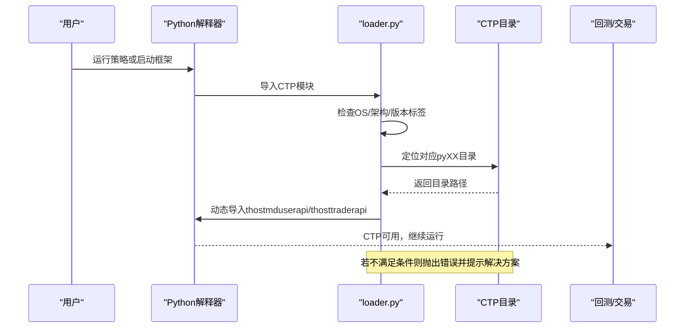
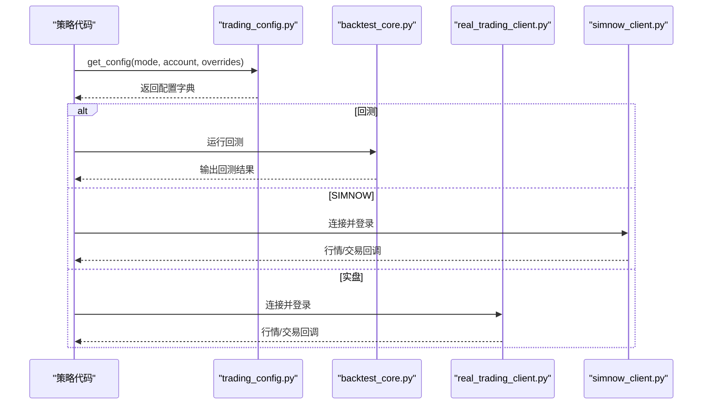
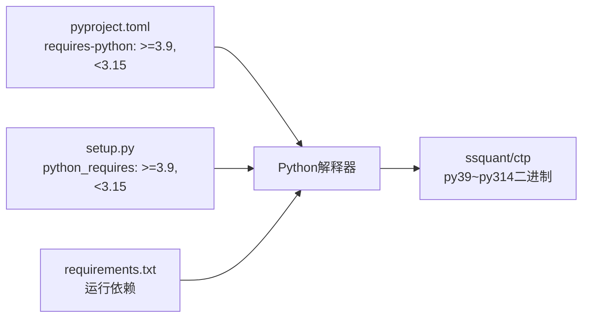
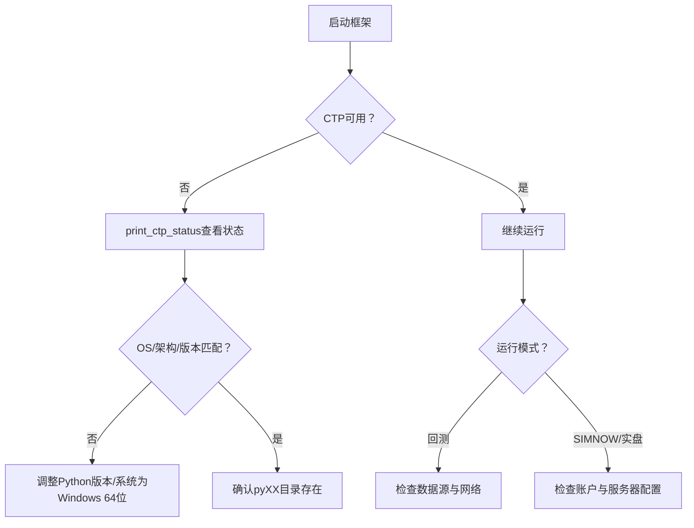

# 系统要求

<cite>
**本文引用的文件**
- [README.md](file://README.md)
- [pyproject.toml](file://pyproject.toml)
- [setup.py](file://setup.py)
- [requirements.txt](file://requirements.txt)
- [ssquant/ctp/loader.py](file://ssquant/ctp/loader.py)
- [ssquant/ctp/__init__.py](file://ssquant/ctp/__init__.py)
- [ssquant/config/trading_config.py](file://ssquant/config/trading_config.py)
- [ssquant/backtest/backtest_core.py](file://ssquant/backtest/backtest_core.py)
- [ssquant/pyctp/real_trading_client.py](file://ssquant/pyctp/real_trading_client.py)
- [ssquant/pyctp/simnow_client.py](file://ssquant/pyctp/simnow_client.py)
- [setup_and_run.bat](file://setup_and_run.bat)
</cite>

## 目录
1. [简介](#简介)
2. [项目结构](#项目结构)
3. [核心组件](#核心组件)
4. [架构总览](#架构总览)
5. [详细组件分析](#详细组件分析)
6. [依赖关系分析](#依赖关系分析)
7. [性能考虑](#性能考虑)
8. [故障排查指南](#故障排查指南)
9. [结论](#结论)
10. [附录](#附录)

## 简介
本文件面向SSQuant期货量化交易框架的使用者与维护者，系统化梳理并明确如下内容：
- 操作系统要求：Windows 10及以上（CTP二进制为Windows DLL/PYD）
- Python版本支持范围：3.9 ~ 3.14
- CTP版本兼容性：6.7.7 ~ 6.7.10（内置各Python版本对应的二进制文件）
- 内存与网络要求：4GB+内存，稳定网络（实盘/SIMNOW）
- 各Python版本对应的CTP二进制文件支持情况
- 不同环境下的安装注意事项与兼容性检查方法
- 常见系统问题的排查与解决方案

## 项目结构
围绕系统要求，项目的关键技术约束主要体现在以下位置：
- 顶层文档与元数据声明：README.md、pyproject.toml、setup.py
- CTP动态加载与版本匹配：ssquant/ctp/loader.py、ssquant/ctp/__init__.py
- 配置与运行模式：ssquant/config/trading_config.py
- 回测与日志：ssquant/backtest/backtest_core.py
- 实盘/SIMNOW客户端：ssquant/pyctp/real_trading_client.py、ssquant/pyctp/simnow_client.py
- 示例批处理：setup_and_run.bat

**图示来源**
- [README.md](file://README.md#L43-L51)
- [pyproject.toml](file://pyproject.toml#L10-L30)
- [setup.py](file://setup.py#L59-L91)
- [requirements.txt](file://requirements.txt#L1-L16)
- [ssquant/ctp/loader.py](file://ssquant/ctp/loader.py#L1-L203)
- [ssquant/ctp/__init__.py](file://ssquant/ctp/__init__.py#L1-L8)
- [ssquant/config/trading_config.py](file://ssquant/config/trading_config.py#L1-L187)
- [ssquant/backtest/backtest_core.py](file://ssquant/backtest/backtest_core.py#L1-L200)
- [ssquant/pyctp/real_trading_client.py](file://ssquant/pyctp/real_trading_client.py#L1-L200)
- [ssquant/pyctp/simnow_client.py](file://ssquant/pyctp/simnow_client.py#L1-L200)
- [setup_and_run.bat](file://setup_and_run.bat#L1-L12)

**章节来源**
- [README.md](file://README.md#L43-L51)
- [pyproject.toml](file://pyproject.toml#L10-L30)
- [setup.py](file://setup.py#L59-L91)
- [requirements.txt](file://requirements.txt#L1-L16)

## 核心组件
- 操作系统与Python版本
  - 操作系统：Windows 10+（CTP二进制为Windows DLL/PYD）
  - Python版本：3.9 ~ 3.14（打包元数据与分类器声明）
- CTP版本与二进制文件
  - CTP版本：6.7.7 ~ 6.7.10（内置）
  - Python版本与CTP二进制映射：py39 ~ py314目录（loader自动匹配）
- 内存与网络
  - 内存：4GB+
  - 网络：实盘/SIMNOW需要稳定网络

**章节来源**
- [README.md](file://README.md#L43-L51)
- [README.md](file://README.md#L370-L390)
- [pyproject.toml](file://pyproject.toml#L10-L30)
- [setup.py](file://setup.py#L59-L91)
- [ssquant/ctp/loader.py](file://ssquant/ctp/loader.py#L19-L82)

## 架构总览
下图展示系统要求在框架中的落地方式与交互关系。

**图示来源**
- [README.md](file://README.md#L43-L51)
- [README.md](file://README.md#L370-L390)
- [pyproject.toml](file://pyproject.toml#L10-L30)
- [setup.py](file://setup.py#L59-L91)
- [ssquant/ctp/loader.py](file://ssquant/ctp/loader.py#L1-L203)
- [ssquant/ctp/__init__.py](file://ssquant/ctp/__init__.py#L1-L8)
- [ssquant/config/trading_config.py](file://ssquant/config/trading_config.py#L1-L187)
- [ssquant/backtest/backtest_core.py](file://ssquant/backtest/backtest_core.py#L1-L200)
- [ssquant/pyctp/real_trading_client.py](file://ssquant/pyctp/real_trading_client.py#L1-L200)
- [ssquant/pyctp/simnow_client.py](file://ssquant/pyctp/simnow_client.py#L1-L200)

## 详细组件分析

### CTP动态加载器与版本匹配
- 自动匹配当前Python主次版本，生成py39/py310/py311/py312/py313/py314目录标签
- 仅支持Windows 64位；若不满足则抛出明确错误
- 动态添加DLL目录或PATH，导入thostmduserapi/thosttraderapi
- 提供状态查询与打印接口，便于诊断

**图示来源**
- [ssquant/ctp/loader.py](file://ssquant/ctp/loader.py#L36-L81)
- [ssquant/ctp/loader.py](file://ssquant/ctp/loader.py#L103-L121)

**章节来源**
- [ssquant/ctp/loader.py](file://ssquant/ctp/loader.py#L1-L203)

### Python版本与CTP二进制文件支持矩阵
- 框架内置CTP 6.7.7 ~ 6.7.10，并为Python 3.9 ~ 3.14分别提供对应二进制文件目录
- 通过loader.py自动选择匹配的目录，确保API与解释器版本一致

**图示来源**
- [ssquant/ctp/loader.py](file://ssquant/ctp/loader.py#L19-L82)
- [README.md](file://README.md#L377-L389)

**章节来源**
- [README.md](file://README.md#L377-L389)
- [ssquant/ctp/loader.py](file://ssquant/ctp/loader.py#L19-L82)

### 安装与兼容性检查
- 安装方式
  - pip安装（推荐）
  - 源码安装（开发/调试）
- 兼容性检查
  - CTP状态打印：print_ctp_status
  - 模块加载调试：backtest_core中可调用调试信息输出
  - 常见问题排查：ModuleNotFoundError等

**图示来源**
- [ssquant/ctp/loader.py](file://ssquant/ctp/loader.py#L84-L122)
- [ssquant/backtest/backtest_core.py](file://ssquant/backtest/backtest_core.py#L160-L169)

**章节来源**
- [README.md](file://README.md#L56-L120)
- [ssquant/ctp/loader.py](file://ssquant/ctp/loader.py#L151-L170)
- [ssquant/backtest/backtest_core.py](file://ssquant/backtest/backtest_core.py#L160-L169)

### 运行模式与配置
- 支持回测、SIMNOW模拟、实盘交易三种模式
- 账户配置集中于trading_config.py，按模式注入参数
- 回测引擎统一调度，日志与可视化辅助排障

**图示来源**
- [ssquant/config/trading_config.py](file://ssquant/config/trading_config.py#L115-L164)
- [ssquant/backtest/backtest_core.py](file://ssquant/backtest/backtest_core.py#L144-L200)
- [ssquant/pyctp/real_trading_client.py](file://ssquant/pyctp/real_trading_client.py#L129-L196)
- [ssquant/pyctp/simnow_client.py](file://ssquant/pyctp/simnow_client.py#L146-L200)

**章节来源**
- [ssquant/config/trading_config.py](file://ssquant/config/trading_config.py#L1-L187)
- [ssquant/backtest/backtest_core.py](file://ssquant/backtest/backtest_core.py#L1-L200)
- [ssquant/pyctp/real_trading_client.py](file://ssquant/pyctp/real_trading_client.py#L1-L200)
- [ssquant/pyctp/simnow_client.py](file://ssquant/pyctp/simnow_client.py#L1-L200)

## 依赖关系分析
- Python版本要求：>=3.9,<3.15（打包元数据与分类器）
- 操作系统：Microsoft :: Windows（分类器）
- 运行依赖：pandas、numpy、requests等
- CTP二进制打包：package-data包含py*目录下的二进制与资源文件

**图示来源**
- [pyproject.toml](file://pyproject.toml#L10-L40)
- [setup.py](file://setup.py#L59-L74)
- [requirements.txt](file://requirements.txt#L1-L16)
- [ssquant/ctp/loader.py](file://ssquant/ctp/loader.py#L64-L65)

**章节来源**
- [pyproject.toml](file://pyproject.toml#L10-L40)
- [setup.py](file://setup.py#L59-L74)
- [requirements.txt](file://requirements.txt#L1-L16)
- [ssquant/ctp/loader.py](file://ssquant/ctp/loader.py#L64-L65)

## 性能考虑
- 内存：建议4GB以上，回测与多数据源场景更需充足内存
- 网络：实盘/SIMNOW需稳定网络，避免频繁断连导致交易异常
- 并行与句柄：Windows平台并行任务数受限，建议控制并发规模

**章节来源**
- [README.md](file://README.md#L43-L51)
- [README.md](file://README.md#L48-L49)
- [examples/B_多品种多周期交易策略_参数优化.py](file://examples/B_多品种多周期交易策略_参数优化.py#L6-L19)

## 故障排查指南
- CTP不可用
  - 现象：CTP模块不可用，但回测仍可运行
  - 排查：使用print_ctp_status查看状态与错误信息；确认操作系统为Windows且为64位；确认对应Python版本的pyXX目录存在
- 模块导入错误
  - 现象：ModuleNotFoundError: No module named 'ssquant'
  - 排查：检查是否已安装；重新安装或从源码安装；验证导入
- 数据源为空
  - 现象：回测日志提示“所有数据源均为空”
  - 排查：检查trading_config.py中的API认证配置；确认本地数据文件存在；检查网络连接
- 实盘/SIMNOW登录失败
  - 现象：登录/认证响应错误
  - 排查：核对broker_id、investor_id、密码、app_id、auth_code；检查服务器地址与端口；关注错误码与错误描述

**图示来源**
- [ssquant/ctp/loader.py](file://ssquant/ctp/loader.py#L151-L170)
- [README.md](file://README.md#L90-L120)
- [ssquant/backtest/backtest_core.py](file://ssquant/backtest/backtest_core.py#L170-L174)
- [ssquant/pyctp/real_trading_client.py](file://ssquant/pyctp/real_trading_client.py#L130-L196)
- [ssquant/pyctp/simnow_client.py](file://ssquant/pyctp/simnow_client.py#L146-L200)

**章节来源**
- [README.md](file://README.md#L90-L120)
- [ssquant/ctp/loader.py](file://ssquant/ctp/loader.py#L151-L170)
- [ssquant/backtest/backtest_core.py](file://ssquant/backtest/backtest_core.py#L170-L174)
- [ssquant/pyctp/real_trading_client.py](file://ssquant/pyctp/real_trading_client.py#L130-L196)
- [ssquant/pyctp/simnow_client.py](file://ssquant/pyctp/simnow_client.py#L146-L200)

## 结论
- SSQuant当前严格限定在Windows 10+与Python 3.9 ~ 3.14范围内运行
- CTP版本6.7.7 ~ 6.7.10通过内置各Python版本对应的二进制文件实现兼容
- 安装与运行过程中，建议优先使用pip安装；遇到问题可通过print_ctp_status与回测日志快速定位
- 实盘与SIMNOW需要稳定的网络与正确的账户配置

## 附录
- 安装与运行示例
  - 使用批处理脚本运行示例策略并查看日志尾部输出
- 常用检查清单
  - Python版本与架构匹配
  - Windows 64位系统
  - 对应pyXX目录存在
  - 网络稳定
  - 账户配置正确

**章节来源**
- [setup_and_run.bat](file://setup_and_run.bat#L1-L12)