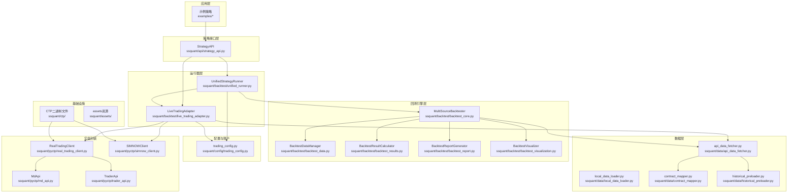
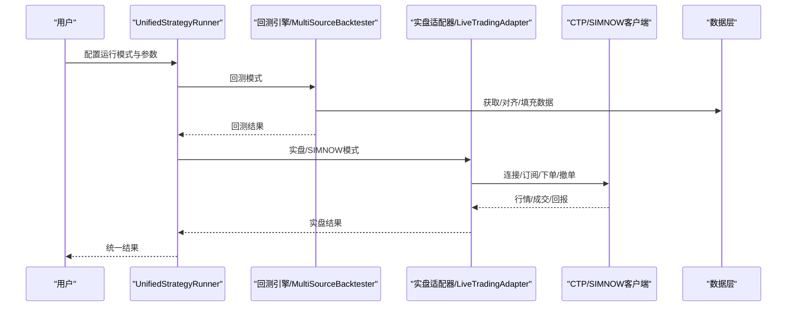
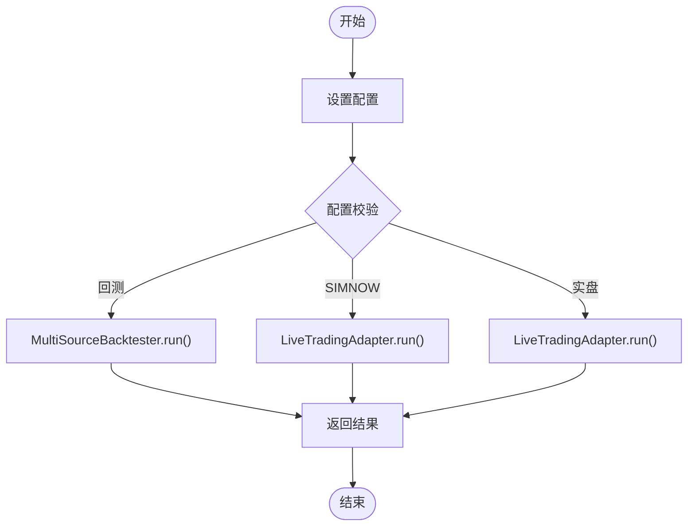
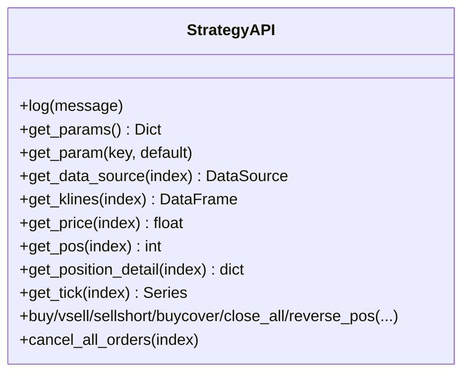
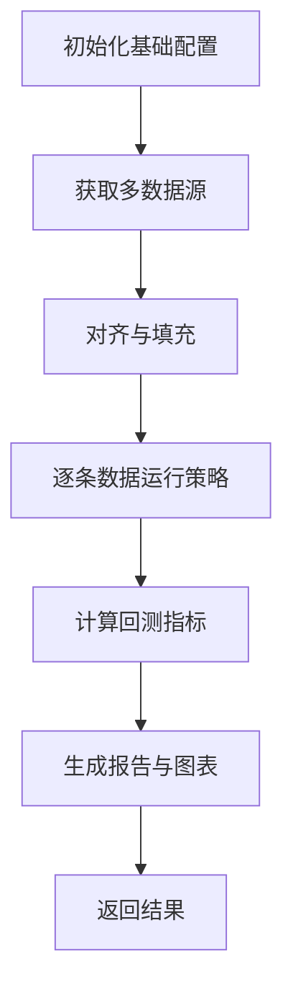
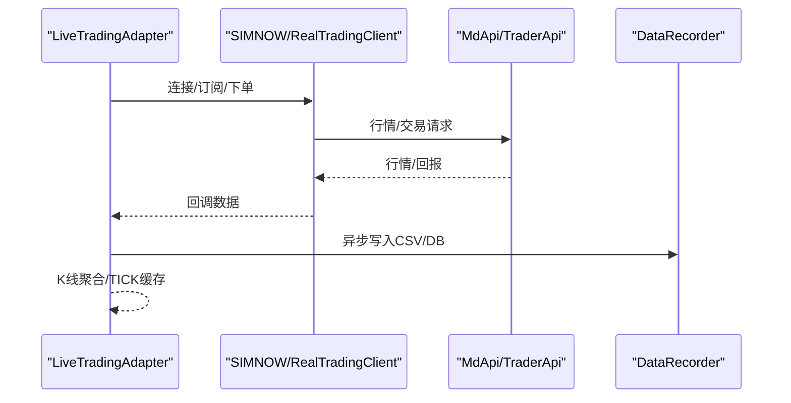
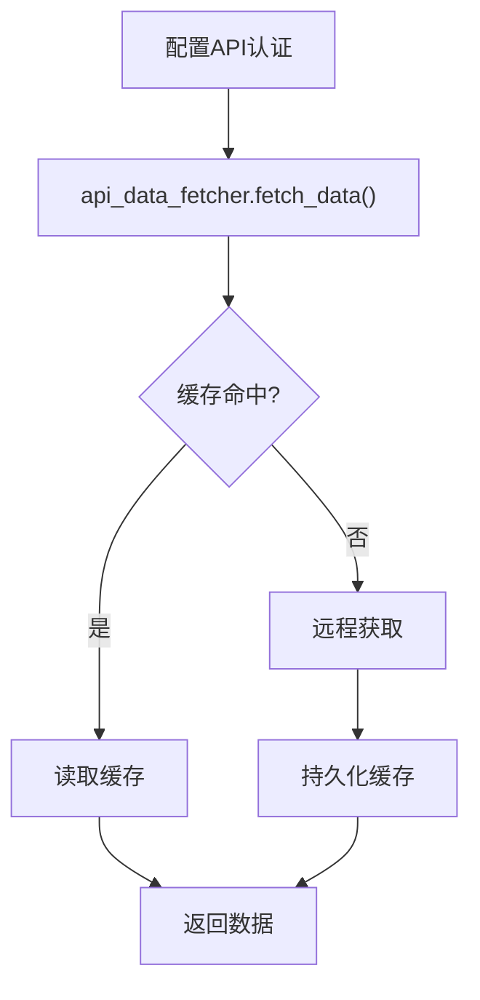
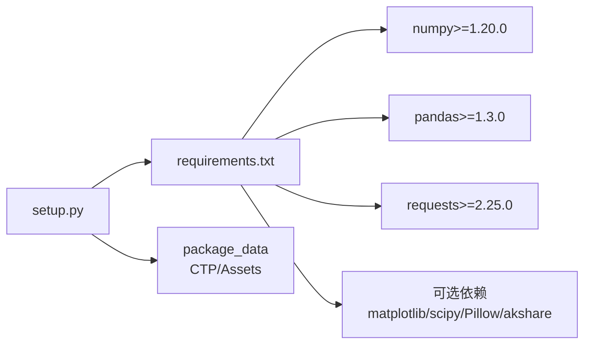

# 项目概述

<cite>
**本文档引用的文件**
- [README.md](file://README.md)
- [setup.py](file://setup.py)
- [requirements.txt](file://requirements.txt)
- [ssquant/__init__.py](file://ssquant/__init__.py)
- [ssquant/api/strategy_api.py](file://ssquant/api/strategy_api.py)
- [ssquant/backtest/unified_runner.py](file://ssquant/backtest/unified_runner.py)
- [ssquant/backtest/backtest_core.py](file://ssquant/backtest/backtest_core.py)
- [ssquant/backtest/live_trading_adapter.py](file://ssquant/backtest/live_trading_adapter.py)
- [ssquant/config/trading_config.py](file://ssquant/config/trading_config.py)
- [ssquant/data/api_data_fetcher.py](file://ssquant/data/api_data_fetcher.py)
- [ssquant/pyctp/real_trading_client.py](file://ssquant/pyctp/real_trading_client.py)
- [examples/B_双均线策略.py](file://examples/B_双均线策略.py)
- [examples/C_纯Tick高频交易策略.py](file://examples/C_纯Tick高频交易策略.py)
</cite>

## 目录
1. [简介](#简介)
2. [项目结构](#项目结构)
3. [核心组件](#核心组件)
4. [架构总览](#架构总览)
5. [详细组件分析](#详细组件分析)
6. [依赖关系分析](#依赖关系分析)
7. [性能考量](#性能考量)
8. [故障排除指南](#故障排除指南)
9. [结论](#结论)
10. [附录](#附录)

## 简介
SSQuant 是一款面向中国期货市场的量化交易框架，专注于提供“一套代码三处运行”的统一策略开发体验：同一套策略代码可在历史回测、SIMNOW 模拟交易与实盘 CTP 交易三种环境中无缝切换。项目强调易用性与实用性，提供完整的数据支持（K线与TICK）、多品种多周期、自动开平仓管理、智能算法交易、实时回调系统以及丰富的策略示例，适合从入门到高级的各类用户。

核心价值主张：
- 统一策略接口：StrategyAPI 提供一致的数据访问与交易操作，屏蔽回测与实盘差异
- 三环境一体化：通过配置切换运行模式，策略代码零改动
- 完整数据链路：支持历史数据回测与实时数据落地（CSV/DB）
- 实战导向：SIMNOW 模拟与实盘 CTP 集成，提供订单超时、撤单重发等实战能力

## 项目结构
项目采用模块化分层设计，围绕策略 API、回测引擎、实盘适配器、数据管理与配置管理展开，配合示例策略形成完整的开发与运行闭环。

**图示来源**
- [ssquant/backtest/unified_runner.py](file://ssquant/backtest/unified_runner.py#L26-L379)
- [ssquant/backtest/backtest_core.py](file://ssquant/backtest/backtest_core.py#L14-L579)
- [ssquant/backtest/live_trading_adapter.py](file://ssquant/backtest/live_trading_adapter.py#L1-L800)
- [ssquant/api/strategy_api.py](file://ssquant/api/strategy_api.py#L4-L570)
- [ssquant/data/api_data_fetcher.py](file://ssquant/data/api_data_fetcher.py#L1-L800)
- [ssquant/config/trading_config.py](file://ssquant/config/trading_config.py#L1-L187)
- [ssquant/pyctp/real_trading_client.py](file://ssquant/pyctp/real_trading_client.py#L538-L755)

**章节来源**
- [README.md](file://README.md#L297-L321)

## 核心组件
- 策略 API（StrategyAPI）：提供统一的数据访问与交易操作接口，屏蔽回测与实盘差异，支持多数据源访问与参数传递
- 统一运行器（UnifiedStrategyRunner）：支持回测、SIMNOW 模拟与实盘 CTP 三种模式，通过配置切换运行环境
- 回测引擎（MultiSourceBacktester）：多品种多周期回测，支持数据对齐、填充、参数优化与结果可视化
- 实盘适配器（LiveTradingAdapter）：将 CTP 实盘接口适配为与回测一致的 API 调用方式，支持数据记录、历史数据预加载与智能算法交易
- 数据管理：API 数据获取、本地数据加载、合约映射与历史数据预加载
- 配置管理：账户配置、运行参数与数据 API 认证
- 实盘封装：SIMNOW 与 CTP 实盘客户端，提供行情与交易回调

**章节来源**
- [ssquant/api/strategy_api.py](file://ssquant/api/strategy_api.py#L4-L570)
- [ssquant/backtest/unified_runner.py](file://ssquant/backtest/unified_runner.py#L26-L379)
- [ssquant/backtest/backtest_core.py](file://ssquant/backtest/backtest_core.py#L14-L579)
- [ssquant/backtest/live_trading_adapter.py](file://ssquant/backtest/live_trading_adapter.py#L235-L800)
- [ssquant/config/trading_config.py](file://ssquant/config/trading_config.py#L1-L187)

## 架构总览
SSQuant 采用“策略 API + 运行器 + 引擎/适配器 + 数据 + 配置”的分层架构，核心思想是“策略代码与运行环境解耦”。策略通过 StrategyAPI 访问数据与执行交易，运行器根据配置选择回测或实盘路径，引擎负责回测流程，适配器负责实盘桥接与数据落地。

**图示来源**
- [ssquant/backtest/unified_runner.py](file://ssquant/backtest/unified_runner.py#L206-L372)
- [ssquant/backtest/backtest_core.py](file://ssquant/backtest/backtest_core.py#L144-L306)
- [ssquant/backtest/live_trading_adapter.py](file://ssquant/backtest/live_trading_adapter.py#L631-L755)

## 详细组件分析

### 组件A：统一运行器（UnifiedStrategyRunner）
- 职责：根据运行模式（回测/SIMNOW/实盘）调度相应执行路径，校验配置，封装策略运行生命周期
- 关键流程：配置校验 → 选择运行器 → 执行策略 → 汇总结果
- 优势：策略代码零改动，仅通过配置切换模式

**图示来源**
- [ssquant/backtest/unified_runner.py](file://ssquant/backtest/unified_runner.py#L79-L214)

**章节来源**
- [ssquant/backtest/unified_runner.py](file://ssquant/backtest/unified_runner.py#L26-L379)

### 组件B：策略API（StrategyAPI）
- 职责：提供统一的数据访问（K线/TICK/持仓）与交易操作（开平仓、反手、撤单等），支持多数据源与参数注入
- 设计要点：方法命名清晰、参数丰富、兼容回测与实盘差异、提供 TCK 流优化

**图示来源**
- [ssquant/api/strategy_api.py](file://ssquant/api/strategy_api.py#L4-L570)

**章节来源**
- [ssquant/api/strategy_api.py](file://ssquant/api/strategy_api.py#L4-L570)

### 组件C：回测引擎（MultiSourceBacktester）
- 职责：多品种多周期回测，数据对齐与填充、参数优化、结果计算与可视化
- 特色：支持预加载数据、参数网格/随机/贝叶斯优化、性能报告生成

**图示来源**
- [ssquant/backtest/backtest_core.py](file://ssquant/backtest/backtest_core.py#L144-L380)

**章节来源**
- [ssquant/backtest/backtest_core.py](file://ssquant/backtest/backtest_core.py#L14-L579)

### 组件D：实盘适配器（LiveTradingAdapter）
- 职责：桥接 CTP/SIMNOW 实盘接口，提供统一 API、数据记录（CSV/DB）、历史数据预加载、智能算法交易（超时撤单、重发）
- 特色：异步写入、订单冷却、K线聚合、TICK流双驱动

**图示来源**
- [ssquant/backtest/live_trading_adapter.py](file://ssquant/backtest/live_trading_adapter.py#L26-L233)
- [ssquant/pyctp/real_trading_client.py](file://ssquant/pyctp/real_trading_client.py#L538-L755)

**章节来源**
- [ssquant/backtest/live_trading_adapter.py](file://ssquant/backtest/live_trading_adapter.py#L235-L800)
- [ssquant/pyctp/real_trading_client.py](file://ssquant/pyctp/real_trading_client.py#L538-L755)

### 组件E：数据管理与API
- API 数据获取：支持 K 线与 TICK 数据，自动交易日历与缓存策略
- 合约映射与历史预加载：支持主连与具体合约映射，历史数据预加载提升实盘效率

**图示来源**
- [ssquant/data/api_data_fetcher.py](file://ssquant/data/api_data_fetcher.py#L171-L626)

**章节来源**
- [ssquant/data/api_data_fetcher.py](file://ssquant/data/api_data_fetcher.py#L1-L800)

### 组件F：配置与账户
- 配置集中管理：数据 API 认证、账户（SIMNOW/实盘）、运行参数、数据保存路径等
- 支持动态覆盖与账户扩展

**章节来源**
- [ssquant/config/trading_config.py](file://ssquant/config/trading_config.py#L1-L187)

## 依赖关系分析
- 依赖声明：核心依赖 numpy、pandas、requests；可选依赖 matplotlib、scipy、Pillow、akshare
- 包数据：包含 CTP 二进制文件与资源文件，支持多 Python 版本
- 许可与分类：非商业许可，面向金融与开发者

**图示来源**
- [setup.py](file://setup.py#L16-L74)
- [requirements.txt](file://requirements.txt#L1-L16)

**章节来源**
- [setup.py](file://setup.py#L1-L110)
- [requirements.txt](file://requirements.txt#L1-L16)

## 性能考量
- 回测性能：支持数据预加载、参数优化模式下的静默输出、环境变量控制可视化与日志输出
- 实盘性能：异步数据记录、订单冷却、K线聚合与成交量增量计算，降低实时处理开销
- 数据效率：交易日历缓存、SQLite 缓存、历史数据预加载，减少网络与磁盘 IO

[本节为通用指导，无需特定文件引用]

## 故障排除指南
- ModuleNotFoundError: No module named 'ssquant'
  - 检查是否已安装，或使用源码安装
- CTP 功能不可用
  - 检查 Python 版本与 CTP 二进制匹配，查看初始化警告
- SIMNOW/实盘登录失败
  - 核对账户配置、服务器名称、认证参数
- 订单超时/撤单重发
  - 检查智能算法交易配置与超时阈值

**章节来源**
- [README.md](file://README.md#L90-L120)
- [ssquant/__init__.py](file://ssquant/__init__.py#L1-L18)
- [ssquant/backtest/live_trading_adapter.py](file://ssquant/backtest/live_trading_adapter.py#L416-L460)

## 结论
SSQuant 通过统一策略 API 与运行器，实现了“一套代码三处运行”的核心理念，兼顾回测严谨性与实盘实战性。其模块化架构、完善的配置体系与丰富的示例策略，使得从入门到高级的用户都能快速上手并构建稳健的量化交易系统。

[本节为总结性内容，无需特定文件引用]

## 附录

### 系统要求与安装
- 系统：Windows 10+（当前仅支持 Windows）
- Python：3.9 ~ 3.14
- 内存：4GB+
- 网络：稳定连接（实盘/SIMNOW）

安装方式：
- pip 安装（推荐）
- 源码安装（开发模式）

**章节来源**
- [README.md](file://README.md#L43-L120)

### 快速开始示例
- 回测：配置 symbol、start_date、end_date、kline_period 等
- SIMNOW：配置 account、server_name、symbol、kline_period 等
- 实盘：配置 broker_id、investor_id、md_server、td_server、app_id、auth_code 等

**章节来源**
- [examples/B_双均线策略.py](file://examples/B_双均线策略.py#L134-L269)
- [examples/C_纯Tick高频交易策略.py](file://examples/C_纯Tick高频交易策略.py#L315-L463)

### 版本信息与社区
- 版本：0.3.8
- 更新日志：涵盖 CTP 登录乱码修复、TICK 流双驱动、多品种多周期支持等
- 社区资源：PyPI、GitHub、Gitee、用户手册、API 参考

**章节来源**
- [README.md](file://README.md#L413-L441)
- [setup.py](file://setup.py#L28-L34)