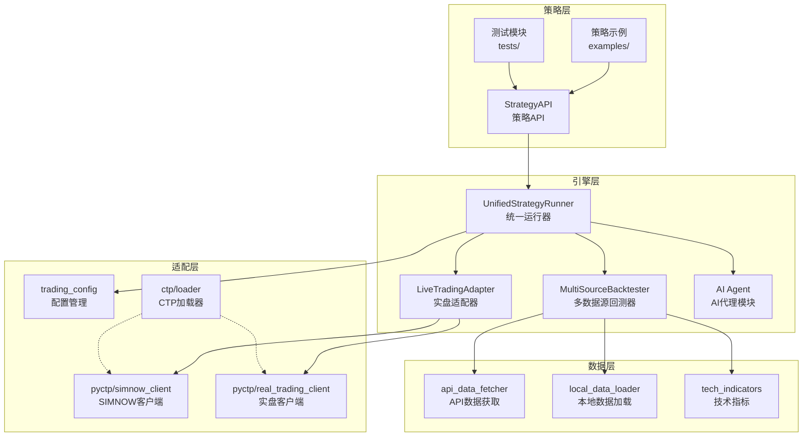
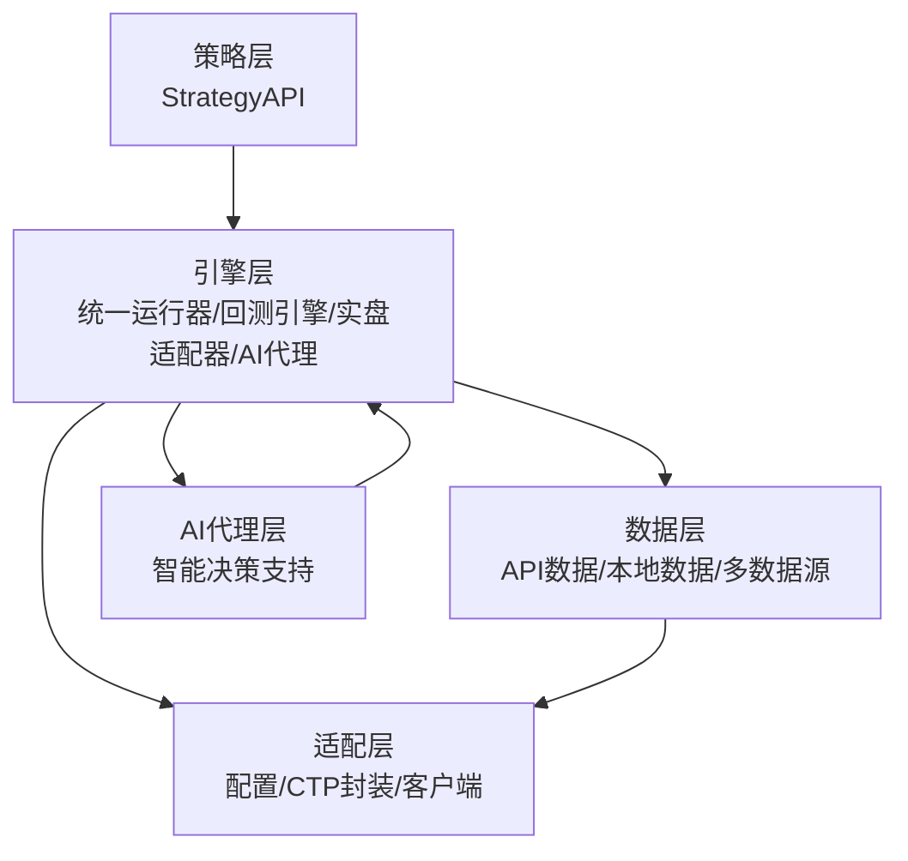
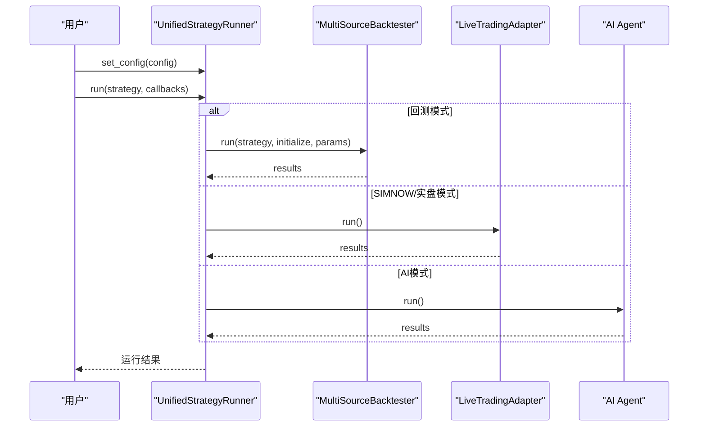
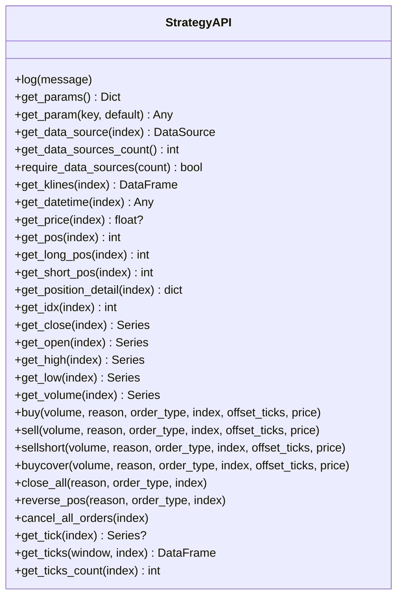
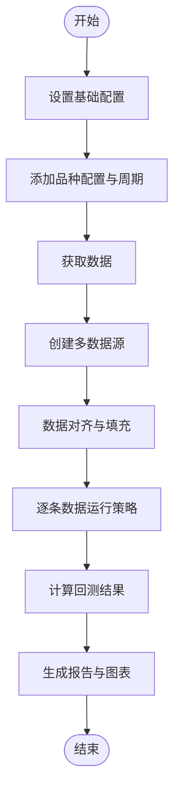
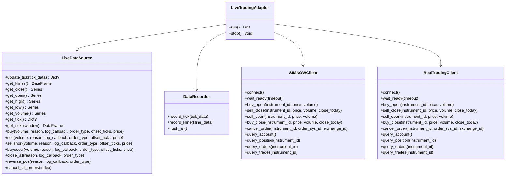
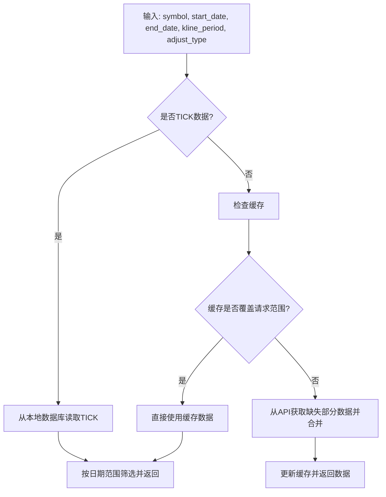
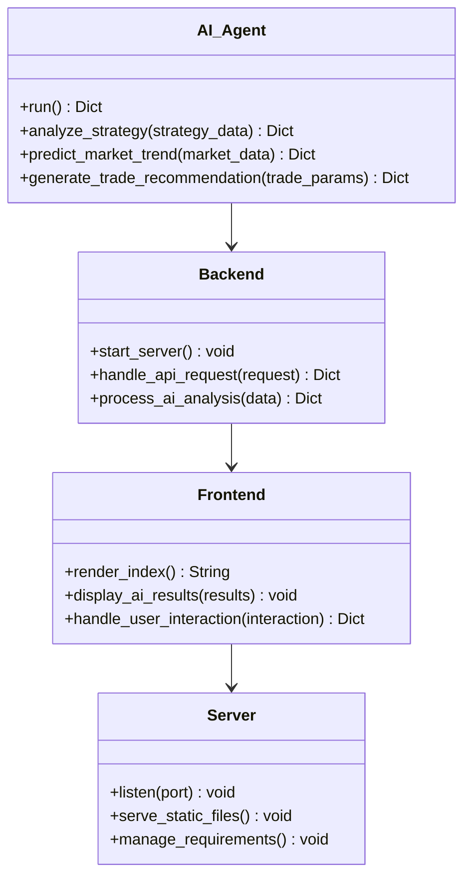
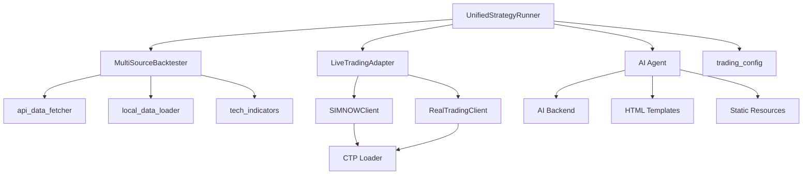

# 项目结构

<cite>
**本文档引用的文件**
- [README.md](file://README.md)
- [ssquant/__init__.py](file://ssquant/__init__.py)
- [ssquant/api/__init__.py](file://ssquant/api/__init__.py)
- [ssquant/api/strategy_api.py](file://ssquant/api/strategy_api.py)
- [ssquant/backtest/__init__.py](file://ssquant/backtest/__init__.py)
- [ssquant/backtest/unified_runner.py](file://ssquant/backtest/unified_runner.py)
- [ssquant/backtest/backtest_core.py](file://ssquant/backtest/backtest_core.py)
- [ssquant/backtest/live_trading_adapter.py](file://ssquant/backtest/live_trading_adapter.py)
- [ssquant/data/__init__.py](file://ssquant/data/__init__.py)
- [ssquant/data/api_data_fetcher.py](file://ssquant/data/api_data_fetcher.py)
- [ssquant/data/local_data_loader.py](file://ssquant/data/local_data_loader.py)
- [ssquant/config/__init__.py](file://ssquant/config/__init__.py)
- [ssquant/config/trading_config.py](file://ssquant/config/trading_config.py)
- [ssquant/ctp/loader.py](file://ssquant/ctp/loader.py)
- [ssquant/indicators/tech_indicators.py](file://ssquant/indicators/tech_indicators.py)
- [ssquant/pyctp/simnow_client.py](file://ssquant/pyctp/simnow_client.py)
- [ssquant/pyctp/real_trading_client.py](file://ssquant/pyctp/real_trading_client.py)
- [ai_agent/README.md](file://ai_agent/README.md)
- [ai_agent/backend.py](file://ai_agent/backend.py)
- [ai_agent/start_server.py](file://ai_agent/start_server.py)
- [ssquant/backtest/README.md](file://ssquant/backtest/README.md)
</cite>

## 更新摘要
**所做更改**
- 移除了关于 README_公众号版.md 的引用和相关内容
- 更新了项目结构说明以反映文档整合后的简化架构
- 新增了 AI 代理模块的详细说明和架构分析
- 优化了文件组织结构的描述，移除了冗余的文档引用
- 更新了架构图以包含新的 AI 代理组件

## 目录
1. [简介](#简介)
2. [项目结构](#项目结构)
3. [核心组件](#核心组件)
4. [架构总览](#架构总览)
5. [详细组件分析](#详细组件分析)
6. [依赖关系分析](#依赖关系分析)
7. [性能考虑](#性能考虑)
8. [故障排除指南](#故障排除指南)
9. [结论](#结论)

## 简介
SSQuant 是一个专业的期货量化交易框架，支持"一套代码三处运行"：回测、SIMNOW 模拟交易与实盘 CTP 交易。框架提供统一的策略 API、多数据源管理、多周期回测、智能算法交易（限价排队、超时撤单、追价重发）、TICK 流双驱动（K 线驱动 + TICK 驱动）等能力，覆盖趋势、套利、轮动、期权、机器学习等多种策略类型。

**更新** 项目结构已进行简化优化，移除了冗余文档，整合了相关模块，新增了 AI 代理模块以增强智能化交易能力。

## 项目结构
项目采用模块化分层设计，核心目录与职责如下：
- ssquant/api：策略 API 层，提供策略开发统一接口（StrategyAPI），屏蔽底层数据与交易细节
- ssquant/backtest：回测引擎与统一运行器，支持多数据源、多周期、参数优化、可视化与报告
- ssquant/data：数据管理模块，支持 API 数据获取、本地数据加载、多数据源管理与数据对齐
- ssquant/config：配置管理模块，提供回测默认配置与账户配置（SIMNOW/实盘）
- ssquant/ctp：CTP 二进制文件与动态加载器，按 Python 版本自动加载对应 CTP 库
- ssquant/pyctp：CTP 封装，提供 SIMNOW 客户端与实盘客户端，封装行情与交易回调
- ssquant/indicators：技术指标库，提供常用技术指标计算函数
- ai_agent：AI 代理模块，提供智能化交易决策支持
- examples：策略示例集合，涵盖多种交易策略类型
- tests：单元测试与集成测试模块

**图表来源**
- [ssquant/api/strategy_api.py:1-570](file://ssquant/api/strategy_api.py#L1-L570)
- [ssquant/backtest/unified_runner.py:1-379](file://ssquant/backtest/unified_runner.py#L1-L379)
- [ssquant/backtest/backtest_core.py:1-579](file://ssquant/backtest/backtest_core.py#L1-L579)
- [ssquant/backtest/live_trading_adapter.py:1-800](file://ssquant/backtest/live_trading_adapter.py#L1-L800)
- [ssquant/data/api_data_fetcher.py:1-800](file://ssquant/data/api_data_fetcher.py#L1-L800)
- [ssquant/data/local_data_loader.py:1-233](file://ssquant/data/local_data_loader.py#L1-L233)
- [ssquant/config/trading_config.py:1-187](file://ssquant/config/trading_config.py#L1-L187)
- [ssquant/ctp/loader.py:1-203](file://ssquant/ctp/loader.py#L1-L203)
- [ssquant/pyctp/simnow_client.py:1-815](file://ssquant/pyctp/simnow_client.py#L1-L815)
- [ssquant/pyctp/real_trading_client.py:1-755](file://ssquant/pyctp/real_trading_client.py#L1-L755)
- [ai_agent/backend.py:1-200](file://ai_agent/backend.py#L1-L200)

**章节来源**
- [README.md:297-321](file://README.md#L297-L321)
- [ssquant/__init__.py:1-18](file://ssquant/__init__.py#L1-L18)

## 核心组件
- 策略 API（StrategyAPI）：提供统一的数据访问与交易操作接口，支持多数据源、多周期、TICK 数据、持仓查询与交易指令（开平仓、反手、全平、撤单等）
- 统一运行器（UnifiedStrategyRunner）：支持回测、SIMNOW 模拟、实盘三种模式，自动切换运行环境，提供统一的策略运行入口
- 多数据源回测器（MultiSourceBacktester）：支持多品种、多周期回测，提供数据对齐、参数优化、可视化与报告生成功能
- 实盘适配器（LiveTradingAdapter）：将 CTP 实盘接口适配为与回测一致的 API 调用方式，支持 SIMNOW 与实盘客户端
- 数据管理（api_data_fetcher、local_data_loader）：支持从远程 API 获取数据、本地 CSV/HDF5/SQLite/7z 数据加载，提供数据校验与日期筛选
- 配置管理（trading_config）：提供回测默认配置与账户配置（SIMNOW/实盘），支持灵活覆盖参数
- CTP 适配（ctp/loader、pyctp/*）：按 Python 版本自动加载 CTP 库，封装 SIMNOW 与实盘客户端，提供行情与交易回调
- AI 代理模块（ai_agent）：提供智能化交易决策支持，包含后端服务、前端模板和服务器启动脚本

**章节来源**
- [ssquant/api/strategy_api.py:1-570](file://ssquant/api/strategy_api.py#L1-L570)
- [ssquant/backtest/unified_runner.py:1-379](file://ssquant/backtest/unified_runner.py#L1-L379)
- [ssquant/backtest/backtest_core.py:1-579](file://ssquant/backtest/backtest_core.py#L1-L579)
- [ssquant/backtest/live_trading_adapter.py:1-800](file://ssquant/backtest/live_trading_adapter.py#L1-L800)
- [ssquant/data/api_data_fetcher.py:1-800](file://ssquant/data/api_data_fetcher.py#L1-L800)
- [ssquant/data/local_data_loader.py:1-233](file://ssquant/data/local_data_loader.py#L1-L233)
- [ssquant/config/trading_config.py:1-187](file://ssquant/config/trading_config.py#L1-L187)
- [ssquant/ctp/loader.py:1-203](file://ssquant/ctp/loader.py#L1-L203)
- [ssquant/pyctp/simnow_client.py:1-815](file://ssquant/pyctp/simnow_client.py#L1-L815)
- [ssquant/pyctp/real_trading_client.py:1-755](file://ssquant/pyctp/real_trading_client.py#L1-L755)
- [ai_agent/README.md:1-150](file://ai_agent/README.md#L1-L150)
- [ai_agent/backend.py:1-200](file://ai_agent/backend.py#L1-L200)
- [ai_agent/start_server.py:1-100](file://ai_agent/start_server.py#L1-L100)

## 架构总览
框架采用"策略层-引擎层-数据层-适配层"的分层设计：
- 策略层：通过 StrategyAPI 提供统一接口，策略代码无需关心运行环境差异
- 引擎层：统一运行器负责模式切换与生命周期管理；回测引擎负责数据获取、对齐与回测执行；实盘适配器负责 CTP 接口适配；AI 代理模块提供智能化决策支持
- 数据层：统一数据接口，支持 API 与本地数据源，提供多数据源管理与对齐
- 适配层：配置管理、CTP 加载与客户端封装，屏蔽底层差异

**更新** 新增 AI 代理模块作为智能化决策层，与传统策略层并行工作，提供更丰富的交易决策能力。

**图表来源**
- [ssquant/api/strategy_api.py:1-570](file://ssquant/api/strategy_api.py#L1-L570)
- [ssquant/backtest/unified_runner.py:1-379](file://ssquant/backtest/unified_runner.py#L1-L379)
- [ssquant/backtest/backtest_core.py:1-579](file://ssquant/backtest/backtest_core.py#L1-L579)
- [ssquant/backtest/live_trading_adapter.py:1-800](file://ssquant/backtest/live_trading_adapter.py#L1-L800)
- [ssquant/data/api_data_fetcher.py:1-800](file://ssquant/data/api_data_fetcher.py#L1-L800)
- [ssquant/data/local_data_loader.py:1-233](file://ssquant/data/local_data_loader.py#L1-L233)
- [ssquant/config/trading_config.py:1-187](file://ssquant/config/trading_config.py#L1-L187)
- [ssquant/ctp/loader.py:1-203](file://ssquant/ctp/loader.py#L1-L203)
- [ssquant/pyctp/simnow_client.py:1-815](file://ssquant/pyctp/simnow_client.py#L1-L815)
- [ssquant/pyctp/real_trading_client.py:1-755](file://ssquant/pyctp/real_trading_client.py#L1-L755)
- [ai_agent/backend.py:1-200](file://ai_agent/backend.py#L1-L200)

## 详细组件分析

### 组件A：统一运行器（UnifiedStrategyRunner）
统一运行器负责在三种模式（回测、SIMNOW、实盘）之间无缝切换，提供统一的策略运行入口。其核心流程如下：

**图表来源**
- [ssquant/backtest/unified_runner.py:1-379](file://ssquant/backtest/unified_runner.py#L1-L379)
- [ssquant/backtest/backtest_core.py:1-579](file://ssquant/backtest/backtest_core.py#L1-L579)
- [ssquant/backtest/live_trading_adapter.py:1-800](file://ssquant/backtest/live_trading_adapter.py#L1-L800)
- [ai_agent/backend.py:1-200](file://ai_agent/backend.py#L1-L200)

**章节来源**
- [ssquant/backtest/unified_runner.py:1-379](file://ssquant/backtest/unified_runner.py#L1-L379)

### 组件B：策略API（StrategyAPI）
StrategyAPI 是策略开发的核心接口，提供数据访问与交易操作能力，支持多数据源、多周期、TICK 数据与交易指令。其核心方法包括：
- 数据访问：get_klines、get_close、get_open、get_high、get_low、get_volume、get_datetime、get_price、get_tick、get_ticks
- 持仓查询：get_pos、get_long_pos、get_short_pos、get_position_detail
- 交易操作：buy、sell、sellshort、buycover、close_all、reverse_pos、cancel_all_orders
- 多数据源：get_data_source、get_data_sources_count、require_data_sources

**图表来源**
- [ssquant/api/strategy_api.py:1-570](file://ssquant/api/strategy_api.py#L1-L570)

**章节来源**
- [ssquant/api/strategy_api.py:1-570](file://ssquant/api/strategy_api.py#L1-L570)

### 组件C：多数据源回测器（MultiSourceBacktester）
多数据源回测器支持多品种、多周期回测，提供数据获取、对齐、回测执行、结果计算、可视化与报告生成。其核心流程如下：

**图表来源**
- [ssquant/backtest/backtest_core.py:1-579](file://ssquant/backtest/backtest_core.py#L1-L579)

**章节来源**
- [ssquant/backtest/backtest_core.py:1-579](file://ssquant/backtest/backtest_core.py#L1-L579)

### 组件D：实盘适配器（LiveTradingAdapter）
实盘适配器将 CTP 实盘接口适配为与回测一致的 API 调用方式，支持 SIMNOW 与实盘客户端。其核心功能包括：
- 实盘数据源（LiveDataSource）：模拟回测时的 DataSource 接口，支持 K 线聚合、TICK 预加载、智能算法交易（超时撤单、追价重发）
- 数据记录器（DataRecorder）：支持 CSV 与数据库双存储，异步队列写入
- 客户端封装：SIMNOWClient 与 RealTradingClient，提供行情订阅、报单、撤单、查询等功能

**图表来源**
- [ssquant/backtest/live_trading_adapter.py:1-800](file://ssquant/backtest/live_trading_adapter.py#L1-L800)
- [ssquant/pyctp/simnow_client.py:1-815](file://ssquant/pyctp/simnow_client.py#L1-L815)
- [ssquant/pyctp/real_trading_client.py:1-755](file://ssquant/pyctp/real_trading_client.py#L1-L755)

**章节来源**
- [ssquant/backtest/live_trading_adapter.py:1-800](file://ssquant/backtest/live_trading_adapter.py#L1-L800)
- [ssquant/pyctp/simnow_client.py:1-815](file://ssquant/pyctp/simnow_client.py#L1-L815)
- [ssquant/pyctp/real_trading_client.py:1-755](file://ssquant/pyctp/real_trading_client.py#L1-L755)

### 组件E：数据管理（api_data_fetcher、local_data_loader）
数据管理模块提供统一的数据接口，支持从远程 API 获取数据与本地数据加载：
- API 数据获取：支持 K 线与 TICK 数据，自动处理复权、缓存、时区转换、交易日过滤
- 本地数据加载：支持 CSV、HDF5、SQLite、7z 等格式，自动校验字段，支持多文件合并与日期筛选

**图表来源**
- [ssquant/data/api_data_fetcher.py:1-800](file://ssquant/data/api_data_fetcher.py#L1-L800)

**章节来源**
- [ssquant/data/api_data_fetcher.py:1-800](file://ssquant/data/api_data_fetcher.py#L1-L800)
- [ssquant/data/local_data_loader.py:1-233](file://ssquant/data/local_data_loader.py#L1-L233)

### 组件F：配置管理（trading_config）
配置管理模块提供回测默认配置与账户配置，支持灵活覆盖参数：
- 回测默认配置：初始资金、手续费、保证金率、合约乘数、价格跳动、滑点、复权类型、缓存与保存开关、调试模式
- 账户配置：SIMNOW 与实盘账户，包含认证信息、交易参数、智能算法交易配置、历史数据预加载、回调配置、数据保存配置

**章节来源**
- [ssquant/config/trading_config.py:1-187](file://ssquant/config/trading_config.py#L1-L187)

### 组件G：CTP 适配（ctp/loader、pyctp/*）
CTP 适配模块按 Python 版本自动加载对应 CTP 库，并封装 SIMNOW 与实盘客户端：
- CTP 加载器：根据当前 Python 版本自动定位并加载对应 CTP 目录，支持错误提示与状态打印
- SIMNOW 客户端：提供行情订阅、报单、撤单、查询等功能，支持智能重试（平今→平昨）
- 实盘客户端：封装期货公司实盘环境的行情与交易回调，支持产品认证与结算单确认

**章节来源**
- [ssquant/ctp/loader.py:1-203](file://ssquant/ctp/loader.py#L1-L203)
- [ssquant/pyctp/simnow_client.py:1-815](file://ssquant/pyctp/simnow_client.py#L1-L815)
- [ssquant/pyctp/real_trading_client.py:1-755](file://ssquant/pyctp/real_trading_client.py#L1-L755)

### 组件H：AI 代理模块（ai_agent）
AI 代理模块提供智能化交易决策支持，包含完整的前后端架构：
- 后端服务（backend.py）：提供 RESTful API 接口，支持策略分析、市场预测和交易建议
- 前端模板（templates/index.html）：提供用户界面，展示 AI 分析结果和交互功能
- 服务器启动（start_server.py）：支持本地开发和部署，提供 HTTP 服务
- 静态资源管理：包含 node_modules、package.json 和 package-lock.json，支持现代化前端开发

**图表来源**
- [ai_agent/backend.py:1-200](file://ai_agent/backend.py#L1-L200)
- [ai_agent/start_server.py:1-100](file://ai_agent/start_server.py#L1-L100)
- [ai_agent/README.md:1-150](file://ai_agent/README.md#L1-L150)

**章节来源**
- [ai_agent/README.md:1-150](file://ai_agent/README.md#L1-L150)
- [ai_agent/backend.py:1-200](file://ai_agent/backend.py#L1-L200)
- [ai_agent/start_server.py:1-100](file://ai_agent/start_server.py#L1-L100)

## 依赖关系分析
- 统一运行器依赖回测引擎与实盘适配器，实现模式切换
- 回测引擎依赖数据管理模块（API 数据获取与本地数据加载）与技术指标库
- 实盘适配器依赖 CTP 加载器与客户端封装（SIMNOW/实盘）
- AI 代理模块独立运行，可与策略层并行工作
- 策略 API 依赖数据源接口，向上提供统一的策略开发接口
- 配置管理模块为运行器与适配器提供参数注入

**更新** 新增 AI 代理模块的依赖关系，该模块相对独立，不依赖传统交易组件。

**图表来源**
- [ssquant/backtest/unified_runner.py:1-379](file://ssquant/backtest/unified_runner.py#L1-L379)
- [ssquant/backtest/backtest_core.py:1-579](file://ssquant/backtest/backtest_core.py#L1-L579)
- [ssquant/backtest/live_trading_adapter.py:1-800](file://ssquant/backtest/live_trading_adapter.py#L1-L800)
- [ssquant/data/api_data_fetcher.py:1-800](file://ssquant/data/api_data_fetcher.py#L1-L800)
- [ssquant/data/local_data_loader.py:1-233](file://ssquant/data/local_data_loader.py#L1-L233)
- [ssquant/indicators/tech_indicators.py:1-322](file://ssquant/indicators/tech_indicators.py#L1-L322)
- [ssquant/ctp/loader.py:1-203](file://ssquant/ctp/loader.py#L1-L203)
- [ssquant/pyctp/simnow_client.py:1-815](file://ssquant/pyctp/simnow_client.py#L1-L815)
- [ssquant/pyctp/real_trading_client.py:1-755](file://ssquant/pyctp/real_trading_client.py#L1-L755)
- [ssquant/config/trading_config.py:1-187](file://ssquant/config/trading_config.py#L1-L187)
- [ai_agent/backend.py:1-200](file://ai_agent/backend.py#L1-L200)

**章节来源**
- [ssquant/backtest/unified_runner.py:1-379](file://ssquant/backtest/unified_runner.py#L1-L379)
- [ssquant/backtest/backtest_core.py:1-579](file://ssquant/backtest/backtest_core.py#L1-L579)
- [ssquant/backtest/live_trading_adapter.py:1-800](file://ssquant/backtest/live_trading_adapter.py#L1-L800)
- [ssquant/data/api_data_fetcher.py:1-800](file://ssquant/data/api_data_fetcher.py#L1-L800)
- [ssquant/data/local_data_loader.py:1-233](file://ssquant/data/local_data_loader.py#L1-L233)
- [ssquant/indicators/tech_indicators.py:1-322](file://ssquant/indicators/tech_indicators.py#L1-L322)
- [ssquant/ctp/loader.py:1-203](file://ssquant/ctp/loader.py#L1-L203)
- [ssquant/pyctp/simnow_client.py:1-815](file://ssquant/pyctp/simnow_client.py#L1-L815)
- [ssquant/pyctp/real_trading_client.py:1-755](file://ssquant/pyctp/real_trading_client.py#L1-L755)
- [ssquant/config/trading_config.py:1-187](file://ssquant/config/trading_config.py#L1-L187)
- [ai_agent/backend.py:1-200](file://ai_agent/backend.py#L1-L200)

## 性能考虑
- 数据缓存与合并：API 数据获取支持缓存与缺失部分合并，减少重复请求
- 多数据源对齐：回测引擎支持数据对齐与填充，避免不同周期数据错位
- 可视化与报告：回测完成后生成图表与报告，便于结果分析
- 实盘适配：实盘适配器支持异步数据记录与智能算法交易，提升执行效率
- 参数优化：回测引擎支持参数网格搜索、随机搜索与贝叶斯优化，结合数据复用大幅提高优化效率
- AI 代理性能：AI 模块采用异步处理和缓存机制，避免阻塞主交易流程

**更新** 新增 AI 代理模块的性能考虑，强调其异步处理特性。

## 故障排除指南
- CTP 不可用：检查 Python 版本与操作系统是否支持，确认对应版本的 CTP 文件是否存在
- 回测无数据：检查 API 认证配置与本地数据文件路径，确认数据范围与日期筛选
- 实盘报单错误：查看错误码与错误描述，确认平今/平昨仓状态与资金充足性
- 撤单重发：实盘适配器支持订单超时自动撤单与重发，避免长时间挂单
- AI 代理异常：检查后端服务端口占用、前端模板渲染和静态资源加载情况

**更新** 新增 AI 代理模块的故障排除指导。

**章节来源**
- [ssquant/ctp/loader.py:1-203](file://ssquant/ctp/loader.py#L1-L203)
- [ssquant/config/trading_config.py:1-187](file://ssquant/config/trading_config.py#L1-L187)
- [ssquant/backtest/live_trading_adapter.py:1-800](file://ssquant/backtest/live_trading_adapter.py#L1-L800)
- [ai_agent/start_server.py:1-100](file://ai_agent/start_server.py#L1-L100)

## 结论
SSQuant 通过清晰的分层设计与模块化架构，实现了策略开发与运行环境的解耦。统一运行器与策略 API 使得策略代码可以在回测、SIMNOW 模拟与实盘之间无缝切换，配合强大的数据管理与 CTP 适配能力，为开发者提供了一套完整、易用且高性能的期货量化交易框架。

**更新** 新增的 AI 代理模块进一步增强了框架的智能化水平，为用户提供更丰富的交易决策支持。项目结构的简化优化使得整体架构更加清晰，减少了冗余文档，提高了开发效率。